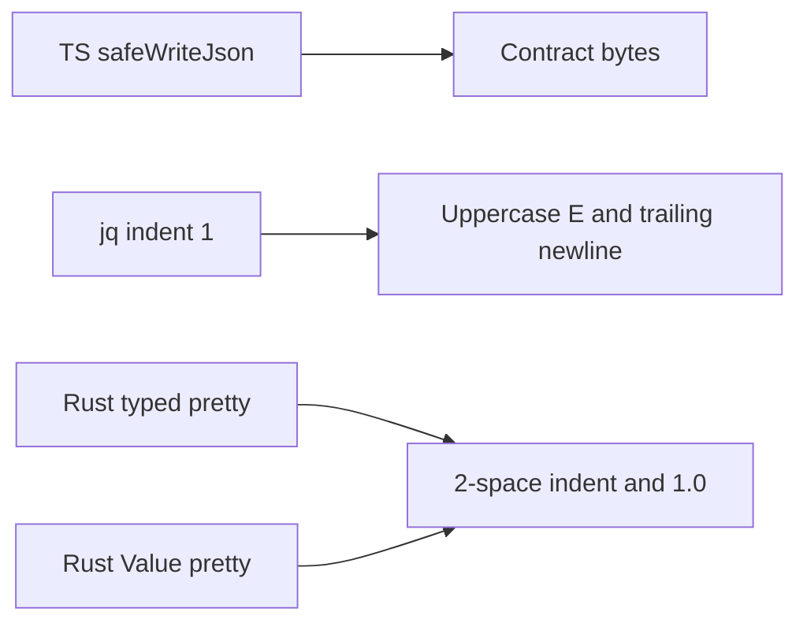

# Persisted creature JSON presentation (Issue #765)

This is the single presentation contract for a **persisted** creature JSON file:
one that is checked in and read by people. It fixes the bytes, not the meaning;
every rule below is about how the same document is spelled.

The reference writer is NEAT-AI's TypeScript exporter. Its layout is exactly
what `JSON.stringify(doc, null, 1)` produces, with one deliberate exception for
`-0`.

## The rules

### Layout

1-space indent, one member or element per line, `": "` between a key and its
value, and empty containers written `[]` / `{}`.

### Numbers

ECMAScript `Number::toString`: the shortest literal that round-trips to the same
f64. Nothing is rounded.

- An integer-valued float has no `.0`: `1`, not `1.0`.
- The exponent letter is lowercase `e` and the exponent is always signed
  (`1e+21`, `1e-7`).
- Decimal notation is used for `1e-6 <= |x| < 1e21` (`0.000001`,
  `100000000000000000000`, `123456789012345680000`).
- Exponent notation is used outside that range (`1e-7`, `1e+21`, `5e-324`,
  `1.7976931348623157e+308`, `2.2985736498644322e-8`).

### Negative zero

`-0` is written `-0` so the sign survives. Plain `JSON.stringify` writes `0` for
`-0`, so the reference writer uses a replacer:

```ts
const negativeZeroReplacer = (_key, value) =>
  Object.is(value, -0) ? JSON.rawJSON("-0") : value;
JSON.stringify(doc, negativeZeroReplacer, 1);
```

`JSON.rawJSON` was observed working on Deno 2.9.8 (local); CI pins Deno 2.9.3 and
runs the corpus gate there. A runtime without `JSON.rawJSON` must restore `-0`
textually instead.

### Key order

Each object kind has a fixed order, taken from NEAT-AI's TypeScript exporter
(NEAT-AI commit `221facd8`: `src/utils/CreatureExportBuilder.ts`,
`src/neuron/NeuronSerialization.ts`, `src/architecture/Synapse.ts`; the memetic
record order and the creature `uuid` position come from
`test/fixtures/golden/creature-memetic.json` and `creature-metadata.json`).

| Object kind | Key order |
|---|---|
| creature | `uuid`, `semanticVersion`, `forwardOnly`, `neurons`, `synapses`, `input`, `output`, `tags`, `memetic` |
| neuron | `type`, `uuid`, `bias`, `squash`, `frozen`, `tags`, `id` |
| synapse | `weight`, `fromUUID`, `toUUID`, `type`, `frozen`, `tags` |
| tag | `name`, `value` |
| memetic record (`memetic` and every `ancestry[]` snapshot at any depth) | `generation`, `weights`, `biases`, `score`, `ancestry` |
| memetic weight row (array-form `weights` element) | `fromUUID`, `toUUID`, `weight` |
| id-keyed memetic weight entry (`weights["<id>"][]` element) | `toId`, `weight` |

Absent keys are skipped, never written as `null`.

The general rule for any object, in this order:

1. **Array-index keys** first, in ascending numeric order. These are canonical
   decimal integer strings from 0 to 2^32 - 2 (`"0"`, `"2"`, `"10"`; not `"-1"`,
   `"01"` or `"1.5"`). JavaScript cannot emit them in any other order, so `"2"`
   precedes `"10"`.
2. The table keys that are present, in table order.
3. Every other key in ascending order of UTF-16 code units (JavaScript's `<` on
   strings, and the default `Array.prototype.sort`).

Map-like objects with no table, namely `memetic.biases` and the id-keyed
`memetic.weights` (at every ancestry depth), are index keys ascending
numerically and then the rest by the UTF-16 comparison, so `{"2", "10", "-1"}` is
written `"2"`, `"10"`, `"-1"`.

For ASCII keys UTF-16 order equals byte order. Rust's `BTreeMap<String, _>`
orders by UTF-8 bytes, which differs from JavaScript only for keys mixing
supplementary-plane characters with U+E000 to U+FFFF. It also puts `"10"` before
`"2"`, so a Rust writer must not rely on `BTreeMap` iteration for these maps.

### Array order

A writer never changes it: neurons, synapses, tags, memetic rows and ancestry
keep their order.

### Strings

Escaped exactly as `JSON.stringify` escapes them: `\"`, `\\`, `\b`, `\f`, `\n`,
`\r`, `\t`; other U+0000 to U+001F as `\u00XX` with lowercase hex (for example
`\u001f`); lone surrogates as `\u` escapes with lowercase hex (for example
`\ud800`). Everything else, including non-ASCII and `/`, is written literally.

### Trailing newline

None. The file ends with `}`.

Evidence, from the issue's planning sample (GRQ-sampler commit `985c99f`, 40
samples, all 1-space indented): 19 files end without a newline (written directly
by NEAT-AI's `safeWriteJson`, which writes the `JSON.stringify` output verbatim)
and 21 end with one (added by `jq`). 33 files are TypeScript-shaped (top-level
`semanticVersion, forwardOnly, neurons, synapses, input, output, tags`; neuron
`type, uuid, bias, squash`; synapse `weight, fromUUID, toUUID, type`; tag `name,
value`; `"bias": 1`) and 7 are Rust-`Value`-shaped (alphabetical keys, `1.0`,
uppercase `E`). Matching the TypeScript form rewrites the fewest existing samples
and needs no change to the TypeScript writer's layout.

### Number spellings, verified

Identical values, both shortest round-trip, only the spelling differs:

| Value | JavaScript (contract) | `serde_json` |
|---|---|---|
| one | `1` | `1.0` |
| 1e-6 | `0.000001` | `1e-6` |
| 1e-7 | `1e-7` | `1e-7` |
| 1e20 | `100000000000000000000` | `1e+20` |
| 1e21 | `1e+21` | `1e+21` |
| 123456789012345680000 | `123456789012345680000` | `1.2345678901234568e+20` |
| negative zero | `0` (plain) or `-0` (contract) | `-0.0` |

`jq --indent 1` (jq 1.8.2) keeps the input literal but uppercases the exponent
(`1E-7`, `1E+21`) and adds a trailing newline.



## Scope and intentional differences

1. Compact, scorer-facing creature files (no whitespace, machine-read) are
   outside the contract.
2. A metadata-only change (for example tags only) is spliced into the existing
   bytes, not reserialised (stSoftwareAU/GRQ#5582). A file not yet in contract
   form keeps its bytes outside the spliced span; the contract governs files a
   writer serialises whole.
3. The contract keeps `-0` where plain `JSON.stringify` writes `0`.
4. Today's Rust writers are not in contract form. `creature_to_json_pretty`
   (typed serde) writes 2-space indent, `1.0` and `-0.0`, uses struct field
   order, drops every key its structs do not model (the creature `uuid`, `tags`
   and `frozen`) while memetic `generation`, `score` and `ancestry` survive, and
   uses `BTreeMap` key order for memetic maps. `serde_json::Value` pretty writes
   alphabetical keys, 2-space indent and `1.0`; `to_string_pretty` writes no
   newline itself, so the production files and the corpus variant that end with
   one do so because the writer appends it. This document changes no
   writer; the corpus `variants/` records these shapes so a test can tell them
   apart from contract bytes.
5. NEAT-AI's own cross-engine golden fixtures (`test/fixtures/golden/*.json` at
   `221facd8`) are 2-space indented with a trailing newline. They are compared
   semantically by their own tests and are not contract bytes.
6. Keys outside the table are placed by the general rule, not preserved in input
   order.

## Corpus and gates

The corpus is `neat-core/tests/fixtures/creature_presentation/`; its `README.md`
describes each file. `canonical/` holds contract bytes and `variants/` holds the
same documents in other writers' shapes.

| Gate | Run by | What it pins |
|---|---|---|
| `tests/creature_presentation_test.ts` | `quality.sh` and the `wasm64-memory64-smoke` job in `.github/workflows/ci.yml` (`--allow-read` only) | Canonical files are byte-identical to the reference writer with no trailing newline. Each variant is semantically equal (numbers by `Object.is`, keys regardless of order, array order kept) and byte-different. Every required feature is present per file, so the gate cannot go vacuous. Every canonical object's keys follow the table above: the writer round trip alone cannot pin key order, because `JSON.parse` then `JSON.stringify` keeps the file's order, so the test checks the corpus against the table directly. |
| `neat-core/tests/creature_presentation.rs` | `cargo test --workspace` | Every canonical file parses with `parse_creature_json` and compiles with `compile_creature`. The typed-serde variant is byte-identical to what `creature_to_json_pretty` writes for its canonical file, so that variant's 2-space indent, `1.0`, struct field order and `BTreeMap` map order are pinned to the real writer. |
| `tests/scripts/creature_presentation_gate.bats` | `bats` | Both `quality.sh` and `ci.yml` run the Deno gate. |
