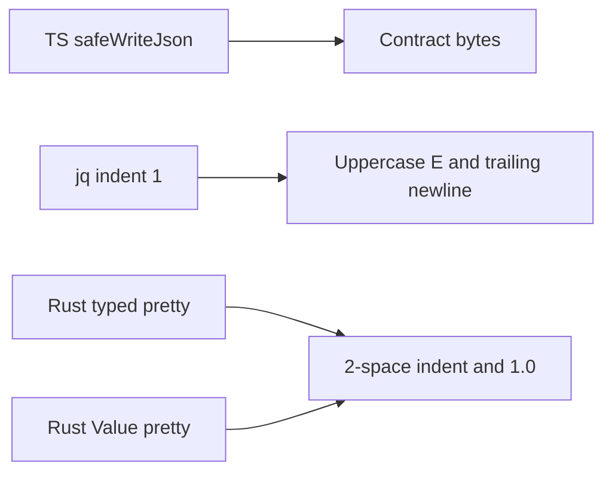
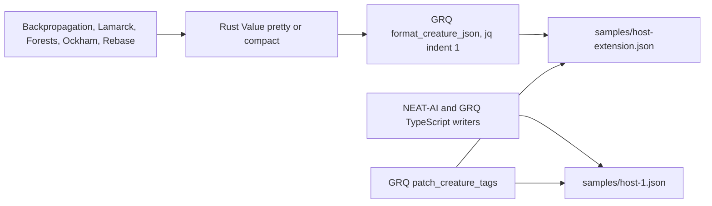

# Persisted creature JSON presentation (Issues #765, #766, #767)

This is the single presentation contract for a **persisted** creature JSON file:
one that is checked in and read by people. It fixes the bytes, not the meaning;
every rule below is about how the same document is spelled.

The reference writer is NEAT-AI's TypeScript exporter. Its layout is exactly
what `JSON.stringify(doc, null, 1)` produces, with one deliberate exception for
`-0`.

## The rules

### Layout

1-space indent, one member or element per line, `": "` between a key and its
value, and empty containers written `[]` / `{}`.

### Numbers

ECMAScript `Number::toString`: the shortest literal that round-trips to the same
f64. Nothing is rounded.

- An integer-valued float has no `.0`: `1`, not `1.0`.
- The exponent letter is lowercase `e` and the exponent is always signed
  (`1e+21`, `1e-7`).
- Decimal notation is used for `1e-6 <= |x| < 1e21` (`0.000001`,
  `100000000000000000000`, `123456789012345680000`).
- Exponent notation is used outside that range (`1e-7`, `1e+21`, `5e-324`,
  `1.7976931348623157e+308`, `2.2985736498644322e-8`).

### Negative zero

`-0` is written `-0` so the sign survives. Plain `JSON.stringify` writes `0` for
`-0`, so the reference writer uses a replacer:

```ts
const negativeZeroReplacer = (_key, value) =>
  Object.is(value, -0) ? JSON.rawJSON("-0") : value;
JSON.stringify(doc, negativeZeroReplacer, 1);
```

`JSON.rawJSON` was observed working on Deno 2.9.8 (local); CI pins Deno 2.9.3 and
runs the corpus gate there. A runtime without `JSON.rawJSON` must restore `-0`
textually instead.

### Key order

Each object kind has a fixed order, taken from NEAT-AI's TypeScript exporter
(NEAT-AI commit `221facd8`: `src/utils/CreatureExportBuilder.ts`,
`src/neuron/NeuronSerialization.ts`, `src/architecture/Synapse.ts`; the memetic
record order and the creature `uuid` position come from
`test/fixtures/golden/creature-memetic.json` and `creature-metadata.json`).

| Object kind | Key order |
|---|---|
| creature | `uuid`, `semanticVersion`, `forwardOnly`, `neurons`, `synapses`, `input`, `output`, `tags`, `memetic` |
| neuron | `type`, `uuid`, `bias`, `squash`, `frozen`, `tags`, `id` |
| synapse | `weight`, `fromUUID`, `toUUID`, `type`, `frozen`, `tags` |
| tag | `name`, `value` |
| memetic record (`memetic` and every `ancestry[]` snapshot at any depth) | `generation`, `weights`, `biases`, `score`, `ancestry` |
| memetic weight row (array-form `weights` element) | `fromUUID`, `toUUID`, `weight` |
| id-keyed memetic weight entry (`weights["<id>"][]` element) | `toId`, `weight` |

Absent keys are skipped, never written as `null`.

The general rule for any object, in this order:

1. **Array-index keys** first, in ascending numeric order. These are canonical
   decimal integer strings from 0 to 2^32 - 2 (`"0"`, `"2"`, `"10"`; not `"-1"`,
   `"01"` or `"1.5"`). JavaScript cannot emit them in any other order, so `"2"`
   precedes `"10"`.
2. The table keys that are present, in table order.
3. Every other key in ascending order of UTF-16 code units (JavaScript's `<` on
   strings, and the default `Array.prototype.sort`).

Map-like objects with no table, namely `memetic.biases` and the id-keyed
`memetic.weights` (at every ancestry depth), are index keys ascending
numerically and then the rest by the UTF-16 comparison, so `{"2", "10", "-1"}` is
written `"2"`, `"10"`, `"-1"`.

For ASCII keys UTF-16 order equals byte order. Rust's `BTreeMap<String, _>`
orders by UTF-8 bytes, which differs from JavaScript only for keys mixing
supplementary-plane characters with U+E000 to U+FFFF. It also puts `"10"` before
`"2"`, so a Rust writer must not rely on `BTreeMap` iteration for these maps.

### Array order

A writer never changes it: neurons, synapses, tags, memetic rows and ancestry
keep their order.

### Strings

Escaped exactly as `JSON.stringify` escapes them: `\"`, `\\`, `\b`, `\f`, `\n`,
`\r`, `\t`; other U+0000 to U+001F as `\u00XX` with lowercase hex (for example
`\u001f`); lone surrogates as `\u` escapes with lowercase hex (for example
`\ud800`). Everything else, including non-ASCII and `/`, is written literally.

### Trailing newline

None. The file ends with `}`.

Evidence, from the issue's planning sample (the production trainer's sampler at
commit `985c99f`, 40 samples, all 1-space indented): 19 files end without a
newline (written directly by NEAT-AI's `safeWriteJson`, which writes the
`JSON.stringify` output verbatim) and 21 end with one (added by `jq`). 33 files
are TypeScript-shaped (top-level `semanticVersion, forwardOnly, neurons,
synapses, input, output, tags`; neuron `type, uuid, bias, squash`; synapse
`weight, fromUUID, toUUID, type`; tag `name, value`; `"bias": 1`) and 7 are
Rust-`Value`-shaped (alphabetical keys, `1.0`, uppercase `E`). Matching the
TypeScript form rewrites the fewest existing samples and needs no change to the
TypeScript writer's layout.

### Number spellings, verified

Identical values, both shortest round-trip, only the spelling differs:

| Value | JavaScript (contract) | `serde_json` |
|---|---|---|
| one | `1` | `1.0` |
| 1e-6 | `0.000001` | `1e-6` |
| 1e-7 | `1e-7` | `1e-7` |
| 1e20 | `100000000000000000000` | `1e+20` |
| 1e21 | `1e+21` | `1e+21` |
| 123456789012345680000 | `123456789012345680000` | `1.2345678901234568e+20` |
| negative zero | `0` (plain) or `-0` (contract) | `-0.0` |

`jq --indent 1` (jq 1.8.2) keeps the input literal but uppercases the exponent
(`1E-7`, `1E+21`) and adds a trailing newline.



## Rust producer (Issue #766)

`neat_core::creature_presentation` (`neat-core/src/creature_presentation.rs`,
re-exported from the crate root) writes the contract bytes. It is plain Rust:
no `cfg`, no file access and no new dependency. Two entry points, both returning
`Result<String, PresentationError>`:

- `creature_presentation_json(&serde_json::Value)` is the primary,
  document-level entry point. It keeps keys the typed structs do not model (the
  creature `uuid`, `tags`, `frozen` and anything else), placing unknown keys by
  the general rule above. Use it for any writer that carries tags or metadata.
- `creature_export_presentation_json(&CreatureExport)` is the typed
  convenience. A typed round trip drops what the structs do not model (`uuid`,
  `tags`, `frozen`), so a writer carrying them must use the document entry.

Output is the contract bytes: 1-space layout, ECMAScript number form derived
from Rust's shortest round-trip digits, `-0` kept, per-kind key order, array
order untouched and no trailing newline. Every number is written from its f64
value, as JavaScript holds it.

Refusals, in order. The document entry: any `null` anywhere is
`PresentationError::NullValue { path }`, because `serde_json` and
`JSON.stringify` both turn NaN and infinities into `null`, so a `null` is a
number already lost and the contract never writes one; a number with no finite
f64 is `PresentationError::NonFiniteNumber { path }` (reachable only when a
build unifies `serde_json`'s `arbitrary_precision` feature and a literal such as
`1e400` overflows); a document that does not parse as a creature is
`PresentationError::Creature(CreatureError::Json(..))`; and a bad width goes
through `validate_creature_width` (`InvalidInputCount`, `InvalidOutputCount`,
`TooManyNodes`). The typed entry validates the width first, then refuses a NaN
or infinite f64 field with `PresentationError::NonFiniteNumber { path }`, then
runs the document entry's checks (so a `null` inside `memetic.extra` is
`NullValue`). `PresentationError` is its own
`#[non_exhaustive]` type wrapping `CreatureError`, because adding a variant to
`CreatureError` would be a public-API break.

`creature_to_json` and `creature_to_json_pretty` are unchanged. Moving a
consumer onto the new entry points is that consumer's own migration.

## Scope and intentional differences

1. Compact, scorer-facing creature files (no whitespace, machine-read) are
   outside the contract.
2. A metadata-only change (for example tags only) is spliced into the existing
   bytes, not reserialised (the production trainer's tags-only splice). A file
   not yet in contract form keeps its bytes outside the spliced span; the
   contract governs files a writer serialises whole.
3. The contract keeps `-0` where plain `JSON.stringify` writes `0`.
4. The existing typed Rust writers are not in contract form; the
   `creature_presentation` module (Issue #766, see "Rust producer" above) is.
   `creature_to_json_pretty` (typed serde) writes 2-space indent, `1.0` and `-0.0`, uses struct field
   order, drops every key its structs do not model (the creature `uuid`, `tags`
   and `frozen`) while memetic `generation`, `score` and `ancestry` survive, and
   uses `BTreeMap` key order for memetic maps. `serde_json::Value` pretty writes
   alphabetical keys, 2-space indent and `1.0`; `to_string_pretty` writes no
   newline itself, so the production files and the corpus variant that end with
   one do so because the writer appends it. Those writers are unchanged; the
   corpus `variants/` records these shapes so a test can tell them apart from
   contract bytes.
5. NEAT-AI's own cross-engine golden fixtures (`test/fixtures/golden/*.json` at
   `221facd8`) are 2-space indented with a trailing newline. They are compared
   semantically by their own tests and are not contract bytes.
6. Keys outside the table are placed by the general rule, not preserved in input
   order.

## Corpus and gates

The corpus is `neat-core/tests/fixtures/creature_presentation/`; its `README.md`
describes each file. `canonical/` holds contract bytes and `variants/` holds the
same documents in other writers' shapes.

| Gate | Run by | What it pins |
|---|---|---|
| `tests/creature_presentation_test.ts` | `quality.sh` and the `wasm64-memory64-smoke` job in `.github/workflows/ci.yml` (`--allow-read` only) | Canonical files are byte-identical to the reference writer with no trailing newline. Each variant is semantically equal (numbers by `Object.is`, keys regardless of order, array order kept) and byte-different. Every required feature is present per file, so the gate cannot go vacuous. Every canonical object's keys follow the table above: the writer round trip alone cannot pin key order, because `JSON.parse` then `JSON.stringify` keeps the file's order, so the test checks the corpus against the table directly. |
| `neat-core/tests/creature_presentation.rs` | `cargo test --workspace` | The Rust producer. Every canonical file is byte-identical through `creature_presentation_json` and rewriting is a no-op; the tagless `memetic_by_id.json` also passes through the typed entry. Every variant rewrites to its canonical bytes. One synthetic object of every kind, carrying every key of its table, is written in table order, which covers the key pairs no corpus object holds together. An independent `serde_json::Value` walk compares f64 bits, so the rewrite is semantically lossless. A number-form table and a deterministic f64 bit-pattern sweep assert the round trip. One changed weight is a one-line diff and one added tag touches only its own lines plus the preceding `}` gaining a comma. Compiled before and after a rewrite, a creature activates bit-identically. Zero width, over-ceiling width, non-finite and `null` are refused. The typed-serde variant is still byte-identical to `creature_to_json_pretty`'s output, and every canonical file still parses with `parse_creature_json` and compiles with `compile_creature`. |
| `tests/scripts/creature_presentation_gate.bats` | `bats` | Both `quality.sh` and `ci.yml` run the Deno gate. |

## Family writer audit (Issue #767)

This section records every production creature write path in the family, what
each one changes when it rewrites a creature, and the measured diff churn
before and after the contract. Test, bench, fuzz and example code, and
`#[cfg(test)]` modules, are excluded throughout: they write fixtures, not
persisted creatures. It starts from NEAT-AI `docs/RUST_EXTENSION_WRITE_PATH_AUDIT.md`
(Issue #3751 there), whose verdicts are re-checked at the end.

### Audited revisions

Every `file:line` below is at this revision of its repository's default branch.

| Repository | Commit SHA |
|---|---|
| stSoftwareAU/NEAT-AI | `6639854db73450ce05d78e436d092f69df297285` |
| stSoftwareAU/NEAT-AI-core | `dbb56fdab27d34ac2341d8e517251d9a48685bb7` (this milestone branch before this change) |
| stSoftwareAU/NEAT-AI-Backpropagation | `947cbb5412156e229ed2e0d34142aa18ff2f9760` |
| stSoftwareAU/NEAT-AI-Lamarck | `4c175c86eba7cecf3407097449af682918205600` |
| stSoftwareAU/NEAT-AI-Forests | `6e14c2b591c0ac65846f10865df56553430f1a89` |
| stSoftwareAU/NEAT-AI-Ockham | `39d44a43e92ed9bcb9ffa7d6d5124240292e3274` |
| stSoftwareAU/NEAT-AI-Rebase | `c80f28a162013e71afbafe298d2429722e004772` |
| stSoftwareAU/NEAT-AI-scorer | `742c5df30fc98ece3afe784be1aca18f925b47b3` |
| stSoftwareAU/NEAT-AI-Discovery | `08f1f51357e10134e3da0e61d1f56354260429ee` |
| stSoftwareAU/NEAT-AI-Explore | `a77592098177614ca5155f1fe9f47017de3ab243` |
| stSoftwareAU/NEAT-AI-Refinery | `84f3d126d58772c20166425c75e0ef487f238cdd` |
| stSoftwareAU/NEAT-AI-Snapshot | `260cd82f45a90e915ee7dc519ff81961aa8a1720` |
| GRQ trainer (private) | `9a6c8f89916a9995a39412b85832e8f53657cac7` |
| GRQ-sampler (private, the destination) | `fdcd279a040345e71e0c6b56f5df1d2a846b2145` |

### Write paths

| Repository | Production write path | Presentation today | Route to GRQ-sampler | Verdict |
|---|---|---|---|---|
| NEAT-AI | `src/creature/CheckpointWriter.ts:224` writes `JSON.stringify(json)` to `.creatures/N.json`; `src/intelligentDesign/ImproveSquash.ts:512,597` write a string built by `JSON.stringify(…, null, 1)` (`src/intelligentDesign/workers/WorkerHandler.ts:159`). `safeWriteJson` (`src/intelligentDesign/SafeWrite.ts:23-28`, indent 1) has no production caller. `src/NEAT/NeatScheduling.ts:842-845` writes a trace file, not a creature export. | The reference layout: key order from `src/utils/CreatureExportBuilder.ts:42-52`, ECMAScript numbers, no trailing newline. The checkpoint is compact. No replacer, so `-0` is written `0`. | The GRQ `-1` slot: `.creatures/1.json` (GRQ `worker/checkin-sample.sh:484`) is copied to `samples/<host>-1.json` (`:632`) and committed (`:739`). The checkpoint is compact, yet every `-1` sample at `fdcd279` is 1-space indented; GRQ's `saveValidatedCreatureExport` re-indents on a score mismatch only (`src/IntelligentDesign/ConfirmScore.ts:62,89`), and the hop that re-indents when the scores agree was not traced. | To be migrated in its own repository: the `-0` replacer. The compact checkpoint is outside the contract. |
| NEAT-AI-core | Library only, with no `[[bin]]`. `neat-core/src/creature.rs:847,853` (`creature_to_json`, `creature_to_json_pretty`) and `neat-core/src/creature_presentation.rs:187,210` return a `String`. The one file write in `src/` outside `#[cfg(test)]` is `neat-core/src/prune_json.rs:1427` (`write_golden`, which regenerates a pruning golden record for tests; not a creature). | `creature_presentation_json` writes contract bytes. `creature_to_json` and `creature_to_json_pretty` are unchanged (typed serde). | Only through the consumers below. | Changed in this repository: Issue #766 added the contract writer. |
| NEAT-AI-Backpropagation | `backpropagation/src/train.rs:1191` writes `best.json` through `serialize_creature_with_meta` (`backpropagation/src/tags.rs:208`: `creature_to_json`, re-parsed as a `Value`, `tags` spliced back, then `to_string_pretty`). Candidates are written by `train.rs:1020-1022`, `blockwise.rs:385-387` and `sweep.rs:156-158` through `creature_to_json_pretty` (`creature_io.rs:114`). | `best.json`: 2-space indent, alphabetical keys, `1.0`, trailing newline (`tags.rs:209-211`), creature `uuid` dropped. Candidates: 2-space indent, struct key order, `1.0`, no trailing newline. | GRQ `worker/Backprop/run.sh` reformats with `format_creature_json` (`:374`) and commits (`:401`). GRQ-sampler at `fdcd279` holds no `-backprop` sample. | To be migrated in its own repository. |
| NEAT-AI-Lamarck | `lamarck/src/run.rs:3116` (and `:1753`, `:3379`) writes `best.json`, and `:3118-3121` writes `winners/`, through `serialize_creature_with_meta` (`lamarck/src/tags.rs:312,361`: `creature_to_json`, `Value`, top-level and neuron tags re-attached, `to_string_pretty`). `run.rs:1441` copies the input bytes verbatim. Scorer files: `candidates.rs:1593,1600` (compact). The compact and pretty typed wrappers are `lamarck/src/width.rs:83,94`; the pretty one also writes `combos.rs:446`, `grafts.rs:575` and `run.rs:4098,4124`. | 2-space indent, alphabetical keys, `1.0`, trailing newline (`tags.rs:362-364`). Creature `uuid` dropped. | GRQ `worker/Lamarck/run.sh`: `format_creature_json` (`:363`), commit (`:390`), to `samples/<host>-lamarck.json`. | To be migrated in its own repository. |
| NEAT-AI-Forests | `forests/src/run.rs:163-166` writes `winners/` and `best.json` through `meta.serialize_with(…, true)` (`forests/src/meta.rs:146-167`: `Value`, tags spliced, `memetic` removed, `to_string_pretty`). `forests/src/tools.rs:239-241` (`import_xgboost`) writes `creature_to_json_pretty`, without tags. `run.rs:278` and `incumbent.rs:207` copy verbatim. Scorer files: `baseline.rs:93-94` and `promote.rs:104-105` (compact). | 2-space indent, alphabetical keys, `1.0`, no trailing newline. Creature `uuid` dropped, and `memetic` removed (a content change, not a presentation one). | GRQ `worker/Forests/run.sh`: `format_creature_json` (`:394`), commit (`:421`), to `samples/<host>-forests.json`. | To be migrated in its own repository. |
| NEAT-AI-Ockham | `ockham/src/run.rs:2843,2847` (`publish_best`) writes `best.json` and `winners/` through the tag splice (`ockham/src/tags.rs:134-154`, `Value`, `to_string_pretty`). `promote.rs:637-638` writes a bare `creature_to_json` (compact), which `publish_best` then overwrites. `reentry.rs:92-97` writes `population-candidate.json` (compact, untagged). Scorer files are compact. `ockham/src/incumbent.rs:272` copies the incumbent's text verbatim to `workspace/incumbent.json`. | 2-space indent, alphabetical keys, `1.0`, no trailing newline, tags spliced. Compact files have no whitespace. | GRQ `worker/Ockham/run.sh`: `format_creature_json` (`:395`), commit (`:422`), to `samples/<host>-ockham.json`. | To be migrated in its own repository. |
| NEAT-AI-Rebase | `rebase/src/cli.rs:653-657` writes `population-candidate.json` through `meta.serialize_with(…, false)` (compact `Value`, tags spliced). Scorer staging: `rebase/src/scorer.rs:424-439` (compact). | Compact: alphabetical keys, `1.0`, no whitespace. | GRQ `worker/shared/rebase.sh:367` swaps it in as `BEST` inside each extension route, which then runs `format_creature_json`. | To be migrated in its own repository. |
| NEAT-AI-scorer | None. `rust_scorer/src/cli.rs:658-666` prints the score result to stdout. The creature writes in `rust_scorer/src/multi_score.rs:1525,1530` sit under the `#[cfg(test)]` gate at `:1506`. `rust_scorer/src/bin/gpu_pipeline_alloc_bench.rs:82` is a bench binary. | Not applicable. | No route. | Confirmed read-only. |
| NEAT-AI-Discovery | None. `src/export/snapshot.rs:374,394` writes a `VisualisationSnapshot` (`src/export/types.rs:138-143`), a debug envelope with a nested creature for NEAT-AI-Explore, never read back as a creature. No `neat-core` dependency in `Cargo.toml`. | Not applicable (compact `to_writer`). | No route. | Confirmed read-only (diagnostic only). |
| NEAT-AI-Explore | None. A Deno web visualiser: the browser code only reads (`docs/shared/snapshot_loader.js:108`). Its scripts write an SBOM (`scripts/generate_sbom.ts:270`) and a build id (`scripts/inject_build_id.ts:53`). | Not applicable. | No route. | Confirmed read-only. |
| NEAT-AI-Refinery | None. It writes `.bin` corpora (`refinery/src/corpus/writer.rs:96`, `refinery/src/corpus/synthetic.rs:49`) and a manifest (`refinery/src/manifest/model.rs:125`). `parity/evolve_dir.ts:85-88` evolves a creature in memory and prints a result (`:156`); nothing is saved. | Not applicable. | No route. | Confirmed read-only. |
| NEAT-AI-Snapshot | None. No code: `README.md`, `LICENSE` and static `docs/` data (`snapshot.json.gz`) served by GitHub Pages. | Not applicable. | No route. | Confirmed read-only. |
| GRQ (worker write paths) | `worker/shared/format_creature_json.sh:55` (`jq --indent 1 .`, whole document, every extension slot). `worker/shared/creature_provenance_guard.sh:152` (`jq --indent 1 'del(.uuid, .memetic)'`). `worker/shared/cluster_creature_provenance.sh:151,246-247` (whole rewrite only when already byte-stable under jq). `worker/shared/patch_creature_tags.ts:133` (tags-only splice). `src/saveValidatedCreatureExport.ts:506` (`JSON.stringify(exported, null, 1)`, called by `src/IntelligentDesign/ConfirmScore.ts:89` on a score mismatch and `src/Learn.ts:1209`). | `jq`: 1-space indent, input key order and number literals kept, uppercase `E`, trailing newline. Splice: only the `tags` span. `saveValidatedCreatureExport`: the reference layout, no `uuid`, `-0` as `0`. | It is the route: `worker/checkin-sample.sh:632` for `-1`, and `format_creature_json` then commit in each `worker/<Extension>/run.sh`. | To be migrated in its own repository. |

GRQ-sampler at `fdcd279` holds 42 samples. 31 are TypeScript-shaped with no trailing newline (every `-1` slot, `Enceladus`, and the other forests, lamarck and ockham files). 10 are Rust-`Value`-then-jq-shaped with a trailing newline: `GRQ-3`, `GRQ-10`, `GRQ-19`, `GRQ-21`, `GRQ-22`, `GRQ-24` and `GRQ-25` `-forests`, plus `GRQ-18`, `GRQ-24` and `Mac-Ultra-M2` `-lamarck`. `Enceladus-Terminal.json` (not `Enceladus.json`) is a third shape: contract key order, but 2-space indent, uppercase `E` and a trailing newline. No writer audited here produces it, and it was not traced.

### Difference classes per writer

A topology or weight change is a genuine change and is outside these classes.

| Writer | Indentation | Exponent casing | Number notation | Key order | Trailing newline | Tag-only change |
|---|---|---|---|---|---|---|
| NEAT-AI `JSON.stringify(doc, null, 1)` | none | none | `-0` written `0` | none | none | none |
| NEAT-AI checkpoint `JSON.stringify(json)` | compact (outside the contract) | none | `-0` written `0` | none | none | none |
| `creature_to_json` (typed serde, compact) | compact | none (lowercase) | `1.0`, `-0.0`, `1e+20`, `1.2345678901234568e+20` | struct order; drops `uuid`, `tags`, `frozen` | none | none |
| `creature_to_json_pretty` | 2 spaces | none | as above | as above | none | none |
| Rust `Value` pretty with tags spliced (Backpropagation, Lamarck, Forests, Ockham `best.json`) | 2 spaces | none | as above | alphabetical; creature `uuid` dropped; Forests also removes `memetic` (content, not presentation) | Backpropagation and Lamarck add one | tags restored or stamped by the writer |
| Rust `Value` compact with tags spliced (Rebase `population-candidate.json`) | compact | none | as above | alphabetical; creature `uuid` dropped | none | tags restored and stamped by the writer |
| GRQ `jq --indent 1` | 1 space | uppercase `E` | keeps the input digits (`1.0` survives) but uppercases the exponent letter | keeps input order | adds one | none |
| GRQ `creature_provenance_guard.sh` (`jq --indent 1 'del(.uuid, .memetic)'`) | 1 space | uppercase `E` | as jq | keeps input order; removes `uuid` and `memetic` (content) | adds one | none |
| GRQ `patch_creature_tags.ts` | none | none | none | none | none | only the `tags` span changes |
| GRQ `saveValidatedCreatureExport` (`JSON.stringify(exported, null, 1)`) | none | none | `-0` written `0` | none; no creature `uuid` | none | none |
| `creature_presentation_json` (Issue #766) | none | none | none | none | none | none |

### Churn on the committed corpus

"Before" compares each `variants/` file with its canonical file. "After"
rewrites the variant through `creature_presentation_json` first. Reproduce from
the repository root:

```bash
C=neat-core/tests/fixtures/creature_presentation
tmp=$(mktemp -d)
for v in jq_indent_1/number_forms serde_typed_pretty/memetic_by_id serde_value_pretty/number_forms; do
  f=$(basename "$v")
  echo "before $v: $(git diff --no-index --numstat "$C/canonical/$f.json" "$C/variants/$v.json")"
  cargo run -q -p neat-core --example creature_presentation_rewrite -- "$C/variants/$v.json" > "$tmp/after.json"
  echo "after $v: $(git diff --no-index --numstat "$C/canonical/$f.json" "$tmp/after.json")"
done
rm -r "$tmp"
```

`git diff --no-index --numstat` prints nothing for identical files, so an empty
"after" line is 0 added and 0 deleted.

| Variant | Before (added / deleted) | After (added / deleted) |
|---|---|---|
| `variants/jq_indent_1/number_forms.json` | 67 / 67 | 0 / 0 |
| `variants/serde_typed_pretty/memetic_by_id.json` | 106 / 106 | 0 / 0 |
| `variants/serde_value_pretty/number_forms.json` | 100 / 100 | 0 / 0 |

Every "after" count is zero, and
`neat-core/tests/creature_presentation.rs::every_variant_is_normalised_to_its_canonical_bytes`
enforces it in `cargo test --workspace`.

### Production scale (GRQ-sampler)

One real commit per class, measured with
`git show --numstat <sha> -- samples/<file>` in GRQ-sampler.

| Class | Commit | Sample | Added / deleted | What the diff is |
|---|---|---|---|---|
| Genuine topology and weight change | `36811a576a817dcab1d1d181820269f754db0716` (2026-11-20) | `GRQ-12-1.json` | 115 / 33 | Three neurons and their synapses added, biases and tags changed; both sides TypeScript-shaped. |
| Shape switch, TypeScript to Rust `Value` plus jq | `a2a7d3915b0671d6e960ea9612dd490a4b6ab2d8` (2026-11-19) | `GRQ-10-forests.json` | 162,179 / 161,645 | Key order, `1.0` notation, 205 exponents turned `e` to `E`, and a trailing newline, all in one rewrite. |
| Shape switch, back to TypeScript | `3b63ecaad182d8f1b64ec371ca11091a462a1955` (2026-11-19) | `GRQ-10-forests.json` | 161,712 / 161,702 | The reverse flip, written by Tacit Knowledge. |
| Tag-only change | `e776c06fcae4157bac0ddb628c1d46fc0fa1a471` (2026-11-18) | `GRQ-12-1.json` | 6 / 2 | Only the `score` and `error` tags rewritten and one `intelligentDesign` tag appended. |
| Indentation or trailing newline alone | not measured | — | — | No example in the last 40 commits of `GRQ-10-forests`, the last 12 of `GRQ-24-lamarck`, the last 10 of `GRQ-19-forests` or the last 8 of `Enceladus-Terminal`; in each case these differences moved only with a shape switch. |
| Exponent casing alone | not measured | — | — | Never seen alone in the same window; it appears only inside a shape switch. |



### Files changed

In this repository, the write path changed in `neat-core/src/creature_presentation.rs`
(re-exported from `neat-core/src/lib.rs`), added by Issue #766. Issue #767 adds
`neat-core/examples/creature_presentation_rewrite.rs`, which reproduces the
churn table, and this section. Every other change is owned elsewhere, and none
is made here:

- NEAT-AI: keep `-0` with the replacer above.
- NEAT-AI-Backpropagation, NEAT-AI-Lamarck, NEAT-AI-Forests, NEAT-AI-Ockham and
  NEAT-AI-Rebase: write persisted creatures through `creature_presentation_json`.
- GRQ: stop `format_creature_json` and `creature_provenance_guard.sh`
  re-spelling numbers and adding a newline, once the extensions write contract
  bytes.

### Earlier audit re-checked

NEAT-AI `docs/RUST_EXTENSION_WRITE_PATH_AUDIT.md` asked a different question: does
a writer strip `tags` or `memetic`, not how it spells the bytes. Its verdicts
against the revisions above:

| Its verdict | Now |
|---|---|
| NEAT-AI-Discovery does not write creature JSON | Holds: only the `VisualisationSnapshot` at `src/export/snapshot.rs:374,394`, and no `neat-core` dependency. |
| NEAT-AI-scorer is read-only | Holds: `rust_scorer/src/cli.rs:658-666` writes scores to stdout; its creature writes are test-only. |
| wasm64 activation bundle is compute-only | Holds for files: no `wasm_bindgen` export writes a file. `prune_json` returns creature JSON as a string over the ABI (`neat-core/src/prune_json.rs:611`), which NEAT-AI re-imports. |
| NEAT-AI-core is library only | Holds; the one file write outside `#[cfg(test)]` regenerates the pruning golden record at `neat-core/src/prune_json.rs:1427`, not a creature. |
| GRQ `rust/train-extensions` writes no creature JSON | Holds: `rust/train-extensions/Cargo.toml` still declares no dependencies. |
| Backpropagation and Lamarck are the only writers | No longer holds: NEAT-AI-Forests, NEAT-AI-Ockham and NEAT-AI-Rebase now write creatures too (rows above). |
| Exactly two `tags.rs` sidecars | No longer holds: NEAT-AI-Ockham `ockham/src/tags.rs`, NEAT-AI-Forests `forests/src/meta.rs` and NEAT-AI-Rebase `rebase/src/tags.rs` carry the same splice. |
