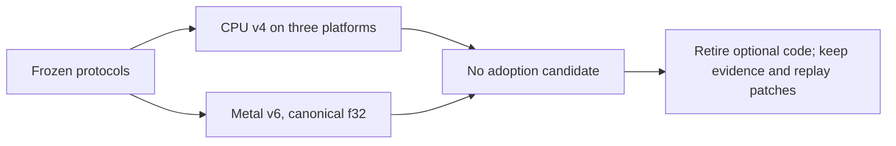

## Summary

Records the controlled sparse-layout and reduced-precision experiment for
Issue #758. The final result is negative. The frozen v4 CPU matrix ran on
Apple Silicon, x86_64 Linux and aarch64 Linux. No variant met the adoption
rule, which needs a win in 75% of planned representative cells on every
platform. The best variant won 1 of 6 cells, where 5 were needed.

A Metal supplement then ran the scorer's existing f32 path on an Apple
virtual GPU. All 54 cells completed, and the GPU was 16 to 1,300 times
slower than the CPU in every cell.

As the issue asks, the optional code that did not earn its place was removed.
That covers the experiment harness, the Metal adapter, its manual research CI
jobs and its supply-chain entries. What remains in the tree is the protocols,
manifests, raw evidence, assessments and two verified replay patches that
rebuild the tested code on Develop. Production code, defaults, public APIs and the scorer are unchanged.
Closes #758.

- [x] Verify both papers and inspect existing core and scorer work.
- [x] Freeze protocols and manifests, then run the CPU matrix on three platforms.
- [x] Probe for native Metal, freeze the v5 and v6 Metal protocols, and run v6 to completion.
- [x] Commit the raw evidence and assessments, and record the negative findings.
- [x] Retire the optional experiment and Metal adapter code.
- [x] Run `./quality.sh`.

## Spec

### Intent and Rationale

- Compare concrete layout and kernel combinations against the real production
  path, measuring end to end. A sparse format alone does not show a speed gain.
- Account for storage, conversion, allocation, warm execution and end-to-end
  cost separately before considering adoption.

### Essential Design Decisions

- Reduced precision means software bf16/f16 weight storage with f32
  arithmetic. That is the only reduced precision these interfaces support.
- Metal coverage is the scorer's public `BatchedRunner`, which runs canonical
  f32 networks only. The 810 sparse/precision Metal combinations are recorded
  as unsupported. No GPU kernel was duplicated, because the issue says to
  coordinate scorer integration instead.
- Adoption thresholds were frozen before validation and never tuned.
  Calibration seeds are separate from validation seeds. Each run version keeps
  its own distribution; none are pooled.
- The experiment code is deleted rather than kept, because both comparisons
  are negative. Its tested source is archived as two patches against Develop
  commit `b426a98`. Each patch rebuilds its tested revision exactly:
  - `docs/research/sparse-precision/replay-cpu-v4.patch` rebuilds `17d222d`,
    the CPU harness;
  - `docs/research/sparse-precision/replay-metal-v6.patch` rebuilds `48e2a1f`,
    the Metal adapter whose source blobs v6 recorded.

### Undiscoverable Facts

- `system_profiler` on the hosted macOS VM listed no display adapter. A native
  Swift probe still created an "Apple Paravirtual device" there. That is why
  the Metal supplement was run.
- The v5 Metal run left nine width-one cells incomplete at its 15-second
  per-cell cap. They are kept separately, with no timing verdict. V6 raised
  the time allowance before its run, with fresh seeds; no threshold changed.
- All timings come from shared or hosted machines and a virtual GPU. They are
  indicative only, and say nothing about physical Apple GPU performance.
- Every completion push so far failed at the worker's pre-push gate. The gate
  lists every file that any pushed commit touched, so the retired `.rs` files
  still scheduled a cargo check. It also read the
  `dtolnay/rust-toolchain@29eef33…` action SHA as `cargo +29eef33…`. The branch
  is now one commit on Develop with an identical tree, so no pushed commit
  touches a Rust, Cargo, workflow or script file. No hook was bypassed.

## Evidence

Backend/research only; no visual surface changed.

- `docs/research/sparse-layouts-reduced-precision.md` is the record. It covers
  the verified sources, the method, the v4 coverage table, memory, the Metal
  v5/v6 results, the retention decision and replay commands.
- CPU v4 results, per platform, are in
  `docs/research/sparse-precision/v4-{aarch64-linux,aarch64-macos,x86_64-linux}/`.
  Each platform has 54 cells, with 909 of 918 slots timed. Each has nine bf16
  accuracy failures (fan-in 64), which are kept and counted.
  `assessment-v4.json` checks that the three runs used the same source,
  manifest and fingerprints. `verification-v4.json` recomputes the
  denominators and medians.
- Metal v6 ran in
  [Actions run 43563660245](https://github.com/stSoftwareAU/NEAT-AI-core/actions/runs/43563660245)
  at `48e2a1f`. Its evidence is in `docs/research/sparse-precision/metal-v6/`,
  with the run record in `docs/research/sparse-precision/execution-metal-v6.json`.
  - 54 of 54 cells completed, each with all 15 repetitions. There were no
    failures, and every verdict was `no_joint_win`.
  - Maximum mean-loss error was 6.98e-08 on the GPU, against a 0.001 tolerance.
  - The best warm GPU/CPU ratio was 16.58 (production_exact, 90% inactive,
    width 32).
  - `metal-v6/assessment.json` was computed from its `results.json`.

## Acceptance Criteria

The issue has no acceptance-criteria heading, and nothing it asks is left
undone. Two combinations are recorded as unsupported, not run: Metal with
sparse layouts or reduced precision, and hardware reduced-precision
arithmetic. No current interface can exercise them, and the issue rules out
duplicating kernels.

## Test Plan

- `./quality.sh < /dev/null` passed (exit 0, "All quality checks passed!") on
  the squashed head `04b4b11`. It ran shellcheck, bats, the TypeScript and
  Mermaid checks, clippy, fmt, cargo deny, all workspace tests, doctests,
  docs, the release build, markdownlint and codespell. The only later change
  is this summary.
- Replay patches: each was applied with `git apply --index` in a throwaway
  worktree at `b426a98`. `git diff --cached --quiet <revision>`, run for all
  non-doc paths and for the manifest, exited 0 for both `17d222d` and
  `48e2a1f`. The patches were not built or run again at the new base.
- Before the squash, with the same code tree, the executor ran
  `bats tests/scripts/`: 767 of 767 passed. `cargo check -p neat-core --all-targets` and `cargo deny check`
  were also clean.
- Removed tests:
  - Removed from `tests/scripts/metal_probe_workflow.bats`: the whole file,
    which pinned the `metal-capability-probe` dispatch job.
    - Removed functionality: the job is gone from `.github/workflows/ci.yml`,
      which is restored to base. `git grep metal_probe` outside `docs/`
      finds nothing.
  - Removed from `tests/scripts/sparse_metal_workflow.bats`: the whole file,
    which pinned the `sparse-metal-research` job.
    - Removed functionality: the job and `experiments/sparse_metal/` are
      deleted. `git grep sparse_metal` outside `docs/` finds nothing.
  - Neither file is on the base branch; both were added and removed within
    this branch.
- Twinned copies: `.github/workflows/ci.yml`, `security.yml`,
  `dependabot.yml`, `deny.toml`, `quality.sh` and `SECURITY.md` all list each
  audited lockfile. All six are restored to base together, so they still
  agree.
- Docs: `git grep` finds no remaining reference to the removed paths outside
  `docs/`. Updated the research record's opening, Metal, retention and replay
  sections, and the #758 section of `neat-core/benches/README.md`. Replay
  links now point at the patches, and `protocol-v4.md` does too. The `.json`
  evidence keeps the original revision SHAs as provenance.

## Merge verification

CI and code review are pending; the worker raises the PR.

## Not done / unchecked

- Physical Apple GPU timings were not taken; only a virtual GPU on a hosted
  runner was measured.
- GPU-side memory peaks were not measured.
- No production corpus was used; the shapes are generated.
- Neither the wasm build nor the downstream consumers were re-checked. No
  file under `neat-core/src` changed.
- Remaining risk: the timings are noisy, because they come from shared hosts.
- The squash force-pushed over this issue's own branch; no PR existed yet. The
  pre-squash history, which includes `17d222d` and `48e2a1f`, survives only
  in the local branch `backup/758-pre-squash` and the patch files. The GitHub
  `tree/<sha>` links in Actions run records may stop resolving.
