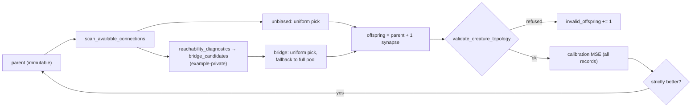

# PR summary — Issue #759: reachability-guided pruning and connection mutation

## Summary

This PR runs the controlled experiment issue #759 asks for. It audited the existing fixed-point cleanup, added the missing O(V+E) input→output reachability diagnostics as `neat_core::reachability`, and compared unbiased connection addition with bridge-biased proposals in a paired, seeded, opt-in experiment. On the synthetic task the verdict is **inconclusive**, and the negative findings are recorded. The bridge filter did not earn its maintenance cost, so it is not core API. It lives only inside the example harness, which keeps the comparison reproducible. No default, interface or cleanup behaviour changes, and no success is claimed. Closes #759.

## Spec

### Intent and Rationale

- **The audit found the pruning half already in place.** `cleanup_creature` (`neat-core/src/prune_cleanup.rs`) removes nodes with no outward edge, repeating until nothing changes. In a `forwardOnly` creature that is the same as "cannot reach an output". It folds a bias-only hidden neuron exactly into a support constant, so constant-driven computation is kept. No second pruning implementation was added.
- **Missing piece 1: a reachability diagnostic.** Core had no way to report which structure no input reaches, which inputs are unused, or which outputs are constant.
- **Missing piece 2: a policy comparison.** Nothing compared connection-proposal policies. `topology_ops::scan_available_connections` already served as the unbiased candidate pool, and the experiment reuses it as the baseline.

### Essential Design Decisions

- **A diagnostic, never a rewrite.** `reachability_diagnostics` only classifies neurons, and `prune_cleanup` stays the sole rewrite owner. A `BiasDriven` neuron (it reaches an output, but no input reaches it) is documented as not removable on reachability alone. The API takes the same parallel `from`/`to` index arrays as `topology_ops`, so NEAT-AI and Ockham can call it without a creature-JSON round trip. Malformed input is a typed `ReachabilityError`, and a neuron count above `u32::MAX` is refused before anything is allocated.
- **`bridge_candidates` is private to the harness.** The results were inconclusive, and 96% of bridge-arm proposals fell back to the unbiased pool. Under the issue's "remove optional code that does not earn its maintenance cost", the filter stays out of the public crate. Releasing it and removing it later would need the three-PR public-API flow (`RELEASING.md`). Its rule and tests moved unchanged into `neat-core/examples/reachability_mutation_experiment.rs`. `[[example]] test = true` in `neat-core/Cargo.toml` keeps those tests in `cargo test`.
- **How "bridge" was defined.** The paper could not be fetched, so the definition comes from the issue text. A bridge is a pair whose source an input reaches and whose target reaches an output, excluding Live→Live pairs.
- **Experiment shape.** The experiment is an example binary, not a test, so its numbers never gate CI. Per seed, both arms share the teacher, the data, the initial student and the weight draws; only the selection policy differs. A child is accepted only on strict improvement of the full calibration MSE. The untouched validation set is scored only on the first and final creatures. Seeds, budgets and the verdict rule are fixed in code and echoed in the JSON manifest.

### Undiscoverable Facts

- **Paper unverified.** <https://arxiv.org/abs/2610.17425> could not be fetched in this work (`proxy refused the connection`), and the issue audit had already failed to fetch it. The method does not rely on it.
- **A `Standard` edge into an `IF` target is valid.** It counts as the `IF`'s positive role (`neat-core/src/topology_invariants.rs:157`). As a result, `validate_creature_topology` accepted every candidate `scan_available_connections` proposed, in both arms.
- **Owner step:** rerun the harness on representative private NEAT-AI/Ockham corpora, with operators that create dead structure (add-neuron, remove-connection). Its results stay private, as the issue requires.

## Evidence

This is a backend/CLI change; no UI files are touched.

- **Command:** `cargo run --release -p neat-core --example reachability_mutation_experiment -- --rev <sha> --out docs/research/reachability-mutation-experiment-results.json` completed all 40 seeds with 0 failures. The output is committed as `docs/research/reachability-mutation-experiment-results.json`. The filter's move into the example kept its selection rule unchanged, so the recorded run is reproducible from the head.
- **Validation MSE (bridge − unbiased):** mean −0.00821, 95% bootstrap CI [−0.0252, 0.0039]. Bridge won 21 seeds and lost 19, so the verdict is `inconclusive`.
- **Invalid offspring:** 0 in both arms on every seed.
- **Dead structure:** the final non-Live interior count was tied on all 40 seeds.
- **Bridge candidates:** found on only 224 of 5 939 bridge-arm proposals.
- **Wall-clock figures:** wall-clock and per-evaluation-hour figures in the JSON come from a shared, parallel host and are indicative only.
- **Write-up:** the audit, design, findings and decision are in `docs/research/reachability-guided-mutation.md`.

## Test Plan

- **`neat-core/tests/reachability_diagnostics.rs`: 10 tests.** Expected classes are derived by hand. Coverage:
  - all four classes and `interior_counts`;
  - unused inputs and input-independent outputs;
  - recurrent cycles, including a self-feeding island;
  - duplicate and unsorted edges matching the clean list;
  - each `ReachabilityError` variant, paired with an accepted legal control;
  - a count above `u32::MAX`, refused before allocation;
  - a creature passed through `cleanup_creature` having only Live or BiasDriven interior neurons.
- **`neat-core/examples/reachability_mutation_experiment.rs`: 2 tests.** `bridge_candidates_keep_only_pairs_that_join_a_path` checks the exact kept pairs and their order. `bridge_candidates_refuse_bad_buffers` checks that the odd-buffer and out-of-range refusals name their cause, each with an accepted control.
- **Red runs:** the tests and the module were written together, so no red run was observed before implementing.
- **Gate:** `./quality.sh < /dev/null` exited 0 on the final code commit `ad5b54e`, printing `All quality checks passed!`. The run covered fmt, clippy `--all-targets -D warnings`, workspace tests (including both suites above), doctests, docs, the Mermaid check and markdownlint.
- **Existing tests:** no test that predates this branch was edited or removed.

## Not checked

- **Representative corpora:** no run on representative or private corpora (owner step above).
- **Wasm:** no wasm build was checked, because no wasm-gated code changed.
- **Independent review:** no Spec or Standards reviewer was dispatched, because the issue has no acceptance-criteria heading.
- **Downstream consumers:** `scripts/check-downstream-consumers.sh` was not run locally. The PR only adds API, so no consumer can break, and CI runs that job.
