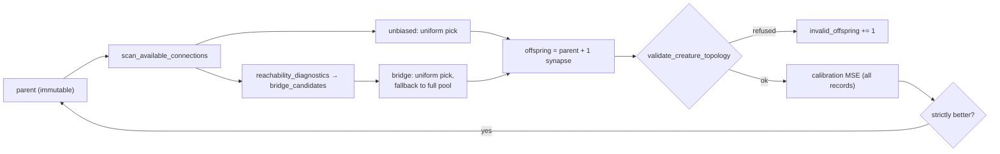

# PR summary — Issue #759: reachability-guided pruning and connection mutation

## Summary

This PR runs the controlled experiment issue #759 asks for. It first audited the existing fixed-point cleanup. It then added the missing O(V+E) input→output reachability diagnostics as `neat_core::reachability`, and compared unbiased connection addition with bridge-biased proposals in a paired, seeded, opt-in experiment. The verdict on the synthetic task is **inconclusive**, and the write-up records the findings as negative or inconclusive. No default, interface or cleanup behaviour changes. A representative run on real corpora has not been done, so no success is claimed. Part of #759.

## Spec

### Intent and Rationale

- **The audit found the pruning half already in place.** `cleanup_creature` (`neat-core/src/prune_cleanup.rs`) removes nodes with no outward edge, repeating until nothing changes. In a `forwardOnly` creature that is the same as "cannot reach an output". It also folds a bias-only hidden neuron exactly into a support constant, so constant-driven computation is kept. A second pruning implementation was therefore not added.
- **Missing piece 1: a reachability diagnostic.** Core had no way to report which structure no input reaches, which inputs are unused, or which outputs are constant.
- **Missing piece 2: a policy comparison.** Nothing compared connection-proposal policies. `topology_ops::scan_available_connections` was already the unbiased candidate pool, and it is reused as the experiment's baseline.

### Essential Design Decisions

- **A diagnostic, never a rewrite.** `reachability_diagnostics` only classifies neurons, and `prune_cleanup` stays the sole rewrite owner. A neuron classed `BiasDriven` (it reaches an output, but no input reaches it) is documented as not removable on reachability alone.
- **Index-based API.** The API takes the same parallel `from`/`to` index arrays as `topology_ops`, so NEAT-AI (through its own `wasm_activation`) and Ockham can call it without a creature-JSON round trip. Cycles, duplicate edges and unsorted edges are handled.
- **Typed refusals.** Malformed input fails with a typed `ReachabilityError`, never an empty result. A neuron count above `u32::MAX` is refused before anything is allocated.
- **How "bridge" was defined.** The paper could not be fetched, so the definition comes from the issue text. A bridge candidate is a pair whose source an input reaches and whose target reaches an output, excluding Live→Live pairs. Adding it puts a currently non-Live endpoint on an input→output path.
- **The experiment is opt-in and reproducible.** It is an example binary, not a test, so it never gates CI. The two arms share the teacher, data, initial student and weight draws for each seed; only the selection policy differs. A child is accepted only if it improves on the full calibration set, and the untouched validation set is scored only on the first and final creature. The seeds, budgets and verdict rule are fixed in code before the run.

### Undiscoverable Facts

- **Paper unverified.** <https://arxiv.org/abs/2610.17425> could not be fetched in this run (`proxy refused the connection`), and the issue audit had already failed to fetch it. The method here does not rely on it.
- **A `Standard` edge into an `IF` target is valid.** It counts as the `IF`'s positive role (`neat-core/src/topology_invariants.rs:157`). As a result, every candidate `scan_available_connections` proposed passed `validate_creature_topology`, in both arms.
- **Owner step:** run the harness, or its operators, on representative private NEAT-AI/Ockham corpora, including mutation operators that create dead structure (add-neuron, remove-connection). Then decide whether `bridge_candidates` stays (see the decision in the research doc).

## Evidence

This is a backend/CLI change; no UI files are touched.

- **Command:** `cargo run --release -p neat-core --example reachability_mutation_experiment -- --rev <sha> --out docs/research/reachability-mutation-experiment-results.json` ran 40 of 40 seeds with 0 failures.
- **Validation MSE (bridge − unbiased):** mean −0.00821, 95% bootstrap CI [−0.0252, 0.0039], bridge won 21 seeds and lost 19. The verdict is `inconclusive`.
- **Invalid offspring:** 0 in both arms on every seed.
- **Dead structure:** the final non-Live interior count was tied on all 40 seeds.
- **Bridge candidates:** they existed on only 224 of the 5 939 bridge-arm proposals; the other 96% fell back to the unbiased pool.
- **Wall clock:** wall-clock and per-evaluation-hour figures in the JSON were taken on a shared, parallel host and are indicative only.
- **Write-up:** the audit, the fixed design and the findings are in `docs/research/reachability-guided-mutation.md`.

## Acceptance Criteria

- **missing** — "Do not claim success before representative runs." — reason: only the synthetic, application-agnostic task ran here. Representative runs need the private NEAT-AI/Ockham corpora, which stay private, so no success is claimed.
- **missing** — "Record negative findings and remove optional code that does not earn its maintenance cost." — reason: the negative and inconclusive findings are recorded. Removing `bridge_candidates` and the example harness waits on that representative run, as the research doc's decision section says.

## Test Plan

- **New test file:** `neat-core/tests/reachability_diagnostics.rs` (12 tests). Its expected classes are derived by hand rather than taken from the code under test. It covers:
  - all four classes in one fixture, plus `interior_counts`;
  - unused inputs and input-independent outputs;
  - recurrent cycles, including an island that feeds only itself;
  - duplicate and unsorted edges matching the clean list;
  - each `ReachabilityError` variant, each paired with an accepted legal control;
  - the neuron count above `u32::MAX`, refused before allocation, with a legal control;
  - `bridge_candidates`: the exact pairs kept and their order, plus refusals of an odd buffer and an out-of-range pair;
  - a creature passed through `cleanup_creature` having only Live or BiasDriven interior neurons.
- **Red runs:** the tests and the module were written together, so no red run was observed before implementing.
- **Gate:** `./quality.sh < /dev/null` exited 0 on the final code commit, with `All quality checks passed!`. That covers fmt, clippy `--all-targets -D warnings` (the example included), workspace tests, doctests, docs, the Mermaid check and markdownlint.
- **Existing tests:** none were edited or removed.

## Not checked

- **Representative corpora:** no run on representative or private corpora (owner step above).
- **Wasm:** no wasm build was checked, because no wasm-gated code changed.
- **Independent reviewers:** no Spec or Standards reviewer was dispatched. The issue states no acceptance-criteria heading.
