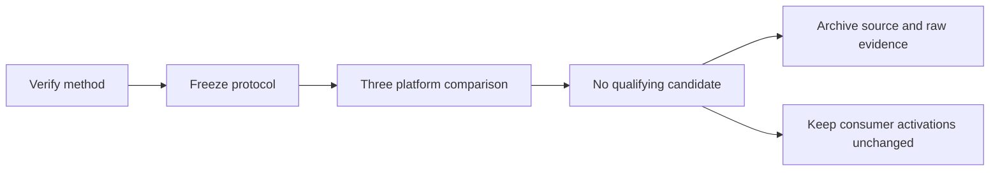

## Summary

Complete the controlled MulClip experiment with a negative adoption decision.
Retain the raw evidence and tested replay artifact; retire the optional live
harness. No consumer activation or public interface changes. Closes #760.

## Spec

### Intent and Rationale

- Verify the published method and test transfer to core before adding an activation. The corrected comparison does not justify exposure.

### Essential Design Decisions

- Pin arXiv:2610.39343v1, including input clipping and Appendix A's separate Float32 products/subtraction. Preserve the rounded d3 endpoint residual.
- Keep v1 historical. Freeze v2 before measurement: fresh validation seeds, parity10, representative sparse degrees, paired samples, stricter intervals and explicit fit/wall limits.
- Reuse core kernels, public inference/scoring and the common wide sparse fixture. Preserve independent numerical oracles in the frozen source artifact.
- Retire the executable harness after rejection. Replay uses an isolated worktree at a pinned base plus a SHA-256-identified patch; routine CI carries no MulClip target.

### Undiscoverable Facts

- Hosted Apple Silicon is virtualised; all timings are indicative on shared hosts. Repeated fitness seeds across platforms are replication, not additional independent trials.
- Eight completion pushes failed on the worker's pre-push gate: it lists every file any pushed commit touched, so the retired harness `.rs` files still planned `cargo clippy`, and it read the `dtolnay/rust-toolchain@29eef33…` action SHA as `cargo +29eef33…`. The branch is squashed into one commit with an identical tree, so the pushed history carries no Rust file. Hooks were not bypassed. The harness source survives in `harness-v2.patch`.
- Hosted jobs bounded installation/build at 30 minutes and scientific work cooperatively at 300 seconds; they lacked the replay command's separate 600-second process wrapper. Actual scientific runs took 6–14 seconds.

## Evidence

- #760: Experiment: Benchmark MulClip as an optional evolvable activation.
- Full method verified against [Section II and Appendix A](https://arxiv.org/html/2610.39343v1). The previous unreachable-source claim is withdrawn in `docs/research/mulclip-activation.md`.
- V2 completed **420/420 cells**, **2,520 calibration fits** and **1,680 validation fits**, with no scientific-run failures. `docs/research/mulclip/cross-platform-assessment-v2.json` records `no-candidate-all-platforms`.
- D2 establishes no positive fitness interval. D3 exceeds the smooth4 regression margin on every degree distribution. Apple Silicon also fails parts of the speed rule. Parity10 is non-saturating but near chance.
- [Hosted run 43572780033](https://github.com/stSoftwareAU/NEAT-AI-core/actions/runs/43572780033) succeeded on x86 Linux and Apple Silicon. The raw JSON contains paired distributions and uncertainty; execution records include provenance, costs and both failed pre-measurement collection attempts.
- `docs/research/mulclip/codegen-v2-aarch64-linux.txt`, `docs/research/mulclip/codegen-v2-x86_64-linux.txt` and `docs/research/mulclip/codegen-v2-aarch64-macos.txt` show packed d2/d3 arithmetic with two scalar lanes. V1's inspected ARM MulClip evaluation was scalar.
- `docs/research/mulclip/harness-v2.patch` preserves the corrected driver and independent tests. Its isolated replay passed 25 tests; `docs/research/mulclip/replay.md` gives verified restoration commands.

## Test Plan

- The focused tests first reproduced two defects in the checkpointed experiment: d3's clipped endpoint incorrectly returned zero, and incomplete evidence was not rejected as invalid. The repaired 25-test suite passed, including literal bit expectations, independent f64 outcomes, missing/duplicate/truncated cells, failures and compute-limit validation.
- The archived kernel proxy was checked through public scalar inference and batched scoring, using both small heavy-tail and wide sparse graphs. The source patch was then applied to a separate checkout of its documented base and all 25 tests passed again.
- `cargo test --workspace < /dev/null`: passed on the final tree after retirement.
- `./quality.sh < /dev/null`: passed (exit 0, "All quality checks passed!") on the squashed head before this summary-only edit, including workspace tests/doctests, clippy, dependency checks and release build. Markdown lint and spelling also passed.
- Existing test assertions removed from the final diff against Develop: none. The optional experiment targets introduced on this branch were retired together; their complete tests remain in the replay artifact.
- No maintained gate, public rule or helper caller changed. The temporary research workflow is absent from the final diff.
- Documentation sweep covered source verification, comparability, results, training limitations and retention/replay. Updated the research note, benchmark README and archival protocol/replay instructions.
- Backend research only; no UI or screenshot applies. Fixtures are seeded and application-agnostic; no private corpus or operational integration is included.

## Merge verification

Required PR CI and downstream-consumer CI remain pending until observed.

## Limits and checks not run

Quiet physical-host timings, production corpora, temporal reservoirs, NEAT
evolution and backpropagation training were not evaluated. The local gate's
opt-in downstream builds were not enabled. These limits constrain adoption
claims; consumer exposure is rejected, not deferred.
