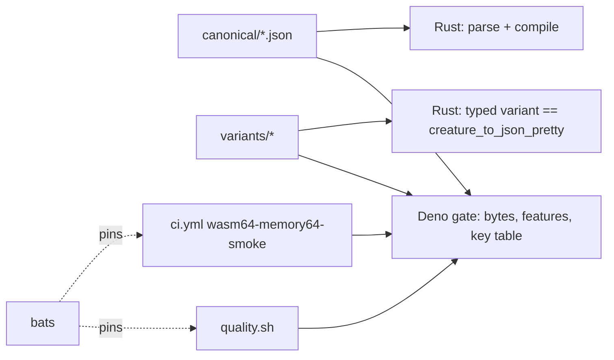

# PR summary — Issue #765

## Summary

Adds the single presentation contract for persisted (checked-in, human-facing)
creature JSON, a small synthetic golden corpus in that form, and gates that pin
the corpus against the JavaScript runtime (Deno) and against `neat-core`.
Closes #765.

- `docs/CREATURE_JSON_PRESENTATION.md` — one rule each for layout, number form,
  exponent casing and sign, `-0`, key order (per-kind table plus array-index
  keys first, then UTF-16 code-unit order), array order, string escaping and the
  trailing newline, with the planning evidence and six intentional differences
  (compact scorer files out of scope; the production trainer's tags-only
  metadata splice; `-0` kept;
  today's Rust writers; NEAT-AI's own 2-space goldens; out-of-table keys).
- `neat-core/tests/fixtures/creature_presentation/` — three `canonical/` files,
  three `variants/` (typed serde pretty, `serde_json::Value` pretty,
  `jq --indent 1`) and a `README.md` with provenance and "never hand-reformat".
- `tests/creature_presentation_test.ts` — run from `quality.sh` and from the
  `wasm64-memory64-smoke` CI job beside `tests/wasm_prune_parity_test.ts`, with
  `--allow-read` only.
- `neat-core/tests/creature_presentation.rs` — every canonical file parses and
  compiles; the typed-serde variant is byte-identical to `creature_to_json_pretty`.
- `tests/scripts/creature_presentation_gate.bats` — pins the two wiring sites.

## Spec

### Intent and Rationale

- The TypeScript form (`JSON.stringify(doc, null, 1)`, no trailing newline) is
  the contract because 33 of the 40 planning samples already have it and the
  TypeScript writer needs no layout change.
- The Deno round trip cannot see key order (`JSON.parse` keeps the file's
  order), so the test also checks every canonical object against the documented
  key table directly.

### Essential Design Decisions

- `-0` is kept through a `JSON.rawJSON("-0")` replacer; plain `JSON.stringify`
  writes `0`. The byte test cannot see that rewrite (a `0` round-trips to
  itself), so the per-file manifest counts `-0` literals exactly.
- Every canonical file carries a manifest of the features it must keep, so a
  gate over an emptied or simplified corpus fails rather than passing vacuously.
- Assumptions: the corpus is authored here and vendored outward, and is
  synthetic (no production-trainer sample is copied); Deno 2.9.3 (the CI pin)
  supports `JSON.rawJSON`, as observed on Deno 2.9.8 locally.
- The issue cites the splice rule by the private production trainer's issue
  slug; this public repository's archive guard
  (`tests/scripts/archive_pr_summaries_private_repo_reference.bats`) forbids
  naming that repository, so the doc and this summary state the rule at concept
  level instead.

### Undiscoverable Facts

- The table order was checked against NEAT-AI commit `221facd8`
  `src/utils/CreatureExportBuilder.ts` (via `gh api … contents?ref=221facd8`):
  `semanticVersion, forwardOnly, neurons, synapses, input, output, tags`, then
  `memetic`. The creature `uuid` and memetic record positions come from that
  commit's golden fixtures, as recorded in the doc.
- The worker added `docs/archive/handover/issue-765.md` after interrupting an
  earlier attempt of this run; it is the worker's note, not part of the contract.

## Evidence

Backend/test-only change; no UI file is touched.

Mutation runs (each applied to the committed corpus, gate run, then reverted
with `git checkout -- neat-core/tests/fixtures`; `git status` clean afterwards):

| Mutation | Result |
|---|---|
| `canonical/number_forms.json` re-indented to 2 spaces | red — byte-identical test |
| `1e-7` → `1E-7` | red — byte-identical and feature tests |
| `"bias": 1` → `"bias": 1.0` | red — byte-identical test |
| `0.000001` → `1e-6` | red — byte-identical test |
| `memetic_by_id.json`: `"10"` block moved ahead of `"2"` | red — byte-identical test |
| `"bias": -0` → `"bias": 0` | red — feature test (`-0` count) and variant test |
| trailing newline appended | red — byte-identical test |
| `memetic_by_id.json` `"2": 1` → `"2": 1.0` | red — byte-identical and feature test (field-line integer check) |
| `variants/jq_indent_1`: one weight `-1.5E-9` → `-1.5E-8` | red — variant test |
| `variants/serde_value_pretty`: one tag value changed | red — variant test |
| `variants/serde_typed_pretty`: `synapses[0]` and `[1]` swapped | red — variant test |

## Acceptance Criteria

<!-- vibe-spec-review inputs="diff+issue-body" -->

- **met** — `docs/CREATURE_JSON_PRESENTATION.md` states one rule each for indentation, number form, exponent casing and sign, `-0`, key order (including array-index keys), array order, string escaping and trailing newline, and lists every intentional difference. — evidence: `docs/CREATURE_JSON_PRESENTATION.md` — reviewer: met
- **met** — The corpus contains every feature listed above, and the Deno test asserts each is present. — evidence: `tests/creature_presentation_test.ts::<name> keeps every feature the manifest requires` — reviewer: met
- **met** — The Deno test goes red when a canonical file is re-indented to 2 spaces, has a number respelt (`1e-7` → `1E-7`, `1` → `1.0`, `0.000001` → `1e-6`), has `"10"` moved ahead of `"2"` in an id-keyed map, has `-0` rewritten as `0`, or gains a trailing newline. Each mutation and its red result is recorded in the PR summary and reverted before commit. — evidence: Evidence table above; `tests/creature_presentation_test.ts::canonical files are byte-identical to the canonical writer's output` — reviewer: met — reason: the reviewer judged the test logic and noted the PR-summary half was not visible in the diff; the mutations were run in this session and are recorded above
- **met** — The Deno test goes red when a variant's value is changed (one weight, one tag value, one swapped array element). — evidence: `tests/creature_presentation_test.ts::variants are the same document as their canonical file but different bytes`; Evidence table above — reviewer: met
- **met** — The Deno test runs in `quality.sh` and in CI with `--allow-read` only. — evidence: `quality.sh`, `.github/workflows/ci.yml` (`wasm64-memory64-smoke`), `tests/scripts/creature_presentation_gate.bats` — reviewer: met
- **met** — Every canonical file parses with `parse_creature_json` and compiles with `compile_creature`. — evidence: `neat-core/tests/creature_presentation.rs::every_canonical_creature_parses_and_compiles_to_the_declared_shape` — reviewer: met
- **met** — `./quality.sh` and `cargo test --workspace` pass. — evidence: `./quality.sh < /dev/null` exit 0 on commit `f52391f` (it runs `cargo test --workspace --lib --tests` and `--doc`) — reviewer: missing — reason: the reviewer could not run anything; the gate was run here and passed
- **unrequested** — `tests/scripts/creature_presentation_gate.bats`, a validator for the two wiring sites — reviewer: unrequested — reason: the issue makes the `quality.sh`/`ci.yml` wiring load-bearing, and a workflow behaviour change owes a validator
- **unrequested** — root `README.md` section "Persisted creature JSON presentation (Issue #765)" — reviewer: unrequested — reason: a code change owes a docs change; it points readers at the contract and its gates
- **unrequested** — key-order enforcement in the Deno test (`KEY_TABLES`, `keyOrderViolation` and its tests) — reviewer: unrequested — reason: checks the committed corpus against the documented table; it pins no writer, so the serialiser sub-issue's golden test remains the writer-side owner
- **unrequested** — the hostile-line and `numberLine` self-tests — reviewer: unrequested — reason: the line parser runs regexes over corpus text, and each pattern needs its own hostile case
- **unrequested** — `emptyContainers` feature, `frozen` keys in the corpus, and the extra count assertions in `neat-core/tests/creature_presentation.rs` — reviewer: unrequested — reason: empty containers exercise the layout rule; `frozen` is a table key; the counts make the parse/compile test assert the declared shape
- **unrequested** — `typed_serde_variant_is_what_creature_to_json_pretty_writes_today` — reviewer: unrequested — reason: added after the Standards review so the hand-captured typed variant is pinned to the real writer
- **unrequested** — Mermaid flowchart and "Number spellings, verified" table in the doc — reviewer: unrequested — reason: records the issue's verified number forms beside the rule

## Standards Review

<!-- vibe-standards-review inputs="diff+CODING-STANDARDS.md" -->

- **violation** — workflow/quality wiring gate missed job-level `if:`, `continue-on-error`, `|| true` and an indented or unreachable `quality.sh` line; README said "every PR" though the job skips drafts — evidence: `tests/scripts/creature_presentation_gate.bats:17` — reason: fixed in this diff (checker refuses each, with a negative test per case; README now says "every non-draft PR")
- **violation** — GNU-only `sed` `\n` insertion in a test `quality.sh` runs — evidence: `tests/scripts/creature_presentation_gate.bats:91` — reason: fixed in this diff (portable `awk` insertion)
- **violation** — refusal tests asserted only a non-zero status — evidence: `tests/scripts/creature_presentation_gate.bats:72` — reason: fixed in this diff (every refusal asserts the checker's specific message)
- **violation** — integer-valued field oracle matched any literal in the file, so `"output": 1` satisfied it — evidence: `tests/creature_presentation_test.ts:499` — reason: fixed in this diff (reads the literal on the bias/weight line; `"2": 1` → `1.0` now fails the feature test)
- **violation** — hand-captured typed-serde variant pinned by nothing — evidence: `neat-core/tests/fixtures/creature_presentation/README.md:47` — reason: fixed in this diff (`neat-core/tests/creature_presentation.rs::typed_serde_variant_is_what_creature_to_json_pretty_writes_today`)
- **clean** — "what" not "how" tests; oracle rules 1, 3, 4 and 5 (key table and manifest independent of the round trip, checkers defined once and run on live and broken copies, helpers tested on synthetic input); CI gate repo-owned with no step `if:`; named tests exist; temp dirs via `mktemp -d`; no shallow-history assumption; Australian English. Review-enforced rules checked: dummy/"how" tests, writing a gate over text, refusal tests refused by the rule they name, tests able to fail on the wrong input, fakes mirror production, named test must exist, workflow validator, macOS-portable shell.

## Test Plan

- Added `tests/creature_presentation_test.ts` — `deno test --allow-read tests/creature_presentation_test.ts < /dev/null`: 11 passed on the final head.
- Added `neat-core/tests/creature_presentation.rs` — `cargo test -p neat-core --test creature_presentation`: 3 passed.
- Added `tests/scripts/creature_presentation_gate.bats` — `bats tests/scripts/creature_presentation_gate.bats < /dev/null`: 15 passed (2 positive on the live files, 13 refusals each asserting its message).
- `./quality.sh < /dev/null`: exit 0, "All quality checks passed!", on `f52391f`. Later commits change only Markdown table cells and this summary; `markdownlint-cli2` and `scripts/check_mermaid.ts` passed on them.
- No existing test was edited; no assertion was removed.
- Twinned gates: `quality.sh` and the `ci.yml` `wasm64-memory64-smoke` job both gained the Deno step, as the issue requires; no other copy found.
- `deno.lock` and `Cargo.lock` are unchanged.

Not checked: the Deno gate has not run on Deno 2.9.3 (the CI pin) yet; it has run only on 2.9.8 locally. The gate is not wired to draft PRs, as with every step of the `wasm64-memory64-smoke` job.
