# PR summary — Issue #766

## Summary

Adds `neat_core::creature_presentation`, the one Rust writer of the persisted
creature JSON contract in `docs/CREATURE_JSON_PRESENTATION.md`. It has two entry
points:

- `creature_presentation_json(&serde_json::Value)` is the document-level entry.
  It keeps the creature `uuid`, `tags`, `frozen` and every other key the typed
  structs do not model.
- `creature_export_presentation_json(&CreatureExport)` is the typed entry.

Both return the contract bytes:

- 1-space layout;
- ECMAScript `Number::toString` text derived from Rust's shortest round-trip
  `{:e}` digits, with `-0` kept;
- the per-kind key table, with array-index keys first and the rest in UTF-16
  order;
- array order untouched;
- no trailing newline.

`neat-core/tests/creature_presentation.rs` pins the writer to the #765 golden
corpus. `creature_to_json` and `creature_to_json_pretty` are unchanged. Every
acceptance criterion is met except the `downstream-consumers` CI job, which has
not run yet. Part of #766.

## Spec

### Intent and Rationale

- `CreatureExport` and its children model no `tags`, so a typed round trip drops
  them. The document-level entry is therefore the primary one: a writer that
  carries tags (the production trainer's tags-only splice, NEAT-AI-Lamarck's
  `Value` re-attach) needs it.
- Key order is decided by where an object sits in the document: root, neuron,
  synapse, tag, memetic record, weight row or id-keyed entry. Struct fields are
  not reordered and `preserve_order` is not enabled, so every registered
  consumer's existing writer output is unchanged. This is phase 1, "add the
  alternative in core", of the `RELEASING.md` three-phase flow.

### Essential Design Decisions

- `PresentationError` is the module's own `#[non_exhaustive]` enum wrapping
  `CreatureError`, which is not extended. Its variants are `Creature`,
  `NonFiniteNumber { path }` and `NullValue { path }`.
- The document entry refuses any `null` (`NullValue`). The issue asks for
  non-finite numbers to be refused, but a `serde_json::Value` cannot hold NaN or
  an infinity: `json!`, `Value::from` and `to_value` turn them into `null`, as
  `JSON.stringify` does. So a `null` is a number already lost, and the contract
  never writes `null`. This is my reading of "refuse a non-finite number" for
  the document entry; it also refuses a `null` in unmodelled metadata.
- The order of checks:
  - **Document entry:** scan for `null` and for numbers with no finite `f64`,
    then parse as `CreatureExport` (`CreatureError::Json`), then
    `validate_creature_width`, then write.
  - **Typed entry:** `validate_creature_width` first, then the non-finite walk
    over every typed `f64`, then `to_value`, then the document entry. There is
    one writer and no second code path.
- The writer panics (`expect` / `unreachable!`) only on states the pre-scan
  rules out. It never falls back to wrong bytes.

### Undiscoverable Facts

- `serde_json` parses the literal `-0` as `f64` `-0.0`. The losslessness test
  asserts this, so its sign-of-zero check is not vacuous.
- `cargo check -p neat-core --target wasm32-unknown-unknown` could not run here:
  the target is not installed and `rustup` is absent. The module has no `cfg`,
  no I/O and no new dependency.

## Evidence

Backend-only change: no UI files.

Before-fix evidence: pointing the typed golden assertion
(`typed_entry_writes_the_tagless_canonical_file_byte_for_byte`) at
`creature_to_json_pretty` made it red. The output had 2-space indent, `1.0` and
struct field order. The change was reverted.

Single-mutation runs of `cargo test -p neat-core --test creature_presentation`.
Each was applied to the writer alone and reverted before commit:

| Mutation                                                 | Result         | First failing test printed                            |
| -------------------------------------------------------- | -------------- | ----------------------------------------------------- |
| indent 2 spaces                                          | red (7 failed) | `adding_a_creature_tag_changes_only_the_tags_array`   |
| exponent letter `E`                                      | red (4)        | `every_variant_is_normalised_to_its_canonical_bytes`  |
| exponent sign dropped (`1e21`)                           | red (4)        | `every_variant_is_normalised_to_its_canonical_bytes`  |
| `1e21` threshold (21 → 22)                               | red (4)        | `numbers_are_written_as_ecmascript_number_to_string`  |
| `1e-6` threshold (-6 → -7)                               | red (4)        | `numbers_are_written_as_ecmascript_number_to_string`  |
| integers written with `.0`                               | red (8)        | `canonical_files_are_rewritten_byte_for_byte`         |
| creature table `neurons`/`synapses` swapped              | red (5)        | `adding_a_creature_tag_changes_only_the_tags_array`   |
| synapse table `weight`/`fromUUID` swapped                | red (5)        | `canonical_files_are_rewritten_byte_for_byte`         |
| array-index keys sorted as text                          | red (4)        | `every_variant_is_normalised_to_its_canonical_bytes`  |
| values rounded to 15 significant digits                  | red (9)        | `canonical_files_are_rewritten_byte_for_byte`         |
| `-0` written `0`                                         | red (6)        | `changing_one_number_changes_exactly_one_line`        |
| array order reversed                                     | red (9)        | `canonical_files_are_rewritten_byte_for_byte`         |
| typed entry's own `validate_creature_width` call deleted | red (1)        | `the_typed_entry_checks_the_width_before_the_numbers` |
| UTF-16 key comparison replaced by byte order             | red (1)        | `unknown_keys_follow_index_then_utf16_order`          |

A second sweep swapped adjacent pairs in every key table, one at a time. The
first three pairs are never both present in any corpus object. Before
`every_key_table_is_written_in_its_documented_order` was added, those three
swaps left all 21 tests green, as the pre-PR verifier reported. With the test
added, every swap below is red:

| Key-table swap                    | Result         |
| --------------------------------- | -------------- |
| neuron `frozen`/`tags`            | red (1 failed) |
| neuron `tags`/`id`                | red (1)        |
| synapse `frozen`/`tags`           | red (1)        |
| neuron `bias`/`squash`            | red (6)        |
| synapse `type`/`frozen`           | red (3)        |
| tag `name`/`value`                | red (4)        |
| memetic record `score`/`ancestry` | red (6)        |
| id-keyed entry `toId`/`weight`    | red (6)        |
| weight row `toUUID`/`weight`      | red (4)        |
| creature `tags`/`memetic`         | red (4)        |
| creature `uuid`/`semanticVersion` | red (4)        |

The new test builds one object of each kind carrying every key of its table. Its
expected orders are copied by hand from the table in
`docs/CREATURE_JSON_PRESENTATION.md`, not read from the writer's constants.

The losslessness test, `rewriting_loses_no_value_including_the_sign_of_zero`,
was among the failures for the rounding, `-0` and reorder mutations.

```mermaid
flowchart LR
    T["creature_export_presentation_json(&CreatureExport)"] --> W1["validate_creature_width"]
    W1 --> F["non-finite f64 walk"]
    F --> V["serde_json::to_value"]
    V --> D["creature_presentation_json(&Value)"]
    D --> S["scan: null / non-finite number"]
    S --> P["parse as CreatureExport"]
    P --> W2["validate_creature_width"]
    W2 --> O["writer: key tables, ECMAScript numbers, 1-space"]
```

## Acceptance Criteria

<!-- vibe-spec-review inputs="diff+issue-body" -->

- **met** — Every canonical corpus file is byte-identical after parse and write
  through the document-level entry point, and every tagless one through the
  typed entry point — evidence:
  `neat-core/tests/creature_presentation.rs::canonical_files_are_rewritten_byte_for_byte`,
  `::typed_entry_writes_the_tagless_canonical_file_byte_for_byte` — reviewer:
  met
- **met** — The golden assertion is red when pointed at
  `creature_to_json_pretty`; that red run is recorded in the PR summary as the
  before-fix evidence — evidence: Evidence section above — reviewer: missing —
  reason: the reviewer had only the diff and no PR summary, so it said it could
  not see this; the red run is recorded above
- **met** — Every variant file rewrites to its canonical file's bytes —
  evidence:
  `neat-core/tests/creature_presentation.rs::every_variant_is_normalised_to_its_canonical_bytes`,
  `::variant_directory_lists_exactly_the_registered_variants` — reviewer: met
- **met** — The losslessness test compares `f64` bit patterns and goes red when
  the writer is mutated to round a value, drop the sign of `-0`, or reorder an
  array — evidence:
  `neat-core/tests/creature_presentation.rs::rewriting_loses_no_value_including_the_sign_of_zero`;
  mutation table above — reviewer: met
- **met** — The suite goes red for each single mutation of: indent width,
  exponent case, exponent sign, the `1e21` threshold, the `1e-6` threshold, the
  integer `.0` suffix, two keys swapped in the per-kind key table, and
  array-index keys sorted as text. Each mutation and its result is listed in the
  PR summary and reverted before commit — evidence: both mutation tables above;
  `neat-core/tests/creature_presentation.rs::every_key_table_is_written_in_its_documented_order`
  — reviewer: met (re-review over the new diff; it re-ran eight adjacent swaps
  and each went red, including the three neuron/synapse pairs the earlier review
  flagged as uncovered)
- **met** — A one-weight change makes exactly one output line differ; a one-tag
  change touches only that tag's lines — evidence:
  `neat-core/tests/creature_presentation.rs::changing_one_number_changes_exactly_one_line`,
  `::adding_a_creature_tag_changes_only_the_tags_array` — reviewer: partial —
  reason: the reviewer noted the tag test also allows the previous tag's `}` to
  gain a comma. JSON without trailing commas forces that line, and the test
  asserts it is exactly `},` and that every changed line is inside the creature
  `tags` array
- **met** — A zero-width creature, an over-ceiling width and a non-finite number
  are each refused with a typed error by both entry points, and nothing is
  written — evidence:
  `neat-core/tests/creature_presentation.rs::zero_input_is_refused_by_both_entries_and_one_input_is_accepted`,
  `::zero_output_is_refused_by_both_entries_and_one_output_is_accepted`,
  `::an_input_width_past_the_node_ceiling_is_refused_and_the_ceiling_itself_is_accepted`,
  `::a_non_finite_typed_number_is_refused_with_its_path`,
  `::a_null_in_a_document_is_refused_with_its_path`;
  `neat-core/tests/creature_width_contract.rs::presentation_serialise_refuses_zero_input`,
  `::presentation_serialise_refuses_zero_output`,
  `::presentation_serialise_refuses_input_past_the_ceiling` — reviewer: met
- **met** — `creature_to_json` and `creature_to_json_pretty` output is
  unchanged, and the existing tests pass unmodified — evidence:
  `neat-core/src/creature.rs` not in the diff;
  `neat-core/tests/creature_presentation.rs::typed_serde_variant_is_what_creature_to_json_pretty_writes_today`
  unchanged and passing; `./quality.sh` passed — reviewer: met
- **partial** — The `downstream-consumers` CI job passes — evidence: locally,
  `scripts/check-downstream-consumers.sh < /dev/null` (clone mode, `Develop`)
  exited 0 on the final tree with "all 6 registered consumers compile against
  this core" (Forests, Ockham, Lamarck and the other three each compiled); the
  change is additive, with no public surface removed or narrowed — reviewer:
  missing — reason: CI not yet verified — remaining: merge-verification-only
- **met** — `./quality.sh` and `cargo test --workspace` pass — evidence:
  `./quality.sh < /dev/null` exited 0 on the final tree, after the full-table
  key-order test and this summary's reword ("All quality checks passed!", 81
  `test result: ok`, no `not ok` bats line; archived-summary bats 20 and 22 now
  pass); it runs `cargo test --workspace --lib --tests --all-features` and the
  doc tests — reviewer: missing — reason: the reviewer could not run the gate;
  it was run here and passed
- **unrequested** — `PresentationError::NullValue` and the whole-document `null`
  scan — reviewer: unrequested — reason: this is how the document entry refuses
  a non-finite number, since a `Value` cannot hold one (see Essential Design
  Decisions)
- **unrequested** — README "Rust producer" paragraph and gate row, the AGENTS.md
  repository-layout bullet, the fixture README "Gates" bullet, and the reworded
  `tests/creature_presentation_test.ts` header comment — reviewer: unrequested —
  reason: each described the old Rust gate and was made false by this change
- **unrequested** —
  `neat-core/tests/creature_presentation.rs::variant_directory_lists_exactly_the_registered_variants`
  — reviewer: unrequested — reason: it stops the normalisation test passing over
  an emptied variant directory

## Standards Review

<!-- vibe-standards-review inputs="diff+CODING-STANDARDS.md" -->

This repository has no `CODING-STANDARDS.md`; the reviewer checked against
`AGENTS.md`.

- **violation** — fail loud, no silent fallback: the writer fell back to `NaN`
  text, `null` and `""` on unreachable states — evidence:
  `neat-core/src/creature_presentation.rs:325` — reason: fixed in this diff (the
  pre-scan now refuses a number with no finite `f64` as `NonFiniteNumber`, and
  the writer uses `expect` / `unreachable!` naming the invariant)
- **violation** — AGENTS.md #550, each width-check site must fail its own test:
  deleting the typed entry's own `validate_creature_width` call left every test
  green — evidence: `neat-core/src/creature_presentation.rs:205` — reason: fixed
  in this diff (`the_typed_entry_checks_the_width_before_the_numbers` goes red
  with that call deleted)
- **clean** — "what" not "how" tests; oracle rule 1 (an independent `Value`
  walk, a hand-written number table, `f64::from_str`, Deno-written golden
  bytes); oracle rule 3 (no vacuous oracles: a `-0` count and non-empty guards);
  public-API three-phase rule (additive, `#[non_exhaustive]` error, existing
  writers untouched); one home for the width rule (helper called, not
  re-inlined); `float_roundtrip` kept; Australian English; docs updated. The
  UTF-16 order and the array-index ceiling, flagged as optional, are now pinned
  by `unknown_keys_follow_index_then_utf16_order`.

## Test Plan

- `neat-core/tests/creature_presentation.rs` keeps its three existing tests
  unchanged and adds 19:
  - corpus and variants:
    `variant_directory_lists_exactly_the_registered_variants`,
    `canonical_files_are_rewritten_byte_for_byte`,
    `typed_entry_writes_the_tagless_canonical_file_byte_for_byte`,
    `every_variant_is_normalised_to_its_canonical_bytes`,
    `rewriting_loses_no_value_including_the_sign_of_zero`;
  - number form: `numbers_are_written_as_ecmascript_number_to_string`,
    `number_text_round_trips_and_has_the_ecmascript_shape_across_a_sweep`;
  - diffs and scoring: `changing_one_number_changes_exactly_one_line`,
    `adding_a_creature_tag_changes_only_the_tags_array`,
    `rewriting_does_not_change_what_a_creature_scores`;
  - refusals: `zero_input_is_refused_by_both_entries_and_one_input_is_accepted`,
    `zero_output_is_refused_by_both_entries_and_one_output_is_accepted`,
    `an_input_width_past_the_node_ceiling_is_refused_and_the_ceiling_itself_is_accepted`,
    `a_non_finite_typed_number_is_refused_with_its_path`,
    `a_null_in_a_document_is_refused_with_its_path`,
    `a_document_that_is_not_a_creature_is_refused_as_json`,
    `the_typed_entry_checks_the_width_before_the_numbers`;
  - key order: `unknown_keys_follow_index_then_utf16_order`,
    `every_key_table_is_written_in_its_documented_order`.
- `neat-core/tests/creature_width_contract.rs` adds
  `presentation_serialise_refuses_zero_input`,
  `presentation_serialise_refuses_zero_output` and
  `presentation_serialise_refuses_input_past_the_ceiling`. Each refusal has an
  accepted control.
- No existing test's assertions changed; only `use` lines and the
  `creature_presentation.rs` module doc were edited.
- Final runs:
  - `cargo test -p neat-core --test creature_presentation --test creature_width_contract`
    passed (22 and 29).
  - `./quality.sh < /dev/null` passed on the final tree.
  - `scripts/check-downstream-consumers.sh < /dev/null` passed on the final tree
    (6 of 6).
  - `npx markdownlint-cli2` reported 0 issues.
  - `deno test --allow-read tests/creature_presentation_test.ts` passed (11).
- Not run:
  - `cargo check --target wasm32-unknown-unknown`, because the target is not
    installed;
  - the `downstream-consumers` CI job itself, which runs on the PR. The same
    script passed locally in clone mode against all six consumers;
  - the Deno coverage carry-over: the only TypeScript test,
    `tests/creature_presentation_test.ts`, is new. It imports only `@std/assert`
    and reads JSON fixtures, so it covers no repository source, and no edited or
    removed test lost a covered line;
  - the `arbitrary_precision` overflow branch of `NonFiniteNumber`, which needs
    that feature unified into the build.

🤖 Generated with [Claude Code](https://claude.com/claude-code)
