# PR summary — Issue #766

## Summary

The contract serialiser `neat_core::creature_presentation` and its golden-corpus
gate are already on this milestone branch. #769 (`617cb12`) and #770 (`84decf4`)
added them. This PR finishes #766:

- **Fail loud in `js_number`.** The two unreachable `unwrap_or` fallbacks in
  `neat-core/src/creature_presentation.rs` are now `expect` calls that name the
  `{:e}` invariant. Before, the writer could fall back to wrong bytes; now it
  panics instead.
- **Correct the test module doc.** The doc of `neat-core/tests/creature_presentation.rs`
  still said "This crate does not own the byte layout". That has been false since
  #766. It now says the file pins both entry points to the corpus.
- **Fix one row label.** The `0.1` row of the number-form table now names the
  branch it actually takes, `-6 < n <= 0`.
- **Record the last criterion.** The `downstream-consumers` criterion, left
  `partial` in #770's summary because CI had not run, is now met: #770's
  `Downstream consumers` check passed.

Every acceptance criterion is met. Closes #766.

## Spec

### Intent and Rationale

- An independent review of the whole #766 delivery (`0526acb...HEAD`) found the
  two fallbacks and the stale module doc. Both are in lines #766 wrote, so they
  are fixed here rather than left standing.

### Essential Design Decisions

- These carry over from #770 and are unchanged:
  - The document-level entry `creature_presentation_json(&Value)` is the primary
    one, because the typed structs carry no `tags`.
  - `PresentationError` is the module's own `#[non_exhaustive]` enum wrapping
    `CreatureError`, which is not extended.
  - The document entry refuses `null` (`NullValue`), because a
    `serde_json::Value` cannot hold NaN or an infinity.
- Neither fallback could fire: `{:e}` on a finite non-zero `f64` always writes
  `d.ddde<int>`. So `expect` changes no output and only removes a silent route
  to wrong bytes.

### Undiscoverable Facts

- #770 merged into the milestone branch at 2026-11-20T02:20:47Z. Its CI run
  `44659679442` passed every job, including `Downstream consumers` (1m45s) and
  `Quality Checks`.
- `cargo check -p neat-core --target wasm32-unknown-unknown` still cannot run
  here: `rustup` is absent and the target is not installed. This diff adds no
  `cfg`, no I/O and no dependency.

## Evidence

Backend-only change: no UI files.

- `gh pr checks 770` printed `Downstream consumers pass 1m45s` and
  `Quality Checks pass 2m37s`. Every other check passed, except
  `Lint & Compile Gates`, which was `skipping`.
- The before-fix and mutation evidence comes from #770's run against `84decf4`.
  This PR does not change the code those mutations targeted, apart from the two
  `expect` lines, so it was not re-run here:
  - **Before-fix red run.** The typed golden assertion,
    `typed_entry_writes_the_tagless_canonical_file_byte_for_byte`, was pointed at
    `creature_to_json_pretty` and went red. The output had a 2-space indent, `1.0`
    and the struct field order.
  - **Single mutations of the writer.** Each was run through
    `cargo test -p neat-core --test creature_presentation` and reverted:

    | Mutation                                    | Result         |
    | ------------------------------------------- | -------------- |
    | indent 2 spaces                             | red (7 failed) |
    | exponent letter `E`                         | red (4)        |
    | exponent sign dropped (`1e21`)              | red (4)        |
    | `1e21` threshold (21 → 22)                  | red (4)        |
    | `1e-6` threshold (-6 → -7)                  | red (4)        |
    | integers written with `.0`                  | red (8)        |
    | creature table `neurons`/`synapses` swapped | red (5)        |
    | synapse table `weight`/`fromUUID` swapped   | red (5)        |
    | array-index keys sorted as text             | red (4)        |
    | values rounded to 15 significant digits     | red (9)        |
    | `-0` written `0`                            | red (6)        |
    | array order reversed                        | red (9)        |
    | typed entry's `validate_creature_width` cut | red (1)        |
    | UTF-16 key order replaced by byte order     | red (1)        |

  - **Adjacent key-table swaps.** Eleven swaps across every key table were each
    red once `every_key_table_is_written_in_its_documented_order` was added. The
    losslessness test `rewriting_loses_no_value_including_the_sign_of_zero` was
    among the failures for the rounding, `-0` and array-order mutations.

```mermaid
flowchart LR
    T["creature_export_presentation_json(&CreatureExport)"] --> W1["validate_creature_width"]
    W1 --> F["non-finite f64 walk"]
    F --> V["serde_json::to_value"]
    V --> D["creature_presentation_json(&Value)"]
    D --> S["scan: null / non-finite number"]
    S --> P["parse as CreatureExport"]
    P --> W2["validate_creature_width"]
    W2 --> O["writer: key tables, js_number (fails loud), 1-space"]
```

## Acceptance Criteria

<!-- vibe-spec-review inputs="diff+issue-body" -->

The Spec reviewer was given `git diff 0526acb...HEAD`, the whole #766 delivery
(#769, #770 and this PR's code commit), and the issue body.

- **met** — Every canonical corpus file is byte-identical after parse and write
  through the document-level entry point, and every tagless one through the
  typed entry point — evidence:
  `neat-core/tests/creature_presentation.rs::canonical_files_are_rewritten_byte_for_byte`,
  `::typed_entry_writes_the_tagless_canonical_file_byte_for_byte` — reviewer:
  met
- **met** — The golden assertion is red when pointed at
  `creature_to_json_pretty`; that red run is recorded in the PR summary as the
  before-fix evidence — evidence: the "Before-fix red run" bullet under Evidence
  above, from #770's run — reviewer: met
- **met** — Every variant file rewrites to its canonical file's bytes —
  evidence:
  `neat-core/tests/creature_presentation.rs::every_variant_is_normalised_to_its_canonical_bytes`,
  `::variant_directory_lists_exactly_the_registered_variants` — reviewer: met
- **met** — The losslessness test compares `f64` bit patterns and goes red when
  the writer is mutated to round a value, drop the sign of `-0`, or reorder an
  array — evidence:
  `neat-core/tests/creature_presentation.rs::rewriting_loses_no_value_including_the_sign_of_zero`;
  the mutation table above — reviewer: met
- **met** — The suite goes red for each single mutation of: indent width,
  exponent case, exponent sign, the `1e21` threshold, the `1e-6` threshold, the
  integer `.0` suffix, two keys swapped in the per-kind key table, and
  array-index keys sorted as text. Each mutation and its result is listed in the
  PR summary and reverted before commit — evidence: the mutation table and the
  key-table swaps above;
  `neat-core/tests/creature_presentation.rs::every_key_table_is_written_in_its_documented_order`
  — reviewer: met
- **met** — A one-weight change makes exactly one output line differ; a one-tag
  change touches only that tag's lines — evidence:
  `neat-core/tests/creature_presentation.rs::changing_one_number_changes_exactly_one_line`,
  `::adding_a_creature_tag_changes_only_the_tags_array` — reviewer: met
- **met** — A zero-width creature, an over-ceiling width and a non-finite number
  are each refused with a typed error by both entry points, and nothing is
  written — evidence:
  `neat-core/tests/creature_presentation.rs::zero_input_is_refused_by_both_entries_and_one_input_is_accepted`,
  `::zero_output_is_refused_by_both_entries_and_one_output_is_accepted`,
  `::an_input_width_past_the_node_ceiling_is_refused_and_the_ceiling_itself_is_accepted`,
  `::a_non_finite_typed_number_is_refused_with_its_path`,
  `::a_null_in_a_document_is_refused_with_its_path`;
  `neat-core/tests/creature_width_contract.rs::presentation_serialise_refuses_zero_input`,
  `::presentation_serialise_refuses_zero_output`,
  `::presentation_serialise_refuses_input_past_the_ceiling` — reviewer: met
- **met** — `creature_to_json` and `creature_to_json_pretty` output is
  unchanged, and the existing tests pass unmodified — evidence:
  `neat-core/src/creature.rs` is not in the diff;
  `neat-core/tests/creature_presentation.rs::typed_serde_variant_is_what_creature_to_json_pretty_writes_today`
  passes — reviewer: met
- **met** — The `downstream-consumers` CI job passes — evidence:
  `gh pr checks 770` printed `Downstream consumers pass 1m45s` (run
  `44659679442`). This PR changes no public surface — reviewer: partial —
  reason: the reviewer could not see a CI run from the diff ("no CI run is
  shown"). The check passed on #770 at `84decf4`
- **met** — `./quality.sh` and `cargo test --workspace` pass — evidence:
  `./quality.sh < /dev/null` exited 0 on this PR's code head, printing "All
  quality checks passed!" with 81 `test result: ok` lines and no `FAILED`. The
  gate runs `cargo test --workspace` — reviewer: met — reason: the reviewer
  accepted it "on the author's word"; it was run here
- **unrequested** — `PresentationError::NullValue` and the whole-document `null`
  scan, from #770 — reviewer: unrequested — reason: this is how the document
  entry refuses a non-finite number, because a `Value` cannot hold one
- **unrequested** — the README, AGENTS.md layout bullet and #550 paragraph,
  fixture README and `tests/creature_presentation_test.ts` header edits, from
  #770 — reviewer: unrequested — reason: each described the old Rust gate and
  this change made it false
- **unrequested** —
  `neat-core/tests/creature_presentation.rs::variant_directory_lists_exactly_the_registered_variants`
  and `::unknown_keys_follow_index_then_utf16_order` — reviewer: unrequested —
  reason: the first stops the normalisation test passing over an emptied
  directory; the second pins the order of keys outside the tables

## Standards Review

<!-- vibe-standards-review inputs="diff+CODING-STANDARDS.md" -->

This repository has no `CODING-STANDARDS.md`, so the reviewer checked the same
`0526acb...HEAD` diff against `AGENTS.md`. It reported no `violation`; I fixed
three of its four `optional` notes in this diff, listed here.

- **violation** — fail loud: `js_number` fell back silently through
  `unwrap_or((sci, "0"))` and `unwrap_or(0)`, against the summary's claim that
  the writer never falls back to wrong bytes — evidence:
  `neat-core/src/creature_presentation.rs:445` — reason: fixed in this diff
  (both are now `expect` calls naming the invariant)
- **violation** — a doc comment the #766 change made false: the test module doc
  said "This crate does not own the byte layout" — evidence:
  `neat-core/tests/creature_presentation.rs:5` — reason: fixed in this diff
- **violation** — a misleading rule label on the `0.1` number-form row —
  evidence: `neat-core/tests/creature_presentation.rs:347` — reason: fixed in
  this diff
- **clean** — The reviewer checked these and found them compliant:
  - "what" not "how" tests;
  - oracle rule 1, an independent oracle: Deno-written golden bytes, key orders
    copied by hand from the doc, an independent `Value` walk, `f64::from_str`
    round trips, and a bit-for-bit scoring comparison;
  - oracle rule 3, no vacuous oracles: a `-0` positive control, and an accepted
    control beside every refusal;
  - the #550 width rule: both entries call `validate_creature_width`;
  - the #622 ceiling ordering;
  - the #644 three-phase public-API rule: the change is additive only;
  - `float_roundtrip` is kept;
  - plain Rust, with no `cfg`, no I/O and no new dependency;
  - docs consistent.

  Oracle rules 2, 4 and 5 do not apply. No existing test's expected value
  changed. Its fourth `optional` note was that the summary records no mutation
  of the document entry's own width call; that mutation was not run, as Not run
  below says.

## Test Plan

- Edited `neat-core/tests/creature_presentation.rs`: the module doc and the
  label string of one number-form row. No expected value or assertion changed:
  the `0.1` row still expects `"0.1"`.
- Final runs on this PR's code head:
  - `cargo test -p neat-core --test creature_presentation --test creature_width_contract`
    passed (22 and 29).
  - `cargo fmt -p neat-core -- --check` and
    `cargo clippy -p neat-core --all-targets -- -D warnings` were clean.
  - `./quality.sh < /dev/null` exited 0 ("All quality checks passed!").
- Not run:
  - `cargo check --target wasm32-unknown-unknown`, because `rustup` is absent and
    the target is not installed;
  - the #770 mutation sweep, which was not repeated;
  - a mutation that deletes the document entry's own `validate_creature_width`
    call. By reading the code, the three `presentation_serialise_*` refusal
    tests reach that call through the document entry; this was not run.

🤖 Generated with [Claude Code](https://claude.com/claude-code)
