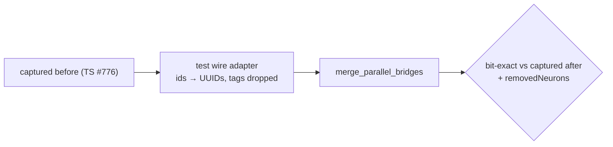

## Summary

Ports NEAT-AI `mergeParallelBridges` (`src/compact/ParallelBridgeMerge.ts` at
`60d6b4e5`) into core as `merge_parallel_bridges`. It merges IDENTITY and
COMPLEMENT parallel bridges and replays every frozen `mergeParallelBridges`
capture from #776 bit-exactly. The change is additive: no caller switches and no
new rule is added. This is the second #777 rule after zero-weight pruning
(#798). COMPLEMENT bypass, constant fold/merge and constant IF collapse are
still to come. The branch also moves the pinned `wasm-bindgen` CLI to 0.2.130,
to match the crate version `bump-deps.sh` locked. Part of #777.

## Spec

### Intent and Rationale

- #777 asks for one small, green PR per independent rule. Parallel bridge merge
  stands on its own: it has no `frozen` guard, and core's `CreatureExport` has
  no `frozen` field. It also has 30 frozen helper captures to check parity
  against.
- The port follows the TypeScript operation by operation, all in `f64` and in
  the same order. That is why the captures compare with `assert_eq!` on `f64`
  rather than within a tolerance.

### Essential Design Decisions

- The function is pure and returns `Result`. Where TypeScript asserts finiteness
  mid-mutation, core returns `ParallelBridgeMergeError::NonFiniteWeight` or
  `NonFiniteBias`, naming the bridge, and leaves the input untouched.
- It is stricter than TypeScript in two places, and both only decline a merge.
  The target check uses core's single aggregate set, `SquashType::is_aggregate`,
  which includes `MEAN`. A MEAN target averages its inputs, so merging two of
  them is not exact. A target squash that core cannot parse is also refused. A
  missing squash is accepted, as in TypeScript. No frozen capture exercises
  either difference.
- Each call merges one group, as TypeScript does. Callers loop to a fixed point.
  Tags are not part of `CreatureExport`, so `mergeTagsByNameValue` stays on the
  TypeScript wire adapter. The tag captures are replayed for topology only.
- Memetic data goes through `prune_memetic`, as in `compact_zero_weight`.
  TypeScript leaves memetic data untouched here.
- The declared `input` width is never walked. A UUID's place in activation order
  is resolved on lookup: a listed neuron first, which shadows an input of the
  same name, then the canonical `input-N` with `N < input`. Positions are an
  `Input(n) < Neuron(k)` enum rather than `input + k`. A width near `usize::MAX`
  therefore neither overflows nor allocates per declared input, which follows
  AGENTS.md "One width check for creature JSON" (#622/#650). `input-01`,
  `input-+0` and `input-N` with `N >= input` name no neuron, the same answer the
  first port's formatted-name map gave.

### Undiscoverable Facts

- #776 closed before this run, so the earlier deferral on it no longer applies.
- Six `bridge_cases` captures name neurons by runtime `id` only. The test
  adapter gives those neurons the label `id-{id}` on both sides and maps
  `fromId`/`toId` to UUIDs. That is wire adaptation done in the test, not
  behaviour.

## Evidence

Backend-only Rust change; no UI files touched.

Captures replayed:

- `compact_legacy_bridges.json`: 4 of 4.
- `compact_legacy_bridge_cases.json`: 23 `mergeParallelBridges` cases. Its 2
  `compactCreature` cases are out of scope for this helper.
- `compact_legacy_tags.json`: 3 `mergeParallelBridges` cases.

## Acceptance Criteria

<!-- vibe-spec-review inputs="diff+issue-body" -->

- **missing** — safe COMPLEMENT bypass — reviewer: missing — reason: only the
  COMPLEMENT→IDENTITY conversion inside a parallel group (`merge_group`) is
  here. The standalone bypass is its own step in `CompactCreature.ts`'s safe
  pass, and the issue asks for one PR per independent rule.
- **missing** — IDENTITY chains — reviewer: missing — reason: the chain captures
  (`identity_chain` in `compact_legacy_tags.json`) are whole-pipeline
  `compactCreature` runs. A native replay needs the composed pass, which needs
  the rules not yet ported.
- **met** — parallel bridges (IDENTITY/COMPLEMENT) — evidence:
  `neat-core/tests/compact_parallel_bridge.rs::legacy_bridge_captures_replay_bit_exactly`,
  `::bridge_case_captures_replay_bit_exactly`,
  `::tag_captures_replay_topology_bit_exactly` — reviewer: met
- **missing** — dead cascades — reviewer: missing — reason: not in this diff.
  #798 hands stranded neurons to `cleanup_creature`, and the cascade captures
  are `compactCreature` runs, which need the composed pass.
- **missing** — transitive constant folding/merge — reviewer: missing — reason:
  not ported. The `ConstantFold.ts`/`ConstantMerge.ts` guards need a `frozen`
  input that core's `CreatureExport` does not carry yet. It is a separate rule
  and a separate PR.
- **missing** — constant IF collapse — reviewer: missing — reason: not ported.
  It depends on the constant-value fixed point from constant fold and has
  `frozen` guards.
- **partial** — preserve guardrails for the ported rule — evidence:
  `::a_mean_target_is_refused_but_an_identity_target_merges`, the typed and
  backward refusal captures, the three overflow tests,
  `compact_parallel_bridge_allocations.rs::a_merge_costs_the_same_whatever_input_width_is_declared`
  — reviewer: partial — reason: no test builds an explicit `forward_only: false`
  recurrent creature, the output is not re-checked with
  `validate_creature_topology`, and tags are stripped before comparison (tag
  merging stays on the TypeScript wire adapter). The rule is a standalone pass
  that calls only `prune_memetic`, not `prune_rewrite`/#688 splicing.
- **met** — run the original tests/fixtures for the rule ported — evidence:
  every `mergeParallelBridges` capture at `60d6b4e5` is replayed with count
  assertions; the `compactCreature` captures are left out, and the docs say so —
  reviewer: met
- **met** — additive only: no callers switched, no arbitrary new simplification
  — evidence: `neat-core/src/lib.rs` exports only — reviewer: met with caveats —
  reason: the MEAN and unparsable-squash refusals only decline merges, and
  `prune_memetic` dropping memetic rows that TypeScript leaves alone is
  documented new behaviour.
- **unrequested** — `wasm-bindgen` CLI pin 0.2.128 → 0.2.130 in
  `.github/workflows/wasm-bundle.yml` and `.oss-scanner/Dockerfile` — reviewer:
  unrequested — reason: the worker's `bump-deps.sh` commit locked the crate at
  0.2.130, and the CLI must match the lock or the required bats gate goes red.
- **unrequested** — `Cargo.lock` dependency bump (`bump-deps.sh` commits) —
  reviewer: unrequested — reason: per-pass worker automation, not issue scope.

## Standards Review

<!-- vibe-standards-review inputs="diff+CODING-STANDARDS.md" -->

- **clean** — the reviewer found no violations. Checked: the capture replays
  compare against frozen TypeScript output, so they share no code path with the
  Rust under test (oracle rule 1). Every hand-written refusal has a positive
  control with derived expected values (rule 3), and every error branch has an
  exact-value test. The declared `input` width is never walked, the allocation
  oracle compares two widths and asserts the merge happened, and the counting
  allocator's `unsafe` blocks carry SAFETY notes. The module docs match the
  code. The `wasm-bindgen` pin matches all four `Cargo.lock` entries and the
  release asset digest. Clippy with `-D warnings` is clean.
- **clean** — advisory, not a violation: two guards in
  `neat-core/src/compact_parallel_bridge.rs` (the self-loop check and the
  target-index lookup) cannot fire. They now carry comments marking them as
  defensive. The error `Display` text is not asserted. The `cases.len()` counts
  in the replay tests count capture records, not a computed result.

## Test Plan

- Added `neat-core/tests/compact_parallel_bridge.rs` (13 tests).
  - Three tests replay the captures
    (`legacy_bridge_captures_replay_bit_exactly`,
    `bridge_case_captures_replay_bit_exactly`,
    `tag_captures_replay_topology_bit_exactly`). They compare neuron order,
    type, UUID, bias and squash, synapse order, endpoints, weight and type, and
    the removed count.
  - Hand-derived tests cover:
    - MEAN and unknown-squash targets are refused, each with an IDENTITY control
      that merges;
    - weight overflow on the kept bridge, weight overflow on a removed
      (redirected) bridge, and bias overflow each name their own bridge, each
      with a finite control;
    - one group is merged per call;
    - memetic rows are pruned while the record stays;
    - only the canonical `input-N` with `N < input` resolves to an input;
    - a listed neuron named `input-0` shadows the implicit input;
    - a declared width of `usize::MAX` still merges.
- Added `neat-core/tests/compact_parallel_bridge_allocations.rs`. A counting
  global allocator checks that a merge at a declared input of 4,000,000 costs no
  more than one at 1,000,000 (4 KiB slack), and that the merge happened.
- Removed `the_input_creature_is_never_mutated`. The function takes
  `&CreatureExport`, which has no interior mutability, so that test could not
  fail.
- Red evidence. Every mutation below was reverted before commit.
  - The allocation test and the `usize::MAX` test both fail against the pre-fix
    module (the `HEAD` copy of `compact_parallel_bridge.rs` at `67a32be`). The
    other tests pass there, because the resolution answers are unchanged.
  - Deleting the canonical-spelling check fails only
    `only_a_canonical_declared_input_name_feeds_a_mergeable_bridge`.
  - Resolving inputs before listed neurons fails only
    `a_listed_neuron_named_like_an_input_is_ordered_as_a_listed_neuron`.
  - Deleting the removed-bridge `is_finite` check fails only
    `an_overflowing_redirect_names_the_removed_bridge_and_a_finite_one_merges`.
- Added a doctest on `merge_parallel_bridges`.
- `neat-core/tests/compact_legacy_bridges.rs` and
  `neat-core/tests/compact_legacy_bridge_cases.rs`: only the `//!` header
  changed, because "not native rewrite" is no longer true. No assertion was
  edited.
- TDD: the first commit wrote the tests and the module in the same step, so no
  separate red run was observed for the capture replays. Their oracle is the
  frozen TypeScript output, not core code. The fix commit's tests were
  red-checked as listed above.
- `cargo test -p neat-core --test compact_parallel_bridge` passed (13 tests),
  and `--test compact_parallel_bridge_allocations` passed (1 test).
- The `compact_legacy_bridges`, `compact_legacy_bridge_cases` and
  `compact_legacy_tags` suites passed.
- `cargo test --doc merge_parallel_bridges` passed.
- `cargo clippy -p neat-core --lib --tests -- -D warnings` passed.
- `bats tests/scripts/wasm_bundle_wasm64_dual_ship.bats` passed, including test
  11, "the pinned wasm-bindgen CLI version already agrees with Cargo.lock".
- `cargo test --workspace` passed (94 test binaries, no failures), and
  `bats tests/scripts` passed (767 tests, none `not ok`).
- `./quality.sh` was not re-run in this pass. The worker re-runs it on the final
  head.

### `wasm-bindgen` pin

The worker's `bump-deps.sh` commits moved the `wasm-bindgen` crates to 0.2.130
and `js-sys`/`web-sys` to 0.3.107. An earlier commit on this branch (f9c24c4)
moved them back with `cargo update --precise`, but the next `bump-deps.sh`
commit (b6804b5) re-bumped them. That left the workflow's CLI pin at 0.2.128 and
bats test 11 red.

The head now keeps the lock at 0.2.130 and moves the CLI pin to match.
`WASM_BINDGEN_VERSION` and `WASM_BINDGEN_SHA256` change together in
`.github/workflows/wasm-bundle.yml` and in `.oss-scanner/Dockerfile`, which
mirrors that pin. The hash is the GitHub release asset digest for
`wasm-bindgen-0.2.130-x86_64-unknown-linux-musl.tar.gz` (`9687f3bb…227f`), read
with `gh api`. The same call returns the committed 0.2.128 hash for the 0.2.128
asset, which cross-checks the source. Direct asset downloads returned 403 here,
so the CLI binary itself was not installed or run. `wasm-bundle.yml` re-checks
the hash with `sha256sum -c` when it installs the CLI.

Not checked:

- the `downstream-consumers` compile gate, which runs in CI (the change is
  purely additive);
- `wasm32` (the module has no `cfg(wasm)` code);
- the `wasm-bundle.yml` run with the new CLI pin, which runs only on push to
  `Develop`.
