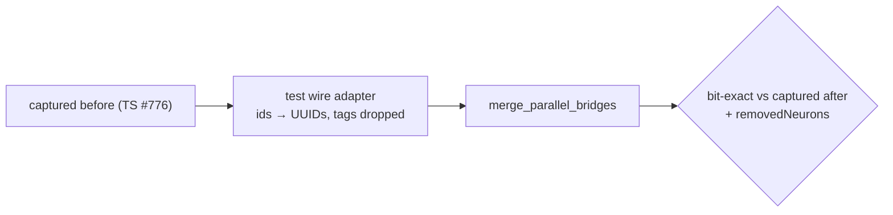

## Summary

Ports NEAT-AI `mergeParallelBridges` (`src/compact/ParallelBridgeMerge.ts` at
`60d6b4e5`) into core as `merge_parallel_bridges`. It merges IDENTITY and
COMPLEMENT parallel bridges and replays every frozen `mergeParallelBridges`
capture from #776 bit-exactly. The change is additive: no caller switches and no
new rule is added. This is the second #777 rule after zero-weight pruning
(#798). COMPLEMENT bypass, constant fold/merge and constant IF collapse are
still to come. Part of #777.

## Spec

### Intent and Rationale

- #777 asks for one small, green PR per independent rule. Parallel bridge merge
  stands on its own: it has no `frozen` guard, and core's `CreatureExport` has
  no `frozen` field. It also has 30 frozen helper captures to check parity
  against.
- The port follows the TypeScript operation by operation, all in `f64` and in
  the same order. That is why the captures compare with `assert_eq!` on `f64`
  rather than within a tolerance.

### Essential Design Decisions

- The function is pure and returns `Result`. Where TypeScript asserts finiteness
  mid-mutation, core returns `ParallelBridgeMergeError::NonFiniteWeight` or
  `NonFiniteBias`, naming the bridge, and leaves the input untouched.
- It is stricter than TypeScript in two places, and both only decline a merge.
  The target check uses core's single aggregate set, `SquashType::is_aggregate`,
  which includes `MEAN`. A MEAN target averages its inputs, so merging two of
  them is not exact. A target squash that core cannot parse is also refused. A
  missing squash is accepted, as in TypeScript. No frozen capture exercises
  either difference.
- Each call merges one group, as TypeScript does. Callers loop to a fixed point.
  Tags are not part of `CreatureExport`, so `mergeTagsByNameValue` stays on the
  TypeScript wire adapter. The tag captures are replayed for topology only.
- Memetic data goes through `prune_memetic`, as in `compact_zero_weight`.
  TypeScript leaves memetic data untouched here.

### Undiscoverable Facts

- #776 closed before this run, so the earlier deferral on it no longer applies.
- Six `bridge_cases` captures name neurons by runtime `id` only. The test
  adapter gives those neurons the label `id-{id}` on both sides and maps
  `fromId`/`toId` to UUIDs. That is wire adaptation done in the test, not
  behaviour.

## Evidence

Backend-only Rust change; no UI files touched.

Captures replayed:

- `compact_legacy_bridges.json`: 4 of 4.
- `compact_legacy_bridge_cases.json`: 23 `mergeParallelBridges` cases. Its 2
  `compactCreature` cases are out of scope for this helper.
- `compact_legacy_tags.json`: 3 `mergeParallelBridges` cases.

## Acceptance Criteria

- **missing** — safe COMPLEMENT bypass — reason: not ported in this PR. The
  TypeScript rule lives in `CompactCreature.ts`'s safe pass, as its own step.
- **missing** — IDENTITY chains — reason: core's #688 identity splicing was not
  re-verified against the frozen chain captures in this PR. Only the IDENTITY
  parallel-bridge half has landed here.
- **missing** — dead cascades — reason: #798 hands stranded neurons to
  `cleanup_creature`. No native replay of the dead-subgraph captures was added
  here.
- **missing** — transitive constant folding/merge — reason: not ported. The
  `ConstantFold.ts`/`ConstantMerge.ts` guards need a `frozen` input that core's
  `CreatureExport` does not carry yet.
- **missing** — constant IF collapse — reason: not ported. It depends on the
  constant-value fixed point from constant fold, and it has `frozen` guards.

## Test Plan

- Added `neat-core/tests/compact_parallel_bridge.rs` (10 tests).
  - Three tests replay the captures
    (`legacy_bridge_captures_replay_bit_exactly`,
    `bridge_case_captures_replay_bit_exactly`,
    `tag_captures_replay_topology_bit_exactly`). They compare neuron order,
    type, UUID, bias and squash, synapse order, endpoints, weight and type, and
    the removed count.
  - Hand-derived tests cover:
    - MEAN and unknown-squash targets are refused, each with an IDENTITY control
      that merges;
    - weight and bias overflow errors name the bridge;
    - one group is merged per call;
    - memetic rows are pruned while the record stays;
    - the input is never mutated.
- Added a doctest on `merge_parallel_bridges`.
- `neat-core/tests/compact_legacy_bridges.rs` and
  `neat-core/tests/compact_legacy_bridge_cases.rs`: only the `//!` header
  changed, because "not native rewrite" is no longer true. No assertion was
  edited.
- TDD: the tests and the module were written in the same step, so no separate
  red run was observed. The capture oracle is the frozen TypeScript output, not
  core code.
- `cargo test -p neat-core --test compact_parallel_bridge` passed (10 tests).
- The `compact_legacy_bridges`, `compact_legacy_bridge_cases` and
  `compact_legacy_tags` suites passed.
- `cargo test --doc merge_parallel_bridges` passed.
- `cargo clippy -p neat-core --lib --tests -- -D warnings` passed.
- `./quality.sh` passed on the final head, including the `bump-deps.sh` commit
  and the `wasm-bindgen` repin described below. The only commit after that run
  is this summary.

The branch also carries the worker's `bump-deps.sh` commit. It moved the
`wasm-bindgen` crates to 0.2.130 and `js-sys`/`web-sys` to 0.3.107 in the root
`Cargo.lock`. `.github/workflows/wasm-bundle.yml` still pins the wasm-bindgen
CLI at 0.2.128, so the bats test "the pinned wasm-bindgen CLI version already
agrees with Cargo.lock" in `tests/scripts/wasm_bundle_wasm64_dual_ship.bats`
went red. A follow-up commit moves only those six packages back to their
pre-bump versions with `cargo update --precise`. Every other bumped crate stays
bumped. Moving the CLI pin to 0.2.130 instead would mean pinning a new release
binary hash, which this compaction PR leaves to the scheduled dependency
upgrade.

Not checked:

- the `downstream-consumers` compile gate, which runs in CI (the change is
  purely additive);
- `wasm32` (the module has no `cfg(wasm)` code).
