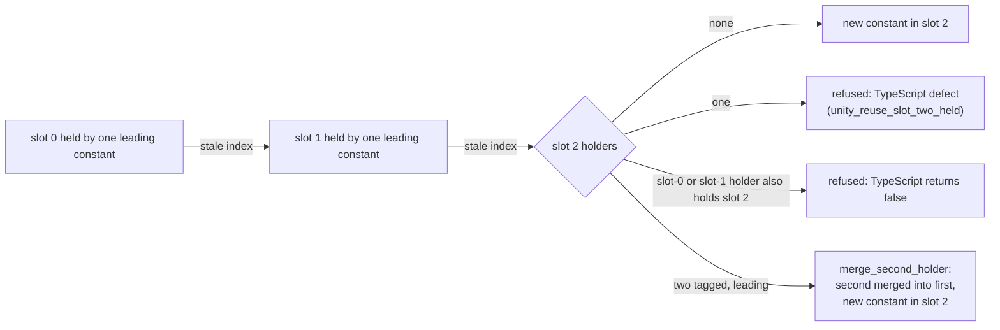

# PR summary — Issue #778

## Summary

This PR ports the last held-unity-slot shape of `compactUnused`'s `removeNeuron`
that PR #808 left unported: two tagged leading constants holding slot 2. In
TypeScript, `createConstantOne(creature, 2)` runs the same dedupe merge it runs
for slots 0 and 1. It moves the second slot-2 holder's outward synapses onto the
first, removes the second holder, and keeps the temporary constant in slot 2.
`removeNeuron` then succeeds. Until now `neat-core::remove_neuron` refused this
shape with `UnitySlotReuseNotPorted`, because no frozen capture backed it.

- `scripts/legacy_compaction_unity.ts` gains the
  `unity_reuse_second_slot_two_holder` case. It was captured from a clean
  NEAT-AI clone at `60d6b4e5d3af20afbaaeb3420d588ad673ab8dab`, the frozen
  revision.
- `remove_neuron` (`neat-core/src/compact_unity_constant.rs`) now takes the
  slot-2 merge through the same `merge_second_holder` path that slots 0 and 1
  use. A single slot-2 holder is still refused, because that is the TypeScript
  defect `unity_reuse_slot_two_held` captures.
- Before that merge, `remove_neuron` refuses one constant that holds slot 2 and
  also slot 1 or slot 0, for example slot 1 by legacy id -1001 (or slot 0 by
  legacy id -1000) and slot 2 by tag, with a second tagged slot-2 holder. In the
  frozen TypeScript, `createConstantOne` for the earlier slot overwrites that
  constant's slot-2 tag (`addTag` replaces the value) or `createConstantOne` for
  slot 2 overwrites its slot-1 tag, and `removeNeuron` returns `false` for that
  shape. Before this PR it was refused because slot 2 was held at all, so
  without this check the port would report a success TypeScript never produces.
  The check mirrors the existing one for one constant holding slots 0 and 1.

PR #808 named this merge as the one open gap. With it ported, everything the
issue asks for has landed. No caller is switched. The only shape that changes
result is the two-holder slot-2 merge, which now matches the capture; every
other shape keeps its previous result.

Closes #778.

## Spec

### Intent and Rationale

- PR #808's summary marked "port only existing compaction rules" `partial`. The
  one shape it named as unported was the two-holder slot-2 merge, because the
  NEAT-AI checkout needed to capture it was not available in that run. This run
  cloned NEAT-AI at the frozen revision. The unchanged capture script reproduced
  `compact_legacy_unity.json` byte for byte, so the new record was captured from
  the original TypeScript, not derived by hand.

### Essential Design Decisions

- The slot-2 merge reuses `merge_second_holder`, which already owns the slot-0
  and slot-1 merges. It therefore keeps the same refusals. The port refuses a
  merge that would duplicate a synapse, remove a holder that has an inward
  synapse, or run while the removed neuron leads the list.
- The remaining `UnitySlotReuseNotPorted` refusals each cover a TypeScript
  defect, or a shape `compactUnused` never hands `removeNeuron`. Examples are a
  holder that does not lead the list, and a removed neuron that is a constant.
  The module docs list each refusal. No refused shape has a sound TypeScript
  outcome, so the port fails loud on it instead of emulating it.
- The port still mints one UUID. For a slot-2 merge, TypeScript mints two plus
  one per outward synapse: three in the capture, which has one outward synapse.

### Undiscoverable Facts

- The new record's `result` is `true`. Its `after` shows `k2b` gone, with its
  synapse into `hidden-1` now coming from `k2`. `k0`, `k1` and `k2` have bias 1.
  A new constant tagged `"2"` feeds the IF condition at 3 × 1.5 = 4.5.
- The first 13 records of the regenerated golden file are identical to the
  committed ones, both as parsed JSON and as text. The run left no `deno.lock`
  change.

## Evidence

Backend only. The evidence is the tests below.

## Test Plan

- `neat-core/tests/golden/compact_legacy_unity.json` grows from 13 to 14 records
  with `unity_reuse_second_slot_two_holder`. The first 13 are unchanged.
- `neat-core/tests/compact_unity_constant.rs` (52 tests, all passing):
  - Added
    `a_second_tagged_slot_two_holder_is_merged_into_the_first_as_captured`. It
    replays the capture through `replay_merge_capture`, which compares the whole
    result with the captured `after`. It also asserts these literals:
    - the neuron order `k0, k1, k2, unity-constant-2, hidden-1, output-0`;
    - bias 1 on the three holders;
    - `k2 → hidden-1` at 0.125, and the survivor's condition weight of 4.5;
    - slot 2, and the captured `minted` of 3.
  - Edited `two_tagged_slot_two_holders_are_refused_as_an_unported_merge`, which
    asserted the refusal this change removes. That refusal is obsolete, because
    the frozen TypeScript merges the shape. The test is now
    `two_tagged_slot_two_holders_are_merged_as_captured`, with `k2b`'s edge in
    the `negative` role. It asserts:
    - one mint, and slot 2;
    - `k2b` removed, and its edge re-sourced onto `k2`;
    - bias 1 on `k0`, `k1` and `k2`.
  - The old fixture, where `k2` and `k2b` both feed `output-0` in the standard
    role, moved to the new test
    `a_second_slot_two_holder_with_a_duplicate_synapse_is_refused_and_named`. It
    asserts `UnitySlotReuseNotPorted { constant: "k2b" }` and no mint, and the
    merge test above is its accepted control.
  - Added
    `one_constant_holding_slot_one_by_id_and_slot_two_by_tag_is_refused_before_a_slot_two_merge`.
    Its fixture is `k0` (tag 0), `k1` (legacy id -1001, tag 2), `k2` (tag 2),
    `hidden-0`, `hidden-1` and an IF `output-0`, and it removes `hidden-0`. It
    asserts `UnitySlotReuseNotPorted { constant: "k1" }` and no mint. Red run:
    against commit `d819829`, before the check, it failed with `Ok(Some(..))`, a
    slot-2 merge of `k2` into `k1`. With the check it passes.
  - Added
    `one_constant_holding_slot_zero_by_id_and_slot_two_by_tag_is_refused_before_a_slot_two_merge`.
    Its fixture is `k0` (legacy id -1000, tag 2), `k1` (tag 1), `k2` (tag 2,
    `negative` edge into `output-0`), `hidden-0`, `hidden-1` and an IF
    `output-0`, and it removes `hidden-0`. It asserts
    `UnitySlotReuseNotPorted { constant: "k0" }` and no mint. Red run: before
    the check it failed with `Ok(Some(..))`, a slot-2 merge of `k2` into `k0`
    that deleted `k2`. With the check it passes.
  - `a_held_slot_two_is_refused_and_the_capture_shows_why`, the single-holder
    refusal, is unchanged and passes.
  - Red run: the three new or renamed tests were written first and run against
    the unchanged source. All three failed with
    `UnitySlotReuseNotPorted { constant: "k2" }`. After the port they pass.
- `cargo test -p neat-core --test compact_deadline_boundary --test compact_legacy_unused`
  passed, with 2 and 3 tests. `cargo test -p neat-core --doc compact_unity`
  passed. `cargo fmt --all -- --check` and
  `cargo clippy -p neat-core --all-targets -- -D warnings` are clean, and
  `markdownlint-cli2` reports 0 issues on
  `docs/research/compaction-unity-constant-baseline.md`.
- `./quality.sh < /dev/null` exited 0 on commit `627ed5c`. The slot-1-and-2
  and slot-0-and-2 refusals and their tests came after that commit. For them,
  `cargo test -p neat-core --test compact_unity_constant` (52 passed),
  `cargo test -p neat-core --doc compact_unity` and
  `cargo clippy -p neat-core --all-targets -- -D warnings` were run and are
  clean. The worker re-runs the quality gate on the final head.
- Docs: the module docs, the `merge_second_holder` doc, the
  `UnitySlotReuseNotPorted` doc and
  `docs/research/compaction-unity-constant-baseline.md` no longer describe the
  merge as unported. They also list the slot-1-and-2 and slot-0-and-2
  refusals. The research doc now gives 14 cases and has a row for the new case.
- Not run:
  - `cargo check --target wasm32-unknown-unknown`. The change has no `cfg` and
    is target-independent.
  - `scripts/check-downstream-consumers.sh`. No signature changes:
    `remove_neuron` now accepts one shape it used to refuse, the two-holder
    slot-2 merge, and its error enum is unchanged.
