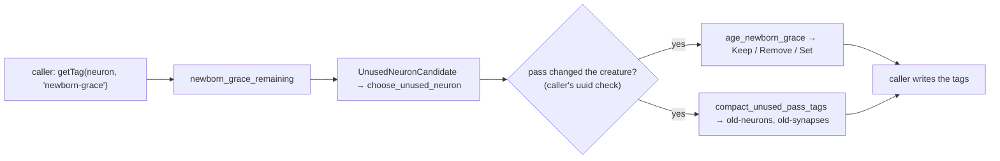

# PR summary — Issue #778

## Summary

This PR ports `compactUnused`'s tag rules to `neat-core`. PR #804 had left them
TypeScript-only. The new module is `neat-core/src/compact_unused_tags.rs`:

- `newborn_grace_remaining` is `newbornGraceRemaining`. It reads a
  `newborn-grace` tag value the way JavaScript's `Number.parseInt(raw, 10)`
  does.
- `age_newborn_grace` is `ageNewbornGrace` for one neuron. It returns
  `NewbornGraceAgeing::Keep`, `Remove` or `Set(value)`.
- `compact_unused_pass_tags` gives the `old-neurons` and `old-synapses` counts.
  `compactCreature` writes the same `old-neurons` count.

It also widens `remove_neuron` to every held unity-slot reuse whose TypeScript
outcome is sound. That covers slot 1 held (the survivor takes slot 2), and a
second tagged holder of slot 0 or slot 1, which TypeScript's dedupe loop merges
into the first. Six new frozen `removeNeuron` captures back this change. Four
show the outcomes that are now ported. Two show why a shape stays refused: the
defect with slot 2 held, and the loader order that never hands over a trailing
holder. The remaining refusals are TypeScript defects, shapes its loader never
produces, and one shape left unported: two tagged leading slot-2 holders, where
TypeScript's dedupe loop would merge them and `removeNeuron` would succeed. That
merge has no frozen capture, so the port refuses it and the docs say so. New tests also pin what core owes the caller-side compaction deadline.

The change is additive and no caller is switched.

Closes #778.

## Spec

### Intent and Rationale

- PR #804's summary listed "tag/memetic semantics" as missing, because
  `NeuronExport` carries no tags. The rules are pure functions of a tag value or
  of the creature before the pass, so they can be ported without giving the
  export a tags field.
- The frozen `compactUnused` captures (`compact_legacy_unused.json`) record each
  neuron's tags before and after the pass, and the `compactCreature` capture
  (`compact_legacy_behaviour.json`) records `old-neurons`. The native rules are
  therefore checked against original TypeScript output, not only against
  hand-derived tables.

### Essential Design Decisions

- The caller reads and writes the tags. These functions only compute the values.
  Adding a `tags` field to `NeuronExport` or `CreatureExport` would break every
  consumer that builds them as struct literals, so it is a three-phase
  public-API change (`RELEASING.md`), not an additive one.
- The `parseInt` emulation follows JavaScript in these respects:
  - it skips JS whitespace only, so it skips the BOM (U+FEFF) but not NEL
    (U+0085);
  - it takes one optional sign, then the longest run of ASCII digits;
  - a value that is infinite as an `f64` reads as `0`, because `Number.isFinite`
    rejects `Infinity`.

  One deviation is deliberate: a grace count above `u32::MAX` saturates there,
  marked `SIMPLE-ON-PURPOSE`, because `UnusedNeuronCandidate` holds a `u32`.
- `age_newborn_grace(Some(""))` is `Keep`. TypeScript's `getTag` returns `""`,
  which is falsy, so `ageNewbornGrace` leaves an empty tag in place.
- `old_neurons` is an `i128` computed as `neurons.len() - output`. The export
  lists no inputs, so this equals TypeScript's runtime
  `neurons.length - input - output`. The value is exact, and it is negative for
  a malformed creature, as in TypeScript.

- How a held unity slot is reused. TypeScript's `createConstantOne(creature, n)`
  inserts a temporary constant after the leading constants. Its dedupe loop then
  meets the tagged constants for slot `n` in list order. Two outcomes follow:
  - When a second tagged holder leads, the loop moves that holder's outward
    synapses onto the first holder, removes it, re-sorts the synapses and stops.
    The temporary constant survives in slot `n`.
  - Otherwise it removes the temporary constant again and returns it with a
    stale index. When that index names the removed neuron, `removeNeuron` asks
    for the next slot.

  The port follows both outcomes for slots 0 and 1. The survivor therefore takes
  slot 0, 1 or 2, and every holder TypeScript resolves has its bias set to 1. It
  refuses, before any change:
  - the stale-index defect;
  - a held slot 2 with one holder, where TypeScript returns `false` after
    mutating biases;
  - two tagged leading slot-2 holders. TypeScript would merge them as it does
    for slots 0 and 1 and `removeNeuron` would succeed, so this is **not** a
    TypeScript defect. It is left unported because no capture backs it, and the
    NEAT-AI checkout needed to make one was not available in this run;
  - a removed constant that leads the list while a merge applies. It may be one
    of the holders, and the merge would then return a creature no capture backs
    (for example two duplicate synapses from the survivor);
  - a merge that would duplicate a synapse, or would remove a holder that has an
    inward synapse;
  - one constant holding both slots;
  - a lone holder that does not lead. TypeScript's loader never hands
    `removeNeuron` that order.
- The reuse is not exact even with a perfect activation. Resetting a holder's
  bias to 1, and merging a second holder into the first, change what the
  holders' other targets receive. The module docs now say so. It is TypeScript's
  behaviour, ported as it is.
- Deadlines stay with the caller. The tests pin what the caller's
  `skipCompaction` relies on: re-running a stage after an abandoned attempt is
  bit-identical, and the caller's single grace round equals the round a
  compacting pass writes.

### Undiscoverable Facts

- I read the originals from a NEAT-AI checkout at `60d6b4e5`, the capture
  revision. They are `src/architecture/NewbornGrace.ts`, the post-pass tag
  writes in `src/compact/CompactUnused.ts` and `src/compact/CompactCreature.ts`,
  and `getTag`/`addTag`/`removeTag` from `jsr:@stsoftware/tags@1.0.41`.
- `src/compact` has no deadline. The only one is `skipCompaction` in
  `src/architecture/training/TrainingTeardown.ts`, which is asked before and
  after `compactUnused` runs. Both the skipped and the completed teardown age
  the trained creature exactly once, so a deadline decides only whether a
  compacted copy exists.
- `Creature.fromJSON` moves constants to the front. The new
  `unity_reuse_holder_behind` capture lists its holder behind the removed
  neuron, and TypeScript still runs the leading-holder reuse.
- With slot 2 held by one constant, `removeNeuron` returns `false`, but `compactUnused` still
  returns the creature with every holder's bias set to 1
  (`unity_reuse_slot_two_held`).
- The new captures came from `scripts/legacy_compaction_unity.ts`, run against a
  clean NEAT-AI clone at `60d6b4e5`. The 7 existing records came out
  byte-identical.

## Evidence

Backend only. The evidence is the tests below.

## Acceptance Criteria

<!-- vibe-spec-review inputs="diff+issue-body" -->

These are the two criteria the PR-summary gate listed as unmet. An independent
spec-review sub-agent judged each one against the issue body and the working
tree diff. The first review gave both `partial`. Its findings were fixed: a
vacuous deadline test was deleted, a wrong claim about the teardown was
corrected, and three sound merge shapes that had been refused were ported. The
re-review gave the verdicts below. A later review found one more sound shape that
is still refused, the slot-2 merge. This summary now names it as unported, and
the second criterion is scoped to what is ported.

- **met** — "Add tests for ... deadlines" — evidence:
  `neat-core/tests/compact_deadline_boundary.rs::the_callers_grace_round_matches_the_round_a_compacting_pass_writes`,
  `neat-core/tests/compact_deadline_boundary.rs::rerunning_a_stage_after_an_abandoned_attempt_is_bit_identical`
  — reviewer: met
- **met, for the shapes listed** — "port only existing compaction rules" (the
  held-slot reuse shapes ported with a capture: slot 1 held, and a second tagged
  holder of slot 0 or slot 1). The two-holder slot-2 merge is **not ported** and
  is not claimed. — evidence:
  `neat-core/tests/compact_unity_constant.rs::the_frozen_slot_one_held_capture_replays_exactly`,
  `::a_second_tagged_slot_zero_holder_is_merged_into_the_first_as_captured`,
  `::a_third_slot_zero_holder_is_left_as_it_is_as_captured`,
  `::a_second_tagged_slot_one_holder_is_merged_into_the_first_as_captured`,
  `::a_holder_behind_the_removed_neuron_is_never_handed_over_by_typescripts_loader`,
  `::a_held_slot_two_is_refused_and_the_capture_shows_why` (the single-holder
  slot-2 refusal), `::two_tagged_slot_two_holders_are_refused_as_an_unported_merge`
  (the unported shape stays refused and mints nothing) — reviewer: met for the
  first review's shapes; the unported slot-2 merge came after it

## Test Plan

- `neat-core/tests/golden/compact_legacy_unity.json` grows from 7 to 13 frozen
  `removeNeuron` captures. They were made with
  `scripts/legacy_compaction_unity.ts` against a clean NEAT-AI clone at
  `60d6b4e5`, and the first 7 records are unchanged. The new cases are
  `unity_reuse_slot_one_held`, `unity_reuse_slot_two_held`,
  `unity_reuse_holder_behind`, `unity_reuse_second_slot_zero_holder`,
  `unity_reuse_third_slot_zero_holder` and `unity_reuse_second_slot_one_holder`.
- `neat-core/tests/compact_unity_constant.rs` has 48 tests, all passing:
  - The four merge and slot-2 captures replay bit for bit. Each replay checks
    neuron order, biases, synapse order, weights, roles, the reported slot and a
    single mint.
  - Derived cases cover the legacy ids `-1001` and `-1002`:
    - a holder matched by legacy id alone is left as it is;
    - a tagged holder behind the insertion point is not merged;
    - a merged survivor lands right after the remaining leading constants.
  - Each refusal is named and has an accepted control: slot 2 held, a slot-1
    holder that does not lead, one constant holding both slots, a duplicate
    synapse in a merge, an inward synapse on the second holder, two tagged
    slot-2 holders (the unported merge), and removing either of two slot-0
    holders.
  - The two old `a_slot_one_*_blocks_the_slot_zero_reuse` tests asserted the
    refusal this change replaces, so they became the slot-2 tests.
  - Red run: against the previous `compact_unity_constant.rs`, 6 of the new
    tests failed. Before the removed-constant guard,
    `removing_either_of_two_slot_zero_holders_is_refused_and_mints_nothing` failed:
    removing `k0` returned a merged creature with duplicate synapses from the
    survivor. The slot-2 two-holder test passes before and after, because it
    pins a refusal that already held.
  - Mutations, each reverted afterwards, with at least one test going red for
    each:
    - dropping a holder's bias reset;
    - reporting slot 1 for slot 2;
    - dropping the slot-2 refusal;
    - dropping the slot-1 leads check or the both-slots check;
    - dropping the slot-1 merge;
    - dropping the merge's re-source, re-sort, bias reset, tag requirement,
      leads requirement, inward check or duplicate check;
    - dropping the insertion-point recompute.
  - One mutation survived and its check was removed: a separate "first holder
    leads" check that is implied by the second holder leading.
- `neat-core/tests/compact_deadline_boundary.rs` is new, with 2 tests:
  - The caller's single `age_newborn_grace` round gives every shared neuron the
    tag the frozen pass wrote. It requires Keep, Remove and Set to each occur,
    and it shows that ageing twice would differ.
  - Re-running `remove_neuron`, over all 13 compacting captures, and
    `aggressive_prune`, after an abandoned attempt and an unrelated call, is
    bit-identical. The prune counts are derived by hand.
  - Making `age_newborn_grace` stop decrementing turned the grace test red.
  - An earlier draft had a vacuous stage-boundary test and a wrong claim that
    the skipped and completed teardown paths age grace differently. Both were
    removed after review.
- `cargo test --workspace < /dev/null`: 0 failures. Also clean:
  `cargo clippy -p neat-core --all-targets -- -D warnings`,
  `cargo fmt --all --check`, `deno fmt --check`, and `markdownlint-cli2` on the
  research doc.

- `neat-core/tests/compact_unused_tags.rs` is new, with 6 tests. Every expected
  value is a literal:
  - `newborn_grace_remaining_reads_the_tag_like_parse_int` covers 24 inputs:
    - none, empty, signs, `--1` and `+-1`;
    - JS whitespace (BOM, NBSP, tab and newline) and the non-JS NEL;
    - `3abc`, `1.9`, `1e3`, `0x10` and `007`;
    - `u32::MAX` and its saturation;
    - 400 nines, which is `Infinity` in JavaScript.
  - `age_newborn_grace_decides_what_happens_to_the_tag` covers `Keep`, `Remove`
    and `Set` for 10 inputs, including `""` and `"02"`.
  - Three `pass_tags_*` tests check the count with a constant neuron and with a
    changed declared input count.
- `neat-core/tests/compact_legacy_unused.rs` gains
  `frozen_newborn_grace_tags_read_and_age_like_the_original`, which checks all
  14 captures:
  - the native read of each traced neuron's tag equals the captured
    `graceRemaining`;
  - each surviving neuron's tag after the pass equals the native ageing of its
    tag before.

  It asserts at least one `Keep`, `Remove` and `Set`. It also asserts that
  `newborn_grace_2` ages `2` to `1` and that `newborn_grace_1` removes `1`.
- `neat-core/tests/compact_legacy_behaviour.rs` gains
  `the_recorded_old_neurons_tag_matches_the_native_count`. For both
  `compactCreature` records with a candidate, it checks that the native count
  equals the captured `old-neurons` tag (`2`), and it asserts that two records
  were checked. The `//!` header now names this one native check. The existing
  test in that file is unchanged.
- Red run: before the module existed, both new test files failed to compile with
  E0432 (unresolved imports). After the port they pass.
- `cargo test -p neat-core --test compact_unused_tags --test compact_legacy_unused --test compact_unused_choice --test compact_legacy_behaviour`
  passed. The module doctests also pass
  (`cargo test -p neat-core --doc compact_unused`). `cargo fmt --all -- --check`
  and `cargo clippy -p neat-core --all-targets -- -D warnings` are clean.
- `./quality.sh < /dev/null` exited 0 on the working tree that includes the
  review fixes (the removed-constant guard, the two new tests and the docs).
- Docs: in `neat-core/src/compact_unused_choice.rs` I reworded the "caller keeps
  these parts" list and the `newborn_grace_remaining` field doc so they name the
  new helpers.
- Not run:
  - `cargo check --target wasm32-unknown-unknown`: the target is not installed
    in this environment (E0463, no `std`). The new code is target-independent
    and has no `cfg`.
  - `scripts/check-downstream-consumers.sh`: no signature changes, and the only
    public items are additions. `remove_neuron` now accepts shapes it used to
    refuse with `UnitySlotReuseNotPorted`. Its signature and error enum are
    unchanged. The only `remove_neuron` among the sibling checkouts here is
    NEAT-AI-Rebase's own local function in `rebase/src/ockham.rs`, not core's.
