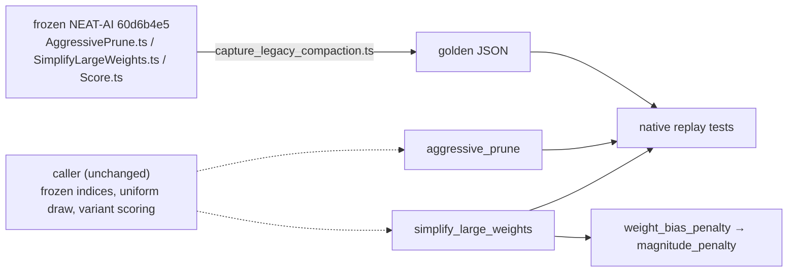

## Summary

This ports two of the existing speculative compaction rules into `neat-core`,
together with the shared primitive one of them needs and the tag-free part of
a third. Nothing calls them yet: no caller is switched and no existing public
struct changes.

- `aggressive_prune` (`neat-core/src/compact_aggressive_prune.rs`) ports
  TypeScript `aggressivePrune`, the dataset-free low-weight prune.
- `simplify_large_weights` and `weight_bias_penalty`
  (`neat-core/src/compact_simplify_large_weights.rs`) port
  `simplifyLargeWeights`, the rescaling of homogeneous squashes, including its
  MCMC acceptance.
- `magnitude_penalty` and `mean_magnitude_penalty`
  (`neat-core/src/magnitude_penalty.rs`) port the per-value penalty from
  `Score.ts` that `simplifyLargeWeights` accepts against.
- `remove_neuron_by_bias_fold` (`neat-core/src/compact_remove_neuron.rs`)
  ports the bias-fold branch of `compactUnused`'s `removeNeuron`, along with
  the `removeHiddenNeuron` orphan cascade it ends with.

A new `simplify` capture mode freezes the TypeScript results so the native tests
can replay them bit for bit. Two parts of `compactUnused` are not ported, so
this is Part of #778:

- its neuron selection, which reads trace statistics and the newborn-grace
  tag and stays with the caller;
- its constant-neuron branch, which is keyed on the `compact-unity-slot`
  neuron tag that core's structs cannot carry.

The branch also carries the routine `bump-deps.sh` lock refresh. The
`wasm-bindgen` family (`wasm-bindgen`, its macro and shared crates, `js-sys`,
`web-sys`) is held at 0.2.128 / 0.3.105, the version `wasm-bundle.yml` pins
for the CLI.

## Spec

### Intent and Rationale

- #776 froze the TypeScript behaviour, and #778 asks for the existing rules to
  be ported against it. Each rule is ported literally: same guards, same
  constants (`1e-3`, the `1000` imbalance ratio, the `1e-15` margin), same order
  of operations.
- The `simplifyLargeWeights` captures did not exist yet.
  `scripts/legacy_compaction_simplify.ts` generates them from the frozen
  checkout in the same way as the other capture modes, so the expected values
  come from TypeScript and not from the Rust under test.

### Essential Design Decisions

- **Frozen synapses are passed by index.** `aggressive_prune` takes a
  `frozen_synapses: &[usize]` argument. `SynapseExport` has no `frozen` field,
  and adding one is a public-struct change that the three-phase rule
  (`RELEASING.md`) puts out of scope for an additive PR. An out-of-range index
  is refused with `FrozenIndexOutOfRange`.
- **Randomness and acceptance stay with the caller.**
  - `simplify_large_weights` takes `Option<McmcAcceptance>`, and the caller
    supplies the uniform draw that TypeScript took from `Math.random`.
  - Neither pass scores anything. Keeping the aggressive candidate is still the
    caller's `selectCompactVariant` policy.
  - The magnitude penalty is the existing heuristic gate inside
    `simplifyLargeWeights`, not the authoritative score.
- **Exactness follows the actual semantics.**
  - `aggressive_prune` is approximate: it removes non-zero weights, including
    into aggregates.
  - `simplify_large_weights` is exact in real arithmetic for positively
    homogeneous squashes, but only rounding-equal in floating point. With MCMC
    it can accept a worse penalty.
- **Memetic handling and stricter refusals.**
  - Memetic handling follows what each rule does. `aggressive_prune` only
    removes edges, so it uses `prune_memetic`, the crate's convention from
    `compact_zero_weight` (TypeScript deletes the whole record).
  - `simplify_large_weights` rewrites weights, so it clears the record
    (`memetic = None`), as TypeScript does.
  - A `NaN` aggressive threshold is refused with `NanThreshold`. In TypeScript a
    NaN threshold would prune every finite unpinned edge. This is the one
    stricter departure.

- **`removeNeuron` is ported only where it needs no tags.**
  - `remove_neuron_by_bias_fold` keeps the TypeScript guards. It computes
    every folded bias before applying any, and when one is non-finite it
    returns `Ok(None)` (TypeScript's `false`) with nothing changed. A target
    left with fewer than two inbound synapses gets a zero-weight edge from
    input `floor(u * input)`. The edge is placed where TypeScript's
    `(from, to)` index order puts it. On removal the memetic record is
    cleared.
  - The uniform draw `u` comes from the caller, as in `simplify_large_weights`.
    A draw outside `[0, 1)` names no input and is refused, as is an outward
    synapse into a target that is not listed (`DanglingTarget`, where
    TypeScript would throw).
  - TypeScript sends a target with its own `propagate` (`IF`, `MINIMUM`,
    `MAXIMUM`) down the constant branch. That branch reuses a constant neuron
    keyed on the `compact-unity-slot` neuron tag, and `NeuronExport` has no
    tags. Adding a field breaks the scorer's struct literals and needs the
    three-phase flow in `RELEASING.md`. That target is therefore refused with
    `ConstantBranchNotPorted`, not approximated.
  - Choosing the neuron stays with the caller: the trace statistics, the
    shuffle and the newborn-grace skip (also a neuron tag).

### Undiscoverable Facts

- `aggressivePrune` pins any `type !== undefined`, so an empty-string role is
  pinned. The zero-weight pass treats `""` as untyped. Both ports keep their own
  TypeScript reading.
- `Math.max` propagates NaN where Rust's `f64::max` ignores it.
  `simplify_large_weights` uses a `js_max` helper so a NaN bias or inbound
  weight skips the neuron, as it does in TypeScript (`nan_bias`,
  `nan_inbound_first` captures).
- `magnitude_penalty` restates NEAT-AI-scorer
  `rust_scorer/src/scoring.rs::magnitude_penalty`. Core cannot call the scorer,
  because the scorer depends on core. The two copies must stay identical until
  the scorer moves to this one; this PR does not switch it. Both are pinned to
  NEAT-AI's `magnitude-penalty-corpus.json`, which is captured into the golden
  file.
- `CompiledNetwork::activate` runs in `f32`, so the behaviour-preservation test
  compares within `1e-6` relative.

## Evidence

This is a backend library change with no UI, so there are no screenshots. The
evidence is the tests below.

- `neat-core/tests/compact_aggressive_prune.rs`:
  - `frozen_captures_replay_with_the_same_survivors` replays the three raw
    `aggressivePrune` captures in
    `neat-core/tests/golden/compact_legacy_variants.json`: `aggressive_maximum`,
    `aggressive_frozen` and `aggressive_last_input`.
  - The other 15 tests cover typed IF roles, empty-string roles, IF targets,
    aggregate targets (MINIMUM/HYPOT), the threshold boundary, negative weights,
    NaN and infinite weights, the last inbound edge of an output, frozen
    indices, the NaN threshold, memetic rows, neuron retention and input
    immutability.
- `neat-core/tests/compact_simplify_large_weights.rs`:
  - `frozen_captures_replay_bit_for_bit` replays all 15 cases in
    `neat-core/tests/golden/compact_legacy_simplify.json`. It checks the
    `changed` flag, the draw count, every bias and weight by `to_bits`, the
    memetic clearing, and the before and after penalties within `1e-12`.
  - The 15 cases are: ABSOLUTE, ReLU with negative values, a tiny inbound edge,
    typed IF, MEAN/HYPOTv2, TANH left alone, a balanced creature, a skipped
    output, a NaN bias, a NaN first inbound edge, an infinite inbound edge, a
    self-loop, a greedy reject, an MCMC accept and an MCMC reject.
  - `magnitude_penalty_matches_the_shared_corpus` checks every corpus case
    within the corpus tolerance.
  - `rescaling_preserves_behaviour` compiles the creature before and after for
    the `absolute`, `relu_negative`, `tiny_inbound` and `typed_if` cases and
    compares their activations.
  - `a_non_positive_temperature_is_greedy` checks that a temperature of 0 or -1
    never draws and never accepts a worse rescale.
- `neat-core/tests/compact_remove_neuron.rs`:
  - `frozen_remove_neuron_captures_replay_exactly` replays the four #776
    `removeNeuron` captures in `neat-core/tests/golden/compact_legacy_metadata.json`
    (`finite_normal`, `finite_overflow`, `finite_nan`, `finite_atomic`). It
    starts from each capture's runtime `before` state, so the injected
    overflow values are included. It compares every bias and weight by
    `to_bits`, in order, and checks that a refusal takes no draw.
  - `removing_a_saturated_clipped_neuron_preserves_behaviour` is the native
    counterpart of `test/compact/UnusedClipped.ts`. It uses the same creature:
    a `CLIPPED` hidden neuron with bias 2 and inbound weights ±0.3 from inputs
    in `[0, 1)`, which always outputs 1. Folding that traced mean of 1 must
    leave both outputs unchanged. It checks a 125-point input grid through
    `compile_creature` + `activate` within `1e-6`. As in TypeScript, the trace
    collection and the neuron choice belong to the caller.
  - The other 8 tests cover:
    - the draw-to-input mapping;
    - a target that keeps two inbound synapses;
    - where the reconnect edge lands in `(from, to)` order;
    - a dangling outward target;
    - the feeder cascade;
    - memetic clearing on removal and keeping it on refusal;
    - the `IF`/`MINIMUM`/`MAXIMUM` refusal against `MEAN`/`HYPOT` folding;
    - unknown and non-hidden neurons, and out-of-range draws.
  - Each mutation below turned the suite red and was reverted:
    - drop the finite guard;
    - halve the folded bias;
    - append the reconnect edge instead of inserting it in order;
    - skip a dangling target instead of refusing it;
    - reconnect at `< 1` inbound;
    - skip the cascade;
    - round instead of floor;
    - keep the memetic record;
    - drop `MAXIMUM` from the constant-branch set.
- `docs/research/compaction-simplify-baseline.md` records the new capture, a
  table of the cases, the exactness classification and the reproduction command.
  `docs/research/compaction-variant-baseline.md` now names the native coverage
  of the aggressive guards.

## Acceptance Criteria

<!-- vibe-spec-review inputs="diff+issue-body" -->

Verdicts come from two independent spec-reviewer passes: a full pass over
5fbf16b, then a scoped pass over 2983a18 that covered the remove-neuron fixes
and the clipping test. 958b6ad came after both passes. It adds only the
width refusal, which one of them suggested.

- **met** — Inventory and port TS AggressivePrune — evidence:
  `neat-core/tests/compact_aggressive_prune.rs::frozen_captures_replay_with_the_same_survivors`
  — reviewer: met
- **met** — Inventory and port the simplify/large-weight transforms and the
  shared primitive they need — evidence:
  `neat-core/tests/compact_simplify_large_weights.rs::frozen_captures_replay_bit_for_bit`,
  `::magnitude_penalty_matches_the_shared_corpus` — reviewer: met
- **partial** — Inventory and port CompactUnused — evidence:
  `neat-core/tests/compact_remove_neuron.rs::frozen_remove_neuron_captures_replay_exactly`
  — reviewer: partial — reason: the bias-fold branch of `removeNeuron` and the
  `removeHiddenNeuron` cascade are ported. The constant branch (`IF`/`MINIMUM`/`MAXIMUM`
  targets) is refused with `ConstantBranchNotPorted`, because it is keyed on
  the `compact-unity-slot` neuron tag, and `NeuronExport` cannot carry tags
  without a three-phase public-struct change.
- **met** — Keep speculative selection, statistics collection and
  authoritative scoring at the caller boundary; no score-based acceptance in
  the graph engine — evidence: `McmcAcceptance` and the `draw` closure are
  caller-supplied, and neither pass scores anything — reviewer: met
- **partial** — Preserve the safe/aggressive output contracts and the
  unsupported/no-op behaviour; keep the existing guards; no new thresholds —
  evidence: `neat-core/tests/compact_aggressive_prune.rs::the_input_creature_is_left_unchanged`
  — reviewer: partial — reason: there are no new thresholds, but there are
  documented departures. `aggressive_prune` prunes memetic rows where
  TypeScript deletes the record. `NanThreshold`, `FrozenIndexOutOfRange`,
  `DrawOutOfRange` and `DanglingTarget` are new refusals.
- **met** — Exactness classifications follow the actual semantics — evidence:
  `docs/research/compaction-simplify-baseline.md`, module docs — reviewer: met
- **met** — Tests for typed IF — evidence:
  `compact_aggressive_prune.rs::an_if_output_keeps_every_typed_tiny_edge`, the
  simplify `typed_if` capture, and
  `compact_remove_neuron.rs::propagate_squash_targets_are_refused_as_the_unported_constant_branch`
  — reviewer: met
- **met** — Tests for aggregation — evidence:
  `compact_aggressive_prune.rs::tiny_edges_into_aggregate_hidden_neurons_are_removed`,
  the `mean_hypot` capture, and MEAN/HYPOT folding in `compact_remove_neuron.rs` —
  reviewer: met
- **met** — Tests for clipping — evidence:
  `compact_remove_neuron.rs::removing_a_saturated_clipped_neuron_preserves_behaviour`
  (the `UnusedClipped.ts` creature against an independent `compile_creature`
  oracle) — reviewer: met
- **met** — Tests for non-finite statistics — evidence: the `finite_overflow`,
  `finite_nan` and `finite_atomic` replays,
  `compact_aggressive_prune.rs::non_finite_weights_are_kept`, and the `nan_bias`,
  `nan_inbound_first` and `infinite_inbound` simplify captures — reviewer: met
  (for the ported scope; the trace-mean fallback is caller-side statistics)
- **missing** — Tests for deadlines — reviewer: missing — reason: the only
  deadline is the `skipCompaction` check in `TrainingTeardown.ts`, which sits
  with the caller around `compactUnused`. No ported rule has a deadline to
  test.
- **partial** — Tests for tag/memetic semantics — evidence:
  `compact_remove_neuron.rs::removal_clears_the_memetic_record_and_a_refusal_keeps_it`,
  `compact_aggressive_prune.rs::memetic_rows_for_a_removed_edge_go_and_the_record_stays`
  — reviewer: partial — reason: memetic semantics are tested. Neuron and
  creature tags (`unused`, `approach`, `old-*`, `compact-unity-slot`) are not
  represented in core's structs, so they are neither ported nor tested.
- **met** — Parity with the original fixtures — evidence: 3 aggressive
  captures, 15 simplify captures, and the 4 #776 `removeNeuron` captures,
  replayed bit for bit and in order — reviewer: met (for the ported scope)
- **met** — Additive changes only; callers not switched — evidence:
  `neat-core/src/lib.rs` adds modules and re-exports only — reviewer: met
- **unrequested** — The `Cargo.lock` refresh from `bump-deps.sh` (9d134a8),
  with the `wasm-bindgen` family held at 0.2.128 (a039b6a) — reviewer:
  unrequested — reason: the routine dependency bump this repository's PR
  pipeline runs. The hold keeps the lock in step with the CLI pinned in
  `wasm-bundle.yml`.

## Test Plan

- Added tests:
  - `neat-core/tests/compact_aggressive_prune.rs` (16 tests);
  - `neat-core/tests/compact_simplify_large_weights.rs` (7 tests);
  - `neat-core/tests/compact_remove_neuron.rs` (11 tests).

  Doctests were added on `aggressive_prune`, `simplify_large_weights`,
  `magnitude_penalty`, `mean_magnitude_penalty` and
  `remove_neuron_by_bias_fold`. No test that existed on `Develop` was edited.
- Added the `simplify` mode to `scripts/capture_legacy_compaction.ts` and added
  `scripts/legacy_compaction_simplify.ts`. The golden file was generated against
  a clean checkout of NEAT-AI at `60d6b4e5d3af20afbaaeb3420d588ad673ab8dab`.
  Every value matched an independent run of the same TypeScript.
- The `wasm-bindgen` family is held at the pinned CLI version.
  `bats tests/scripts/wasm_bundle_wasm64_dual_ship.bats` passes (14/14), and
  so does `scripts/lockfile-freshness.sh --check`.
- `cargo test --workspace` passed on 5fbf16b. `cargo clippy -p neat-core --all-targets -- -D warnings`,
  `cargo fmt --check` and the `compact_remove_neuron` tests and doctest pass
  on 958b6ad.
- `./quality.sh < /dev/null` passed on 958b6ad, the final code commit (exit
  0, "All quality checks passed!", 771 bats `ok` lines with no `not ok`). That
  run covers `cargo test --workspace`, clippy, fmt, doc, the bats gates and the
  deno checks. The only later change is this summary file.
- Not run:
  - `scripts/check-downstream-consumers.sh`. The change only adds modules and
    re-exports, and changes no existing public item.
  - `cargo check --target wasm32-unknown-unknown`. That target is not
    installed on this host. The new modules are plain safe Rust with no wasm
    or `cfg` code.
  - The `wasm64` check.
