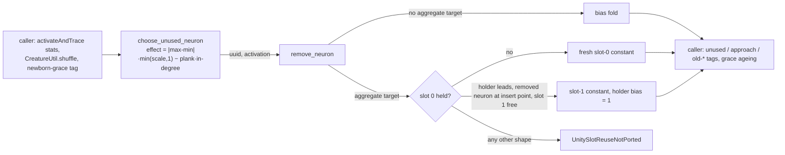

# PR summary — Issue #778

## Summary

This PR ports `compactUnused`'s trace-based neuron choice to `neat-core` as
`choose_unused_neuron`. It also lets `remove_neuron` reuse a held slot-0 unity
constant in the one case where the frozen TypeScript does so soundly. A new
capture freezes 14 `compactUnused` runs from the original tests: `NewbornGrace.ts`,
`UnusedClipped.ts`, `Cascade.ts`, `CompactUnusedOrphanCleanup.ts`, `FixIF.ts`,
`CompactConstant.ts` and `CompactKeepOrder.ts`. Native code replays all 14
bit for bit. Everything is additive and no caller is switched. Deadlines, the
caller-side tags and the remaining held-slot shapes are still open, so this is
Part of #778.

## Spec

### Intent and Rationale

- #802 and #803 ported the rewrites. The rule that picks which neuron
  `compactUnused` removes was still TypeScript-only, so no original
  `compactUnused` test had a native counterpart.
- The choice is deterministic once its inputs are fixed. The caller passes in
  the trace statistics, the shuffled visit order and each neuron's remaining
  newborn grace. The randomness and the trace collection therefore stay with
  the caller, as the issue asks.
- The new captures showed that `remove_neuron` refused a case TypeScript handles
  correctly: a second compaction pass while slot 0 is held. The refusal is
  narrowed to the defective shapes only.

### Essential Design Decisions

- `choose_unused_neuron(creature, candidates, shuffled, plank_constant)`
  visits `shuffled` from its last entry to its first, as TypeScript's
  `for (let i = indices.length; i--;)` does. The comparison is strict, starting
  at `f64::MAX`, and the loop stops at the first negative effect. `NoInwardSynapse`
  and `NoOutwardSynapse` are raised only for a neuron the loop reaches, which
  mirrors TypeScript's `assert`s. `plank_constant` is not validated, which also
  mirrors TypeScript.
- How a held slot 0 is reused. TypeScript's `createConstantOne(0)` returns a
  constant it has just removed, along with that constant's stale position. That
  position names the neuron being removed only when the holder is one of the
  leading constants and the removed neuron sits at the insertion point. In that
  case, and only when slot 1 is free, the port reuses slot 0. It mints a slot-1
  constant and sets the holder's bias to 1.0, as TypeScript does. Every other
  shape is refused with `UnitySlotReuseNotPorted` before anything changes.
- On the reuse path the port calls `mint_uuid` once. TypeScript mints two
  UUIDs: one for a temporary constant it then removes, and one for the
  constant that survives. `mint_uuid` keeps its `FnOnce` bound, so no signature
  changes.
- The capture replaces the originals' `Math.random()` data with
  `createSeededRng(seed)`, and seeds the global RNG so the shuffle reproduces.
  It does not copy any of the algorithm. It calls the frozen `compactUnused`.

### Undiscoverable Facts

- In all nine bias-fold captures, every outward target is `IDENTITY`. The five
  `FixIF`, `CompactConstant` and `CompactKeepOrder` captures take the constant
  branch. In both second calls, TypeScript's `minted` is 2 and the constant that
  survives holds slot 1.
- `newborn_nothing_to_compact` returns undefined because both hidden neurons
  are still in grace. The port gives `Ok(None)` for it.
- When TypeScript matches a slot-0 holder by its legacy id `-1000`, it also
  writes `compact-unity-slot` = `0` onto that holder. `NeuronRemoval` does not
  report that tag, so the caller must write it.
- `gh search code` finds `UnitySlotReuseNotPorted` only in this repository, so
  no registered consumer depends on the refusal this PR narrows.

## Evidence

Backend only. The evidence is the tests and the frozen captures.

- `docs/research/compaction-unused-choice-baseline.md` lists each case's chosen
  neuron, its branch and its draws. It also gives the reproduction command.
- `docs/research/compaction-unity-constant-baseline.md`: finding (b) now says
  which reuse is sound and is ported.

## Acceptance Criteria

The issue has no acceptance-criteria heading, so no reviewer ran. The parts left
undone are listed here in the issue's own words.

- **missing** — "Add tests for ... deadlines" — reason: none of the ported rules
  has a deadline. The only one is `skipCompaction` in `TrainingTeardown.ts`,
  which sits with the caller around `compactUnused`, so no `neat-core` rule
  exists yet for a test to cover.
- **missing** — "tag/memetic semantics" (the `unused`, `approach`,
  `old-neurons` and `old-synapses` tags, newborn-grace ageing, and the slot tag
  on a legacy-id holder) — reason: `NeuronExport` carries no tags, so
  `compactUnused` writes these on the caller's side. The replay compares
  neurons and synapses only, not tags. The memetic clear and the
  `compact-unity-slot` return value are pinned in
  `neat-core/tests/compact_unity_constant.rs`.
- **missing** — "port only existing compaction rules" (the held-slot reuse
  shapes other than the sound one, and slot 2) — reason: those shapes are
  refused with `UnitySlotReuseNotPorted`. The holder may not be a leading
  constant, and TypeScript then merges two constants. The stale position may
  name another neuron, which is the `unity_reuse_tagged_slot` defect. Or slot 1
  may already be held. No capture shows a sound outcome for any of these.

## Test Plan

- `neat-core/tests/compact_unused_choice.rs` (new, 25 tests). Each expected
  value is derived by hand from the formula. The tests cover:
  - smallest effect, the plank term, and the scale cap at 1;
  - a NaN weight, which is ignored for the scale;
  - tie order and the early break;
  - grace, untraced, zero-count, non-hidden and empty-UUID skips;
  - midpoint against `total / count`, and non-finite statistics;
  - every refusal, each with an accepted control;
  - the `NewbornGrace.ts` fixture end to end through `remove_neuron`.
  The file failed to compile before the module existed. Flipping `<` to `<=`
  turned 1 test red, and visiting `shuffled` forwards turned 4 red. Both
  mutations were reverted.
- `neat-core/tests/compact_legacy_unused.rs` (new).
  `frozen_compact_unused_captures_replay_exactly` replays all 14 captures.
  Each replay checks the choice against the `unused` tag. The neuron and
  synapse lists are compared bit for bit, along with the draw count, the mint
  count and the returned unity slot.
  `the_frozen_choice_depends_on_the_callers_visit_order` shows that reversing
  `shuffled` changes the choice in `cascade_cosine_clipped`. The two second-call
  cases failed with `UnitySlotReuseNotPorted` before the reuse change, and pass
  after it.
- `neat-core/tests/compact_unity_constant.rs` (extended):
  - `MINIMUM` and `HYPOTv2` targets take the constant branch, with an
    `IDENTITY` control;
  - a NaN, `+inf` or `-inf` activation is refused, as is `0 × inf`, naming the
    target and with no mint. Disabling the finiteness guard turned 4 tests red.
  - the sound reuse, tagged and by legacy id, takes slot 1 and sets the holder's
    bias to 1;
  - the reuse is refused when the holder is behind the removed neuron, or when
    slot 1 is held by tag or by legacy id. Each refusal has a control that
    differs only in that fact.
  - These reuse tests were red before the source change.
  - Ignoring whether the removed neuron sits at the insertion point turned
    `a_legacy_slot_zero_id_is_refused_like_a_tagged_one` and
    `reusing_a_tagged_slot_is_refused_and_the_capture_shows_why` red.
- Edited existing test: `a_legacy_slot_zero_id_is_refused_like_a_tagged_one`.
  Its fixture placed the legacy holder directly before the removed neuron, which
  is now the sound case. A `hidden-9` neuron now sits between them, so the test
  still pins the defective shape it is named for, and the untagged control gets
  the same change. All of its assertions are kept.
  `reusing_a_tagged_slot_is_refused_and_the_capture_shows_why` is unchanged
  and still refuses.
- Captures: `deno run -A --config <checkout>/deno.json scripts/capture_legacy_compaction.ts <checkout> neat-core/tests/golden/compact_legacy_unused.json unused`,
  where `<checkout>` is a clean checkout at `60d6b4e5`. Repeated runs were
  byte-identical, and the first nine records did not change when the five new
  ones were added.
- `./quality.sh < /dev/null` passed on `7d92a97`, and again on `c2a174b`, the
  last code and test commit ("All quality checks passed!"). Only this line
  changed after it.

Not done: `cargo check --target wasm32-unknown-unknown` (the target is not
installed here, and the new code is target-independent);
`scripts/check-downstream-consumers.sh` (no local consumer checkouts; the change
is additive, and code search finds no consumer of the narrowed refusal).
