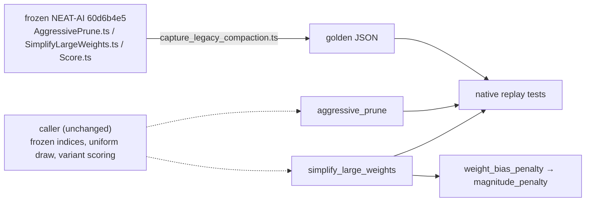

## Summary

This ports two of the existing speculative compaction rules into `neat-core`,
along with the shared primitive one of them needs. Nothing calls them yet: no
caller is switched and no existing public struct changes.

- `aggressive_prune` (`neat-core/src/compact_aggressive_prune.rs`) ports
  TypeScript `aggressivePrune`, the dataset-free low-weight prune.
- `simplify_large_weights` and `weight_bias_penalty`
  (`neat-core/src/compact_simplify_large_weights.rs`) port
  `simplifyLargeWeights`, the rescaling of homogeneous squashes, including its
  MCMC acceptance.
- `magnitude_penalty` and `mean_magnitude_penalty`
  (`neat-core/src/magnitude_penalty.rs`) port the per-value penalty from
  `Score.ts` that `simplifyLargeWeights` accepts against.

A new `simplify` capture mode freezes the TypeScript results so the native tests
can replay them bit for bit. The trace-dependent `compactUnused` rule is not
ported, so this is Part of #778.

## Spec

### Intent and Rationale

- #776 froze the TypeScript behaviour, and #778 asks for the existing rules to
  be ported against it. Each rule is ported literally: same guards, same
  constants (`1e-3`, the `1000` imbalance ratio, the `1e-15` margin), same order
  of operations.
- The `simplifyLargeWeights` captures did not exist yet.
  `scripts/legacy_compaction_simplify.ts` generates them from the frozen
  checkout in the same way as the other capture modes, so the expected values
  come from TypeScript and not from the Rust under test.

### Essential Design Decisions

- **Frozen synapses are passed by index.** `aggressive_prune` takes a
  `frozen_synapses: &[usize]` argument. `SynapseExport` has no `frozen` field,
  and adding one is a public-struct change that the three-phase rule
  (`RELEASING.md`) puts out of scope for an additive PR. An out-of-range index
  is refused with `FrozenIndexOutOfRange`.
- **Randomness and acceptance stay with the caller.**
  - `simplify_large_weights` takes `Option<McmcAcceptance>`, and the caller
    supplies the uniform draw that TypeScript took from `Math.random`.
  - Neither pass scores anything. Keeping the aggressive candidate is still the
    caller's `selectCompactVariant` policy.
  - The magnitude penalty is the existing heuristic gate inside
    `simplifyLargeWeights`, not the authoritative score.
- **Exactness follows the actual semantics.**
  - `aggressive_prune` is approximate: it removes non-zero weights, including
    into aggregates.
  - `simplify_large_weights` is exact in real arithmetic for positively
    homogeneous squashes, but only rounding-equal in floating point. With MCMC
    it can accept a worse penalty.
- **Memetic handling and stricter refusals.**
  - Memetic handling follows what each rule does. `aggressive_prune` only
    removes edges, so it uses `prune_memetic`, the crate's convention from
    `compact_zero_weight` (TypeScript deletes the whole record).
  - `simplify_large_weights` rewrites weights, so it clears the record
    (`memetic = None`), as TypeScript does.
  - A `NaN` aggressive threshold is refused with `NanThreshold`. In TypeScript a
    NaN threshold would prune every finite unpinned edge. This is the one
    stricter departure.

### Undiscoverable Facts

- `aggressivePrune` pins any `type !== undefined`, so an empty-string role is
  pinned. The zero-weight pass treats `""` as untyped. Both ports keep their own
  TypeScript reading.
- `Math.max` propagates NaN where Rust's `f64::max` ignores it.
  `simplify_large_weights` uses a `js_max` helper so a NaN bias or inbound
  weight skips the neuron, as it does in TypeScript (`nan_bias`,
  `nan_inbound_first` captures).
- `magnitude_penalty` restates NEAT-AI-scorer
  `rust_scorer/src/scoring.rs::magnitude_penalty`. Core cannot call the scorer,
  because the scorer depends on core. The two copies must stay identical until
  the scorer moves to this one; this PR does not switch it. Both are pinned to
  NEAT-AI's `magnitude-penalty-corpus.json`, which is captured into the golden
  file.
- `CompiledNetwork::activate` runs in `f32`, so the behaviour-preservation test
  compares within `1e-6` relative.

## Evidence

This is a backend library change with no UI, so there are no screenshots. The
evidence is the tests below.

- `neat-core/tests/compact_aggressive_prune.rs`:
  - `frozen_captures_replay_with_the_same_survivors` replays the three raw
    `aggressivePrune` captures in
    `neat-core/tests/golden/compact_legacy_variants.json`: `aggressive_maximum`,
    `aggressive_frozen` and `aggressive_last_input`.
  - The other 15 tests cover typed IF roles, empty-string roles, IF targets,
    aggregate targets (MINIMUM/HYPOT), the threshold boundary, negative weights,
    NaN and infinite weights, the last inbound edge of an output, frozen
    indices, the NaN threshold, memetic rows, neuron retention and input
    immutability.
- `neat-core/tests/compact_simplify_large_weights.rs`:
  - `frozen_captures_replay_bit_for_bit` replays all 15 cases in
    `neat-core/tests/golden/compact_legacy_simplify.json`. It checks the
    `changed` flag, the draw count, every bias and weight by `to_bits`, the
    memetic clearing, and the before and after penalties within `1e-12`.
  - The 15 cases are: ABSOLUTE, ReLU with negative values, a tiny inbound edge,
    typed IF, MEAN/HYPOTv2, TANH left alone, a balanced creature, a skipped
    output, a NaN bias, a NaN first inbound edge, an infinite inbound edge, a
    self-loop, a greedy reject, an MCMC accept and an MCMC reject.
  - `magnitude_penalty_matches_the_shared_corpus` checks every corpus case
    within the corpus tolerance.
  - `rescaling_preserves_behaviour` compiles the creature before and after for
    the `absolute`, `relu_negative`, `tiny_inbound` and `typed_if` cases and
    compares their activations.
  - `a_non_positive_temperature_is_greedy` checks that a temperature of 0 or -1
    never draws and never accepts a worse rescale.
- `docs/research/compaction-simplify-baseline.md` records the new capture, a
  table of the cases, the exactness classification and the reproduction command.
  `docs/research/compaction-variant-baseline.md` now names the native coverage
  of the aggressive guards.

## Acceptance Criteria

- **missing** — "Inventory TS AggressivePrune, CompactUnused and
  simplify/large-weight transforms from #776; port only existing compaction
  rules" (CompactUnused part) — reason: `compactUnused`/`removeNeuron` keys its
  reusable constant neurons on the `compact-unity-slot` neuron tag and mints
  random UUIDs. `NeuronExport` carries neither tags nor slots, so a faithful
  port first needs a public-struct addition, which is three-phase work under
  `RELEASING.md`. AggressivePrune and simplifyLargeWeights are ported in this
  diff.
- **missing** — "Add tests for … clipping, … deadlines" — reason: neither ported
  rule has a clip or a deadline. Clipping and deadlines belong to
  `compactUnused` and the `compactCreature` and training callers, which are not
  ported here. Typed IF, aggregation, non-finite statistics, memetic semantics
  and fixture parity are tested.

## Test Plan

- Added `neat-core/tests/compact_aggressive_prune.rs` (16 tests) and
  `neat-core/tests/compact_simplify_large_weights.rs` (7 tests). Doctests were
  added on `aggressive_prune`, `simplify_large_weights`, `magnitude_penalty` and
  `mean_magnitude_penalty`. No existing test was edited.
- Added the `simplify` mode to `scripts/capture_legacy_compaction.ts` and added
  `scripts/legacy_compaction_simplify.ts`. The golden file was generated against
  a clean checkout of NEAT-AI at `60d6b4e5d3af20afbaaeb3420d588ad673ab8dab`.
  Every value matched an independent run of the same TypeScript.
- Executor runs on the branch:
  - `cargo test -p neat-core --test compact_aggressive_prune`: 16 passed.
  - `cargo test -p neat-core --test compact_simplify_large_weights`: 7 passed.
  - The doctests passed.
  - `cargo clippy -p neat-core --all-targets -- -D warnings`: clean.
  - `deno fmt --check`, `deno lint` and `deno check` on the two scripts: clean.
- `./quality.sh < /dev/null` passed (exit 0, "All quality checks passed!") on
  commit 4107d17. That commit holds all code, tests and docs; the only later
  change is this result line.
- Not run: `scripts/check-downstream-consumers.sh`, the `wasm32` check and the
  `wasm64` check. These modules hold no wasm-specific code and change no
  existing public surface.
