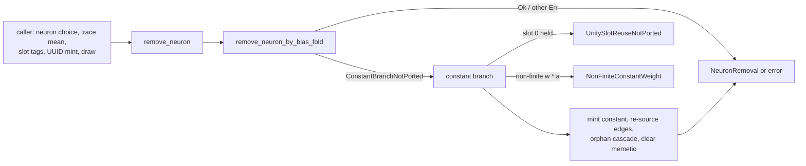

## Summary

Adds `remove_neuron` (`neat-core/src/compact_unity_constant.rs`), the native
port of the constant ("unity slot") branch of NEAT-AI `removeNeuron`. PR #802
(already merged) ported the bias-fold branch as `remove_neuron_by_bias_fold`,
which refuses any removal whose outward targets include an aggregate. The new
function calls that one and, on that refusal, runs the constant branch: it
mints a unity constant and moves the removed neuron's outward synapses onto it.
A new `unity` capture mode freezes the TypeScript branch, and the native tests
replay it bit for bit. Nothing calls the new function yet, and no existing
public item changes.

Reusing a constant that already holds slot 0 is refused, because the frozen
TypeScript reuse path is defective (see Undiscoverable Facts). That path, the
caller-side tags and a few `compactUnused` originals are still open. Part of
#778.

## Spec

### Intent and Rationale

- `compactUnused` sends every removal with an aggregate target (`IF`,
  `MINIMUM`, `MAXIMUM`, `MEAN`, `HYPOT`, `HYPOTv2`) down the constant branch.
  Without it, core could not remove a neuron that feeds an `IF`, which is what
  `FixIF.ts`, `CompactConstant.ts` and `CompactKeepOrder.ts` do.
- The tags this branch reads are not part of `NeuronExport`. As with the frozen
  synapse indices of `aggressive_prune`, the caller passes them in
  (`unity_slots`) and gets the new slot back (`NeuronRemoval::unity_constant`).
  This keeps the change additive.

### Essential Design Decisions

- **The branch decision has one owner.** `remove_neuron` calls
  `remove_neuron_by_bias_fold` first and takes the constant branch only on
  `RemoveNeuronError::ConstantBranchNotPorted`. That refusal comes from
  `needs_constant_branch` (derived from `SquashType::is_aggregate`), so the
  aggregate set is not restated. The width, unknown, not-removable and
  dangling-target checks are shared the same way.
- **The caller supplies what TypeScript took from globals:** the slot tags,
  the new constant's UUID (`mint_uuid`, for `crypto.randomUUID`) and the
  reconnect draw. The caller writes the returned `UnitySlot` back as the
  `compact-unity-slot` tag.
- **Two departures, both refusals that leave the input unchanged:**
  - `UnitySlotReuseNotPorted` when a constant already holds slot 0, either by
    tag or by the legacy id `-1000`.
  - `NonFiniteConstantWeight` when `weight * activation` is not finite. It is
    checked before the UUID is minted. TypeScript throws here after it has
    already inserted the constant.
- **No other public item changes.** `remove_neuron_by_bias_fold` behaves as
  before. Only its docs and its `ConstantBranchNotPorted` message now point at
  `remove_neuron`. `remove_with_orphan_cascade` became `pub(crate)` so the new
  branch reuses it rather than copying it.

### Undiscoverable Facts

- **The frozen reuse path is defective** (NEAT-AI `60d6b4e5`). When a
  constant already holds the slot, `createConstantOne` resets that constant's
  bias to 1 and inserts a new constant. It then removes the new one as a
  duplicate, but still returns it with a stale index. `removeNeuron` then wires
  through whichever neuron now sits at that index. In the
  `unity_reuse_tagged_slot` capture, removing `hidden-1` leaves both constants
  gone and `hidden-0` carrying the condition weight 4.5. Porting that path
  literally would port the defect, so it is refused.
- On the path the port supports (no constant holds slot 0), the frozen code
  behaves as follows:
  - it inserts a constant (bias 1, no squash) after the inputs and existing
    constants;
  - it re-sources every outward synapse from that constant, with weight
    `w * activation` and the same role, in `(from, to, role)` order;
  - it changes no target bias and adds no reconnect edge.

## Evidence

Backend-only Rust and capture-script change; no UI files.

- **Golden file:** `neat-core/tests/golden/compact_legacy_unity.json` (7
  records). It is generated by `scripts/legacy_compaction_unity.ts` through the
  new `unity` mode of `scripts/capture_legacy_compaction.ts`, from a clean
  NEAT-AI checkout at `60d6b4e5d3af20afbaaeb3420d588ad673ab8dab`. Two runs gave
  byte-identical output. With the same tooling, the committed
  `compact_legacy_metadata.json` also regenerates byte for byte. The cases are
  described in `docs/research/compaction-unity-constant-baseline.md`.
- **Tests:** `neat-core/tests/compact_unity_constant.rs`.
  - `frozen_unity_captures_replay_exactly` replays the five fresh-path captures.
    It compares every neuron and synapse in order, with biases and weights
    compared by `to_bits`. It also checks the mint count, the cleared memetic
    record and the returned slot.
  - Three tests are the native counterparts of NEAT-AI `FixIF.ts`,
    `CompactConstant.ts` and `CompactKeepOrder.ts`. They copy those creatures
    and compare `compile_creature` + `activate` outputs before and after on a
    grid within `1e-6`:
    - `removing_a_saturated_neuron_into_an_if_target_preserves_behaviour`;
    - `removing_a_saturated_neuron_with_an_inverse_feeder_preserves_behaviour`;
    - `the_new_constant_lands_right_after_an_untagged_constant`.
- `docs/research/compaction-metadata-baseline.md` no longer says the six
  aggregate captures are only refused.

## Acceptance Criteria

The issue has no acceptance-criteria heading. The parts of it that are still
undone:

- **missing** — "Inventory TS AggressivePrune, CompactUnused and
  simplify/large-weight transforms from #776; port only existing compaction
  rules" (CompactUnused's reuse of an existing `compact-unity-slot` constant,
  slots 1 and 2, and the legacy ids) — reason: the frozen reuse path returns a
  removed constant with a stale index. The port refuses it with
  `UnitySlotReuseNotPorted`. The slot-0 path with no constant holding the slot
  is ported.
- **missing** — "Add tests for ... deadlines" — reason: none of the ported
  rules has a deadline. The only one is the `skipCompaction` check in
  `TrainingTeardown.ts`, which sits with the caller around `compactUnused`.
- **missing** — "tag/memetic semantics" (the `unused`, `approach`, `old-*` and
  newborn-grace tags) — reason: `CreatureExport` carries no tags, and these are
  written by the `compactUnused` wrapper at the caller boundary. Only the
  `compact-unity-slot` tag has a native contract (passed in and returned).
- **missing** — "parity with original fixtures" (`NewbornGrace.ts`,
  `Cascade.ts`, `CompactUnusedOrphanCleanup.ts`) — reason: these drive the whole
  `compactUnused`, whose neuron choice from trace statistics and a shuffle
  stays with the caller. They have no native replay.

## Test Plan

- Added `neat-core/tests/compact_unity_constant.rs` (16 tests):
  - the replay and the three behaviour tests above;
  - `the_overflow_capture_is_refused_before_any_change` (no UUID minted;
    control with a finite activation accepted);
  - `reusing_a_tagged_slot_is_refused_and_the_capture_shows_why` (asserts the
    capture's defect facts; control without tags accepted) and
    `a_legacy_slot_zero_id_is_refused_like_a_tagged_one`;
  - `a_slot_one_tag_does_not_block_the_fresh_slot_zero_path` and
    `a_unity_slot_on_a_non_constant_neuron_is_ignored`;
  - refusals, each with an accepted control and a message check:
    - `a_unity_slot_outside_zero_to_two_is_refused_before_removal`;
    - `a_unity_slot_naming_no_neuron_is_refused_before_removal`;
    - `a_minted_uuid_naming_a_neuron_or_an_input_is_refused`;
    - `an_unknown_neuron_is_refused_by_the_shared_bias_fold_validation`;
  - delegation:
    - `a_target_without_an_aggregate_squash_delegates_to_the_bias_fold`
      (literal fold `0.25 + 2.0 * 1.5 = 3.25`, no mint);
    - `a_non_finite_fold_on_a_bias_fold_target_returns_none_and_mints_nothing`;
  - `the_constant_edges_follow_typescript_order_whatever_order_they_are_listed_in`.
- Doctest on `remove_neuron` (an `IF` target).
- **Red run:** before the module existed, the test file failed to compile with
  `E0432 unresolved imports` for the four new names. That is a compile failure,
  not a behavioural one. Two deliberate breaks were each caught and then
  reverted:
  - ignoring role order turned
    `the_constant_edges_follow_typescript_order_whatever_order_they_are_listed_in`
    red;
  - always inserting the constant at position 0 turned the replay and
    `the_new_constant_lands_right_after_an_untagged_constant` red.
- **Added to `neat-core/tests/compact_remove_neuron.rs`:**
  `removal_cascades_to_a_constant_that_fed_only_the_removed_neuron` and
  `removal_keeps_a_constant_that_still_feeds_another_neuron`. They are the
  native counterparts of `RemoveHiddenNeuronCascade.ts`, including the
  JSON-round-trip validation. They pin existing behaviour and passed on their
  first run. No existing test was edited.
- **Gate:** `./quality.sh < /dev/null` exited 0 ("All quality checks passed!")
  on `448fc64`, and again on `d8f2ccd` (the code, tests and this summary
  before this line was filled in).
- **Not run:**
  - `cargo check --target wasm32-unknown-unknown`: the target is not installed
    here, and the new module has no `cfg` or wasm code;
  - `scripts/check-downstream-consumers.sh`: the change only adds a module and
    exports, and changes no public item;
  - a mutation sweep beyond the two breaks above;
  - Spec and Standards reviewers: the issue has no acceptance-criteria heading.
