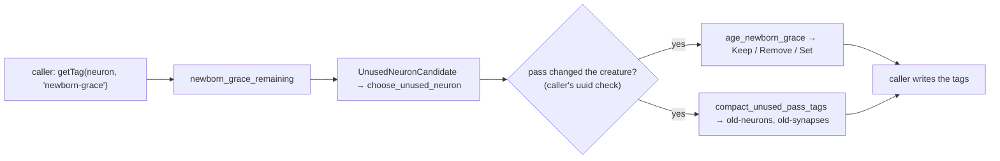

# PR summary — Issue #778

## Summary

This PR ports `compactUnused`'s tag rules to `neat-core`. PR #804 had left them
TypeScript-only. The new module is `neat-core/src/compact_unused_tags.rs`:

- `newborn_grace_remaining` is `newbornGraceRemaining`. It reads a
  `newborn-grace` tag value the way JavaScript's `Number.parseInt(raw, 10)`
  does.
- `age_newborn_grace` is `ageNewbornGrace` for one neuron. It returns
  `NewbornGraceAgeing::Keep`, `Remove` or `Set(value)`.
- `compact_unused_pass_tags` gives the `old-neurons` and `old-synapses` counts.
  `compactCreature` writes the same `old-neurons` count.

The change is additive and no caller is switched. Deadlines and the remaining
held-slot reuse shapes are still open, so this is

Part of #778.

## Spec

### Intent and Rationale

- PR #804's summary listed "tag/memetic semantics" as missing, because
  `NeuronExport` carries no tags. The rules are pure functions of a tag value or
  of the creature before the pass, so they can be ported without giving the
  export a tags field.
- The frozen `compactUnused` captures (`compact_legacy_unused.json`) record each
  neuron's tags before and after the pass, and the `compactCreature` capture
  (`compact_legacy_behaviour.json`) records `old-neurons`. The native rules are
  therefore checked against original TypeScript output, not only against
  hand-derived tables.

### Essential Design Decisions

- The caller reads and writes the tags. These functions only compute the values.
  Adding a `tags` field to `NeuronExport` or `CreatureExport` would break every
  consumer that builds them as struct literals, so it is a three-phase
  public-API change (`RELEASING.md`), not an additive one.
- The `parseInt` emulation follows JavaScript in these respects:
  - it skips JS whitespace only, so it skips the BOM (U+FEFF) but not NEL
    (U+0085);
  - it takes one optional sign, then the longest run of ASCII digits;
  - a value that is infinite as an `f64` reads as `0`, because `Number.isFinite`
    rejects `Infinity`.

  One deviation is deliberate: a grace count above `u32::MAX` saturates there,
  marked `SIMPLE-ON-PURPOSE`, because `UnusedNeuronCandidate` holds a `u32`.
- `age_newborn_grace(Some(""))` is `Keep`. TypeScript's `getTag` returns `""`,
  which is falsy, so `ageNewbornGrace` leaves an empty tag in place.
- `old_neurons` is an `i128` computed as `neurons.len() - output`. The export
  lists no inputs, so this equals TypeScript's runtime
  `neurons.length - input - output`. The value is exact, and it is negative for
  a malformed creature, as in TypeScript.

### Undiscoverable Facts

- I read the originals from a NEAT-AI checkout at `60d6b4e5`, the capture
  revision. They are `src/architecture/NewbornGrace.ts`, the post-pass tag
  writes in `src/compact/CompactUnused.ts` and `src/compact/CompactCreature.ts`,
  and `getTag`/`addTag`/`removeTag` from `jsr:@stsoftware/tags@1.0.41`.
- `src/compact` has no deadline. The only one is `skipCompaction` in
  `src/architecture/training/TrainingTeardown.ts`, which is asked before and
  after `compactUnused` runs.

## Evidence

Backend only. The evidence is the tests below.

## Acceptance Criteria

The issue has no acceptance-criteria heading, so no reviewer ran. The parts left
undone are listed here in the issue's own words.

- **missing** — "Add tests for ... deadlines" — reason: no compaction rule has a
  deadline. The only one is `skipCompaction` in `TrainingTeardown.ts`, which
  sits with the caller around `compactUnused`. The issue keeps that boundary, so
  no `neat-core` rule exists for a test to cover.
- **missing** — "port only existing compaction rules" (the held-slot reuse
  shapes other than the sound one, and slot 2) — reason: `remove_neuron` still
  refuses these shapes with `UnitySlotReuseNotPorted`. The shapes are:
  - the holder is not a leading constant;
  - a second constant also holds slot 0;
  - the stale position names another neuron;
  - slot 1 is already held.

  For the first two, TypeScript merges constants. No capture shows a sound
  outcome for any of them.

## Test Plan

- `neat-core/tests/compact_unused_tags.rs` is new, with 6 tests. Every expected
  value is a literal:
  - `newborn_grace_remaining_reads_the_tag_like_parse_int` covers 24 inputs:
    - none, empty, signs, `--1` and `+-1`;
    - JS whitespace (BOM, NBSP, tab and newline) and the non-JS NEL;
    - `3abc`, `1.9`, `1e3`, `0x10` and `007`;
    - `u32::MAX` and its saturation;
    - 400 nines, which is `Infinity` in JavaScript.
  - `age_newborn_grace_decides_what_happens_to_the_tag` covers `Keep`, `Remove`
    and `Set` for 10 inputs, including `""` and `"02"`.
  - Three `pass_tags_*` tests check the count with a constant neuron and with a
    changed declared input count.
- `neat-core/tests/compact_legacy_unused.rs` gains
  `frozen_newborn_grace_tags_read_and_age_like_the_original`, which checks all
  14 captures:
  - the native read of each traced neuron's tag equals the captured
    `graceRemaining`;
  - each surviving neuron's tag after the pass equals the native ageing of its
    tag before.

  It asserts at least one `Keep`, `Remove` and `Set`. It also asserts that
  `newborn_grace_2` ages `2` to `1` and that `newborn_grace_1` removes `1`.
- `neat-core/tests/compact_legacy_behaviour.rs` gains
  `the_recorded_old_neurons_tag_matches_the_native_count`. For both
  `compactCreature` records with a candidate, it checks that the native count
  equals the captured `old-neurons` tag (`2`), and it asserts that two records
  were checked. The `//!` header now names this one native check. The existing
  test in that file is unchanged.
- Red run: before the module existed, both new test files failed to compile with
  E0432 (unresolved imports). After the port they pass.
- `cargo test -p neat-core --test compact_unused_tags --test compact_legacy_unused --test compact_unused_choice --test compact_legacy_behaviour`
  passed. The module doctests also pass
  (`cargo test -p neat-core --doc compact_unused`). `cargo fmt --all -- --check`
  and `cargo clippy -p neat-core --all-targets -- -D warnings` are clean.
- `./quality.sh < /dev/null` exited 0 ("All quality checks passed!") on
  `3646833`, the code and test commit. The commit after it changes only this
  file.
- Docs: in `neat-core/src/compact_unused_choice.rs` I reworded the "caller keeps
  these parts" list and the `newborn_grace_remaining` field doc so they name the
  new helpers.
- Not run:
  - `cargo check --target wasm32-unknown-unknown`: the new code is
    target-independent and holds no `cfg`.
  - `scripts/check-downstream-consumers.sh`: the change only adds public items
    and changes no existing ones.
