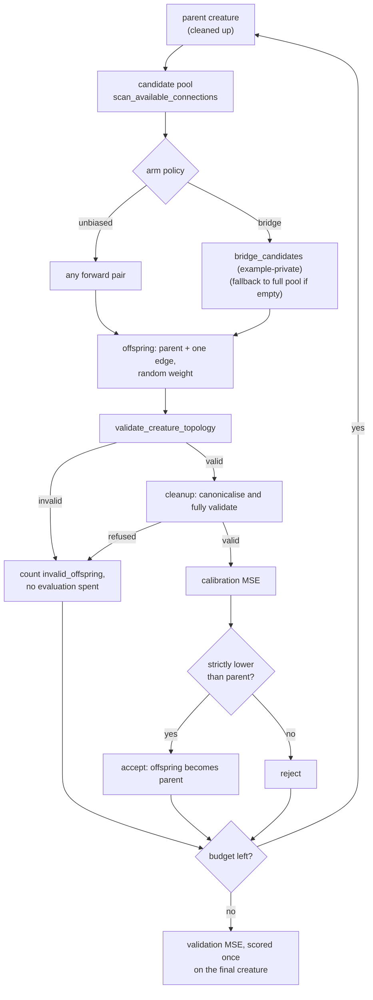

# Reachability-guided connection mutation — result record (Issue #759)

**Decision: KEEP the diagnostic, DO NOT adopt the bridge policy.** The original
comparison is inconclusive and has low bridge coverage. Its results below are
retained as a historical control, with corrected limitations. The extended
comparison follows the separately committed [v2 protocol](reachability-mutation-protocol-v2.md).
No default changes or representative product benefit are claimed.

## Question and status

Issue #759 asks whether classifying every neuron by input-to-output
reachability, and biasing connection proposals toward "bridges" that put a
non-live endpoint on an input-to-output path, produces fewer invalid or wasted
offspring and better final models than unbiased connection addition, under
matched proposal/evaluation caps, with measured costs. These caps do not make the
two policies cost the same amount of time.

The paper is now verified against [arXiv v1](https://arxiv.org/abs/2610.17425v1)
and [its method, section 3 and appendix B](https://arxiv.org/html/2610.17425v1):
*When Sparsity Breaks Connectivity: Functional Reachability and Guided Topology
Dynamics in Extreme Sparse Training*, Mohammad Pasande, Mateusz Jaworski,
Jeroen Rook and Elena Mocanu, submitted 12 October 2026. It orders edge removal
by functional reachability then magnitude, and biases regrowth toward a
forward-reached source and backward-reached target. Empty guided sets use a
one-sided reachability union; sampling retains an unguided component.

This experiment is independently defined. It adds connections without DST
weight training or pruning, excludes Live-to-Live edges from its bridge subset,
and uses the entire available pool as fallback. It does not replicate the
paper's layered architectures, regrowth distribution or method. The old JSON's
`unverified (fetch failed)` paper status records the earlier attempt; it is not
the current verification status. No paper performance number is used here.

## Audit of existing fixed-point cleanup

`cleanup_creature` (`neat-core/src/prune_cleanup.rs:463`) and
`cleanup_creature_with` (`neat-core/src/prune_cleanup.rs:536`) already iterate
to a fixed point (the loop calls `remove_dead_structure` at line 554 and
`fold_zero_inward_hidden` at line 558, with the `IF` repair between them) and:

- **(a) remove dead structure** — non-output nodes with no outward edge,
  repeated to a fixed point. In a finite forward-only graph, a chain that
  cannot reach an output must end at a non-output sink; repeated removal
  therefore removes that chain.
- **(b) fold, never drop, bias-driven computation** — a hidden neuron with no
  inward edge is folded exactly into a bias-1 support constant, so
  constant-driven computation that still reaches an output is preserved
  (module doc, lines 35–39).
- **(c) repair an `IF` short a role**, by downgrade (parity) or rewrite
  (`IfRepair::Rewrite`, Issue #591).
- **(d) leave a recurrent island that feeds only itself alone** — each member
  has an outward edge, so the sweep does not widen the rule (lines 75–77).
- **(e) validate the result** — a successful call never returns an invalid
  creature (lines 9–11).

What was missing:

- no diagnostic for **input-to-output** reachability — input-independent
  structure, unused inputs and constant outputs were invisible;
- no way to compare connection-proposal policies against each other.

`topology_ops::scan_available_connections` (`neat-core/src/topology_ops.rs:310`)
is the existing unbiased forward-only candidate pool, and the baseline arm here.

## What this change adds

`neat_core::reachability` (`neat-core/src/reachability.rs`), O(V + E), two
sweeps (forward from inputs, backward from outputs):

| Class | Reached from an input | Reaches an output | Meaning |
| --- | --- | --- | --- |
| `Live` | yes | yes | on an input-to-output path |
| `BiasDriven` | no | yes | constant-driven; **not removable on reachability alone** |
| `DeadEnd` | yes | no | dead structure nothing reads |
| `Isolated` | no | no | neither |

- `reachability_diagnostics` returns a `ReachabilityReport` with per-neuron
  classes, `interior_counts`, `unused_inputs` and `input_independent_outputs`.
  Malformed input is a typed `ReachabilityError`, never a panic.
- `bridge_candidates` is a private helper in the example harness, **not core
  API**. It filters a flattened `[from, to, ...]` pool (the shape
  `scan_available_connections` returns) to pairs whose source is input-reached
  (`Live` or `DeadEnd`) and whose target reaches an output (`Live` or
  `BiasDriven`), **excluding `Live -> Live`**: adding such an edge puts at least
  one currently non-`Live` endpoint on an input-to-output path. Order is kept.
- The reachability module is a **diagnostic only**. `cleanup_creature` remains
  the pruning rewrite owner; the harness proposes additions on clones.
- `neat-core/examples/reachability_mutation_experiment.rs` is the paired
  harness. Its correctness tests run in the workspace suite; research
  comparisons are opt-in and do not gate CI.

One experiment trial, per arm:



## Original design (historical control)

The original manifest records these constants. Current runs use the v2
protocol instead:

| Item | Value |
| --- | --- |
| Seeds | `0..40` (`DEFAULT_SEEDS = 40`) |
| Inputs / outputs | 4 / 1 |
| Teacher | 4 hidden `TANH` neurons, 2 random inputs each, `IDENTITY` output |
| Calibration / validation records | 256 / 256 |
| `EVAL_BUDGET` | 150 offspring evaluations per arm |
| `MAX_PROPOSALS` | 600 proposals per arm (cap on invalid or empty-pool loops) |
| Bootstrap | 2 000 resamples, seed `0x00B0_0757_12AB` |

- **Arms.** `unbiased` picks any pair from the available forward pool.
  `bridge` picks from the harness-private `bridge_candidates`, falling back to the full pool when
  that is empty.
- **Pairing.** Per seed both arms share the teacher, the data, the initial
  student and the weight-draw stream (independent RNG sub-streams per
  `(seed, stream)`); only the candidate selection policy differs.
- **Acceptance.** An offspring replaces the parent only on a **strictly lower
  calibration MSE**.
- **Calibration vs validation.** Selection sees calibration records only. The
  validation records are scored for the initial and the final creature and
  never during the search, so the headline metric is untouched by selection.
- **Compute limits.** At most `EVAL_BUDGET` valid-offspring evaluations and
  `MAX_PROPOSALS` proposals per arm. The initial calibration evaluation is
  included in `evaluations` (151 for a full run). **Preparation was not fully
  counted:** teacher/data generation and initial cleanup happened before the
  arm timer. The reported evaluation-hour rate used total arm time rather than
  measured evaluation time. Those fields must not be used as evidence of an
  end-to-end or evaluation-throughput advantage.
- **Verdict rule (predeclared).** Bridge is **better** only if the paired
  bootstrap 95% CI of `bridge − unbiased` `final_val_mse` lies wholly below 0
  **and** the invalid-offspring difference is `<= 0`; **worse** if the CI lies
  wholly above 0; otherwise **inconclusive**.

## Reproduction and source provenance

The historical JSON remains at
`docs/research/reachability-mutation-experiment-results.json`. Its revision label
`b426a98` names a base commit with uncommitted changes, so it is **not exact
source provenance**. The checkpoint implementation is preserved in commit
`ad5b54e`; historical execution used `--rev` and `--out`. Do not overwrite or
reinterpret the old schema using the new harness.

Current execution requires a clean committed tree and embeds that tree in the
release binary. The manifest additionally records the full commit, lockfile
blob, executable blob, available compiler and platform. The embedded harness
and driver bytes are checked against the committed sources. Cargo's rebuild
tracking and the embedded tree prevent accidentally reusing a build from a
different declared tree. Git and Rust must be available when executing.

```bash
export NEAT_EXPERIMENT_SOURCE_TREE="$(git rev-parse HEAD^{tree})"
cargo run --release -p neat-core --example reachability_mutation_experiment -- \
    --declare manifest-v2.json
cargo run --release -p neat-core --example reachability_mutation_experiment -- \
    --manifest manifest-v2.json --out results-v2.json
```

Output files must be new. The declaration fixes 40 seeds for each of four
families, budgets, RNG streams and inference rules; an edited or mismatching
manifest is refused. An incomplete experiment writes available results and
failures, exits non-zero and withholds the overall verdict. A killed run leaves
an `incomplete_running` marker. Unexpected arm failures retain workload, seed,
arm and cause; proposal-cap exhaustion retains partial scores and stopping
reason. Research execution remains separate from CI.

## Results (synthetic task)

Coverage: **40 of 40 seeds completed, 0 failures.** Paired differences are
`bridge − unbiased`; a "win" is a seed where bridge is better.

| Metric | Mean difference | Bootstrap 95% CI | Bridge wins / losses / ties |
| --- | --- | --- | --- |
| `final_val_mse` (lower is better) | −0.00821 | [−0.0252, 0.0039] | 21 / 19 / 0 |
| `improvement_cal` (higher is better) | +0.00939 | [−0.0028, 0.0261] | 22 / 18 / 0 |
| `invalid_offspring` | 0 | [0, 0] | 0 / 0 / 40 |
| final non-`Live` interior neurons | 0 | [0, 0] | 0 / 0 / 40 |

- Both score-related CIs straddle 0, so the verdict is **inconclusive**. The point estimates
  lean towards bridge, but that is not evidence at this sample size.
- Every final creature, in both arms, has **5 `Live` interior neurons and 1
  `BiasDriven`** (the support constant), with no unused input and no
  input-independent output.
- The bridge arm found bridge candidates on only **224 of 5 939 proposals**; it
  fell back to the unbiased pool on **5 715 (96%)**.
- Mean non-`Live` interior neurons per valid offspring (across seeds, from
  `mean_nonlive_interior_over_valid_offspring`): **1.015 bridge, 1.139
  unbiased**. It is slightly lower for bridge, but both are dominated by the
  single `BiasDriven` constant that every offspring carries.
- Mean `improvement_per_eval` (calibration MSE improvement per evaluation, an
  evaluation-count measure rather than a clock): **0.001405 bridge, 0.001415
  unbiased** — indistinguishable. Mean evaluations were 149.5 (bridge) and
  147.6 (unbiased).
- Wall-clock and the `*_per_eval_hour_indicative` fields are **indicative
  only**: the host was shared with other jobs. Nothing here relies on them.

## Findings (negative / inconclusive)

1. **Observed topology-invalid offspring was 0.** The pool emits forward
   pairs into non-constant, non-input targets, and an untyped edge into an `IF`
   counts as its positive role (`neat-core/src/topology_invariants.rs`). The old
   harness used `validate_creature_topology` only; it did not perform the full
   `creature_validate` leg after canonicalisation. V2 adds cleanup's complete
   gate before scoring, so the old zero rate is not claimed as universal.
2. **After cleanup a forward-only creature has no `DeadEnd` or `Isolated`
   interior structure**. Bridges can still reach BiasDriven targets or use
   unused inputs (DeadEnd sources) to complete an input-output path. The small
   control exhausts these opportunities quickly: once inputs and hidden paths
   become Live, the policy falls back to the full pool. The observed 96%
   fallback limits what this comparison can distinguish.
3. **Dead structure cannot grow under connection addition alone.** Adding an
   edge only widens reachability, so the dead-structure comparison is
   degenerate in this design. The MSE estimate cannot establish a general benefit;
   early policy differences change subsequent parent and candidate trajectories.

## Extended comparison

The [v2 predeclaration](reachability-mutation-protocol-v2.md) adds generated
24-hidden sparse, 48-hidden mixed-aggregate and 24-hidden conditional families,
as well as the legacy control. Three quarters of the extended hidden layer
initially retains only constant-driven inputs while still feeding an output.
This gives the proposal policy sustained opportunities without manufacturing
invalid parents or treating BiasDriven computation as removable.

The harness now records raw and cleaned initial structure, separate final and
mean-offspring dead and BiasDriven counts, bridge selections/fallbacks, rejection
causes, stopping reasons, calibration/validation scoring calls and record counts.
It measures shared teacher/data/student preparation (including initial cleanup),
arm search and candidate preparation (clone, topology gate and cleanup). Half
of shared preparation is allocated to each arm for end-to-end rates; actual
once-per-pair costs remain recorded. Scoring time includes compilation. The
execution duration includes CLI provenance checks, search and statistics, up to
final output serialisation. It excludes source inspection and the Cargo build;
those external preparation costs are recorded with the execution evidence.

Schema version 2 separates the corrected fields from the historical JSON.
Paired 98.75% bootstrap intervals account for four family comparisons; empty
summaries and means with no evaluated offspring are unknown. Dead structure is DeadEnd + Isolated, never BiasDriven.
The additive operator still cannot create dead structure after cleanup, and the
validated pool may leave no invalid-rate difference to measure. Those outcomes
are limitations, not improvements.

## Decision and scope

Keep `reachability_diagnostics` as the generic diagnostic requested for NEAT-AI
and Ockham. Keep the private filter only as reproducible research code. It is
not a supported mutation policy or a public core API. Cleanup remains the sole
pruning rewrite owner. These generated tasks measure the local bridge
hypothesis; they do not measure private corpora, product orchestration, recurrent
training or the cited paper's guided DST. Private data and operational
integration remain outside this public experiment.

## V2 observed results

Source: `0d7f98e0eda1bcd3f7374c413fd3a02fc124a272`, tree
`813b24a44cb6e5dea44691a7e55b4445f29520ba`. The protocol and executable were
committed before this run. To reproduce this record, use that source commit.
A subsequent serialisation fix represents an offspring mean with no samples as
null; it does not affect these observations (the minimum was 98 calibration
evaluations, including the initial parent). Files:

- [Manifest](reachability-mutation-v2-manifest.json): declaration written before execution.
- [Results](reachability-mutation-v2-results.json): 160 paired trials, 0 failures,
  separate per-arm outcomes and family summaries.
- [Execution costs](reachability-mutation-v2-execution.json): build, declaration
  and comparison commands, durations and exit codes.

All 40 seeds completed in each family. Differences are bridge minus unbiased;
intervals are paired bootstrap 98.75% intervals (12,000 resamples; four-family
Bonferroni adjustment). Lower validation MSE is better.

| Family | Mean validation-MSE difference | Interval | Wins / losses | Bridge-selected proposals | Verdict |
| --- | --- | --- | --- | --- | --- |
| Legacy control | -0.00821 | [-0.02988, 0.00609] | 21 / 19 | 224 / 5,939 (3.8%) | Inconclusive |
| Sparse | -0.00217 | [-0.02866, 0.03058] | 25 / 15 | 2,571 / 6,000 (42.9%) | Inconclusive |
| Mixed aggregate | -0.11111 | [-0.18454, -0.04901] | 34 / 6 | 5,017 / 6,000 (83.6%) | Better on this family |
| Conditional | -0.06943 | [-0.13023, -0.02436] | 31 / 9 | 2,093 / 6,000 (34.9%) | Better on this family |

The predeclared overall verdict is **do not adopt**: the sparse family did not
favour bridge. Two generated-family improvements do not establish a
representative product benefit. This is mixed evidence, not a blanket negative
result and not a reproduction of guided DST.

Both arms had **zero invalid offspring and zero final DeadEnd/Isolated neurons**
in every trial. This confirms the comparison's structural limitation, not an
invalid-rate or pruning improvement. Final mean BiasDriven counts (unbiased /
bridge) were 1 / 1 for legacy, 6.225 / 1.175 for sparse, 21.725 / 2.9 for mixed,
and 5.525 / 1 for conditional. These count input-independent paths, not waste.
All extended arms used 150 offspring evaluations; the legacy control exhausted
its pool early in 3 unbiased and 4 bridge trials. No proposal limit was hit.

Timing below is **indicative on a shared, parallel host**, summed over each
family's 40 seeds. Evaluation time includes calibration scoring and compilation;
allocated total includes arm search plus half the shared preparation. The other
half belongs to the paired arm, so shared generation is counted once overall.

| Family | Shared preparation (s) | Calibration evaluation U / B (s) | Allocated preparation + search U / B (s) |
| --- | --- | --- | --- |
| Legacy | 0.00173 | 0.12195 / 0.12308 | 0.31299 / 0.32006 |
| Sparse | 0.01036 | 0.29743 / 0.30232 | 0.85033 / 0.85136 |
| Mixed | 0.01833 | 0.43133 / 0.44516 | 1.41465 / 1.44198 |
| Conditional | 0.01442 | 0.37481 / 0.37875 | 1.11840 / 1.12110 |

Mean per-trial calibration improvement per calibration-evaluation hour (U / B)
was 245,179 / 242,335 for legacy, 353,327 / 351,802 for sparse,
173,778 / 205,686 for mixed, and 422,465 / 444,899 for conditional. Per allocated
preparation/search hour it was 94,874 / 92,174; 122,579 / 123,636;
52,515 / 63,192; and 141,374 / 149,694 respectively. These rates concern tiny
models and must not be extrapolated to production throughput.

Shared preparation totalled 0.04485 seconds and arm search 7.38602 seconds.
The executable took 7.45319 seconds before final output; the surrounding Cargo
comparison command took 7.51022 seconds. The release build took 31.55468 seconds
and declaration 0.03272 seconds, recorded separately rather than hidden inside
an evaluation rate. Source inspection and engineering labour are not timed by
the research harness. Validation scoring, candidate preparation and individual
rejection reasons remain available per trial in the JSON.
