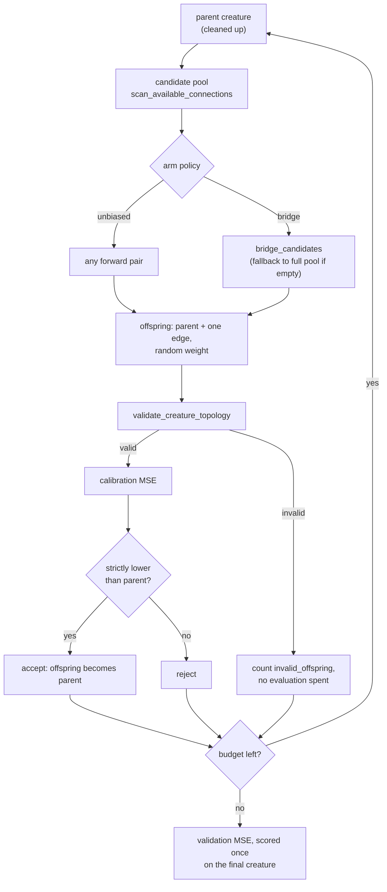

# Reachability-guided connection mutation — result record (Issue #759)

**Decision: KEEP the diagnostic, DO NOT adopt the bridge policy.** The paired
experiment is **inconclusive** on its synthetic task, and the design cannot
exercise the hypothesis (see [Findings](#findings-negative--inconclusive)). No
default changes. No success is claimed.

## Question and status

Issue #759 asks whether classifying every neuron by input-to-output
reachability, and biasing connection proposals toward "bridges" that put a
non-live endpoint on an input-to-output path, produces fewer invalid or wasted
offspring and better final models than unbiased connection addition, at equal
compute.

The cited paper, <https://arxiv.org/abs/2610.17425>, could not be fetched: the
issue audit's fetch failed, and this run's fetch was refused by the proxy. The
method here is therefore defined **from the issue text only**, and no numerical
claim from the paper is relied on anywhere in this document or in the harness
(the results manifest records the paper status as `unverified (fetch failed)`).

## Audit of existing fixed-point cleanup

`cleanup_creature` (`neat-core/src/prune_cleanup.rs:463`) and
`cleanup_creature_with` (`neat-core/src/prune_cleanup.rs:536`) already iterate
to a fixed point (the loop calls `remove_dead_structure` at line 554 and
`fold_zero_inward_hidden` at line 558, with the `IF` repair between them) and:

- **(a) remove dead structure** — non-output nodes with no outward edge,
  repeated to a fixed point. In a `forwardOnly` creature "no outward edge" and
  "cannot reach an output" are the same statement (module doc, lines 72–77).
- **(b) fold, never drop, bias-driven computation** — a hidden neuron with no
  inward edge is folded exactly into a bias-1 support constant, so
  constant-driven computation that still reaches an output is preserved
  (module doc, lines 35–39).
- **(c) repair an `IF` short a role**, by downgrade (parity) or rewrite
  (`IfRepair::Rewrite`, Issue #591).
- **(d) leave a recurrent island that feeds only itself alone** — each member
  has an outward edge, so the sweep does not widen the rule (lines 75–77).
- **(e) validate the result** — a successful call never returns an invalid
  creature (lines 9–11).

What was missing:

- no diagnostic for **input-to-output** reachability — input-independent
  structure, unused inputs and constant outputs were invisible;
- no way to compare connection-proposal policies against each other.

`topology_ops::scan_available_connections` (`neat-core/src/topology_ops.rs:310`)
is the existing unbiased forward-only candidate pool, and the baseline arm here.

## What this change adds

`neat_core::reachability` (`neat-core/src/reachability.rs`), O(V + E), two
sweeps (forward from inputs, backward from outputs):

| Class | Reached from an input | Reaches an output | Meaning |
| --- | --- | --- | --- |
| `Live` | yes | yes | on an input-to-output path |
| `BiasDriven` | no | yes | constant-driven; **not removable on reachability alone** |
| `DeadEnd` | yes | no | dead structure nothing reads |
| `Isolated` | no | no | neither |

- `reachability_diagnostics` returns a `ReachabilityReport` with per-neuron
  classes, `interior_counts`, `unused_inputs` and `input_independent_outputs`.
  Malformed input is a typed `ReachabilityError`, never a panic.
- `bridge_candidates` filters a flattened `[from, to, ...]` pool (the shape
  `scan_available_connections` returns) to pairs whose source is input-reached
  (`Live` or `DeadEnd`) and whose target reaches an output (`Live` or
  `BiasDriven`), **excluding `Live -> Live`**: adding such an edge puts at least
  one currently non-`Live` endpoint on an input-to-output path. Order is kept.
- It is a **diagnostic only**. `cleanup_creature` remains the sole rewrite
  owner; nothing here edits a creature.
- `neat-core/examples/reachability_mutation_experiment.rs` is the paired
  harness. It is opt-in research tooling, not part of any CI gate.

One experiment trial, per arm:



## Predeclared design

Constants are fixed in the harness before any run and echoed in the results
manifest:

| Item | Value |
| --- | --- |
| Seeds | `0..40` (`DEFAULT_SEEDS = 40`) |
| Inputs / outputs | 4 / 1 |
| Teacher | 4 hidden `TANH` neurons, 2 random inputs each, `IDENTITY` output |
| Calibration / validation records | 256 / 256 |
| `EVAL_BUDGET` | 150 offspring evaluations per arm |
| `MAX_PROPOSALS` | 600 proposals per arm (cap on invalid or empty-pool loops) |
| Bootstrap | 2 000 resamples, seed `0x00B0_0757_12AB` |

- **Arms.** `unbiased` picks any pair from the available forward pool.
  `bridge` picks from `bridge_candidates`, falling back to the full pool when
  that is empty.
- **Pairing.** Per seed both arms share the teacher, the data, the initial
  student and the weight-draw stream (independent RNG sub-streams per
  `(seed, stream)`); only the candidate selection policy differs.
- **Acceptance.** An offspring replaces the parent only on a **strictly lower
  calibration MSE**.
- **Calibration vs validation.** Selection sees calibration records only. The
  validation records are scored for the initial and the final creature and
  never during the search, so the headline metric is untouched by selection.
- **Compute limits.** At most `EVAL_BUDGET` valid-offspring evaluations and
  `MAX_PROPOSALS` proposals per arm. **All preparation cost is counted:** the
  initial parent evaluation is included in `evaluations` (151 for a full run),
  and an invalid offspring is counted as a proposal.
- **Verdict rule (predeclared).** Bridge is **better** only if the paired
  bootstrap 95% CI of `bridge − unbiased` `final_val_mse` lies wholly below 0
  **and** the invalid-offspring difference is `<= 0`; **worse** if the CI lies
  wholly above 0; otherwise **inconclusive**.

## Reproduce

```text
cargo run --release -p neat-core --example reachability_mutation_experiment -- \
    --rev <sha> --out docs/research/reachability-mutation-experiment-results.json
```

- Code version: manifest `crate_version` **0.23.4**, `git_revision`
  **`b426a98`** (the commit the committed JSON was produced against, with the
  uncommitted #759 changes on top — pass `--rev` of the commit you build).
- Data: **synthetic**, generated from the seeds. There is no external corpus
  and nothing to download.
- Committed output: `docs/research/reachability-mutation-experiment-results.json`
  (keys `manifest`, `summary`, `coverage`, `failures`, `trials`).

## Results (synthetic task)

Coverage: **40 of 40 seeds completed, 0 failures.** Paired differences are
`bridge − unbiased`; a "win" is a seed where bridge is better.

| Metric | Mean difference | Bootstrap 95% CI | Bridge wins / losses / ties |
| --- | --- | --- | --- |
| `final_val_mse` (lower is better) | −0.00821 | [−0.0252, 0.0039] | 21 / 19 / 0 |
| `improvement_cal` (higher is better) | +0.00939 | [−0.0028, 0.0261] | 22 / 18 / 0 |
| `invalid_offspring` | 0 | [0, 0] | 0 / 0 / 40 |
| final non-`Live` interior neurons | 0 | [0, 0] | 0 / 0 / 40 |

- Both CIs straddle 0, so the verdict is **inconclusive**. The point estimates
  lean towards bridge, but that is not evidence at this sample size.
- Every final creature, in both arms, has **5 `Live` interior neurons and 1
  `BiasDriven`** (the support constant), with no unused input and no
  input-independent output.
- The bridge arm found bridge candidates on only **224 of 5 939 proposals**; it
  fell back to the unbiased pool on **5 715 (96%)**.
- Mean non-`Live` interior neurons per valid offspring (across seeds, from
  `mean_nonlive_interior_over_valid_offspring`): **1.015 bridge, 1.139
  unbiased**. It is slightly lower for bridge, but both are dominated by the
  single `BiasDriven` constant that every offspring carries.
- Mean `improvement_per_eval` (calibration MSE improvement per evaluation, an
  evaluation-count measure rather than a clock): **0.001405 bridge, 0.001415
  unbiased** — indistinguishable. Mean evaluations were 149.5 (bridge) and
  147.6 (unbiased).
- Wall-clock and the `*_per_eval_hour_indicative` fields are **indicative
  only**: the host was shared and trials ran in parallel. Nothing here relies on
  them.

## Findings (negative / inconclusive)

1. **Invalid offspring is structurally 0.** `scan_available_connections` only
   emits forward pairs into non-constant, non-input targets, and a `Standard`
   edge into an `IF` target counts as its positive role
   (`neat-core/src/topology_invariants.rs:157`). The authoritative validator
   (`validate_creature_topology`) therefore accepted every proposal, in both
   arms, on every seed. There is no invalid-offspring rate for a bias to reduce
   in core's pool.
2. **After cleanup a forward-only creature has no `DeadEnd` or `Isolated`
   interior structure**, so bridges exist only into `BiasDriven` hidden
   neurons. They are exhausted within the first few proposals (once that neuron
   is wired to an input it is `Live`), after which the bridge arm is the
   unbiased arm — hence the 96% fallback and the near-identical numbers.
3. **Dead structure cannot grow under connection addition alone.** Adding an
   edge only widens reachability, so the dead-structure comparison is
   degenerate in this design. The observed final-MSE lean is most plausibly the
   few early bridge proposals changing the RNG draw sequence, not a policy
   effect.

## Decision and what remains

- **Keep `reachability_diagnostics`.** It is the generic diagnostic requested
  for NEAT-AI and Ockham (unused inputs, constant outputs, `BiasDriven` vs
  `DeadEnd` structure) and is cheap and self-contained. No default is changed.
- **`bridge_candidates` is kept only as the opt-in arm** for the outstanding
  representative run. If a representative run on **real (private) corpora**,
  with mutation operators that can create `DeadEnd` structure (add-neuron,
  remove-connection), is also inconclusive, remove `bridge_candidates` and the
  example.
- Representative runs on private corpora are an **owner step and have not been
  performed**. This record makes no claim about real NEAT-AI workloads.
