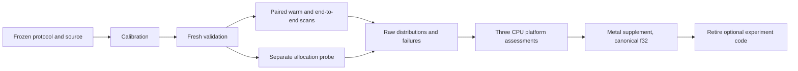

# Sparse layouts and reduced precision — experiment record (Issue #758)

**CPU and Metal comparisons complete: no adoption candidate; production is
unchanged.** The frozen v4 matrix ran on Apple Silicon CPU, x86_64 Linux and
aarch64 Linux. Across 162 cells, 2,727 of 2,754 variant slots were timed; 27
bf16 accuracy failures were retained. A Metal supplement then ran the canonical
f32 scorer path on a virtual Apple GPU: 54 of 54 cells completed and the GPU
was slower than the CPU in every one. All optional experimental executables,
kernels, tests, the Metal adapter and the research CI jobs were retired.
Immutable replay sources, protocols, manifests and raw evidence remain
available below. Hardware reduced-precision arithmetic was not measured.

## Verified sources and existing implementation

Both cited full papers were rechecked on 14 November 2026:

- Badour, van Keulen and Mocanu, [Beyond Masked Sparsity: SNACK Enables Truly
  Sparse Neural Networks on GPU, v1](https://arxiv.org/html/2610.04093v1),
  submitted 2 October 2026. Sections 3.1–3.4 describe nonzero COO storage, CUDA
  blocks indexed by edge chunk and batch, atomic accumulation, sparse gradients
  and an initialiser sampling unique index pairs without a dense mask. Its GPU
  layer method is different from our sequential CPU DAG scatter loop.
- Xiuyi Qin, [Is 2:4 Sparsity Still Worth It? Semi-Structured Sparsity versus
  Quantization in LLM Inference, v1](https://arxiv.org/html/2610.28947v1),
  submitted 20 October 2026. Sections 3.1–3.5 compare equal stored-bit budgets,
  including indices/scales, and nominal tensor-core tiers. NVIDIA measurements
  include online preparation for dynamic operands. This motivates separate
  storage, preparation and execution accounting, not a CPU speed claim.

Neither paper establishes a benefit for this crate, Apple CPU or Metal.
No 2:4 constraint, new dispatch rule or production kernel was introduced.

Production already owns contiguous neuron synapse spans, a CSR family layout
with AoS synapses and a redundant SoA hot view. The experimental CSR used
u32 row offsets, u16 columns and a plain loop. Thus the study compares concrete
layout/kernel combinations, not a pure layout effect. Blocked storage pads each
row to four edges; it is neither matrix BSR nor 2:4. Software bf16/f16 weights
are decoded for f32 computation; biases and activations remain f32.

The production controls call `activate_into` at width one and
`score_records_flat_into` otherwise. `current` chunks calls by requested width;
`current_whole_scan` makes one public call for the whole corpus at widths above
one, exposing repeated scratch-allocation costs. Core's private reused-scratch
entry point was kept private. The original merged
[SoA work](https://github.com/stSoftwareAU/NEAT-AI-core/pull/537) and
[interleaved scoring work](https://github.com/stSoftwareAU/NEAT-AI-core/pull/290)
were accounted for before adding the experiment.

The scorer was inspected again at
[`742c5df30fc98ece3afe784be1aca18f925b47b3`](https://github.com/stSoftwareAU/NEAT-AI-scorer/tree/742c5df30fc98ece3afe784be1aca18f925b47b3).
Its [wgpu backend](https://github.com/stSoftwareAU/NEAT-AI-scorer/blob/742c5df30fc98ece3afe784be1aca18f925b47b3/rust_scorer/src/gpu/mod.rs)
can select Metal. Its [batched runner](https://github.com/stSoftwareAU/NEAT-AI-scorer/blob/742c5df30fc98ece3afe784be1aca18f925b47b3/rust_scorer/src/gpu/forward_mse_batched.rs)
accepts compiled networks with f32 synapses and returns per-creature loss sums;
it does not expose the factorial layout/precision forward interface. No kernel
was copied into core or the scorer, and no incompatible adapter was presented
as a Metal comparison.

## Frozen method

[V2](sparse-precision/protocol-v2.md) defines the audited controls and accounting;
[v3](sparse-precision/protocol-v3.md) corrects zero-measurement platform coverage.
[V4](sparse-precision/protocol-v4.md),
[manifest](sparse-precision/manifest-v4.json), the uninstrumented timing code and
separate allocation probe were frozen at
`a6d407a7cc326d09ec822c3629fbe89eb2cd96a6`. The remote runs used checkpoint
`17d222db0ad8ae5c6a5681b58f6184ea7d9035eb`, which contains the same source blobs. The checkpoint's source is archived as the
[CPU replay patch](sparse-precision/replay-cpu-v4.patch).

- Six shapes × inactive fractions 0/0.5/0.9 × widths 1/8/32: 54 cells per CPU
  platform, 918 planned slots. At fraction zero, duplicate active-only variants
  are omitted. The generated `production_exact` shape matches dimensions and
  edge count; it is not a private production model or dataset.
- Calibration seed 1001, validation network seed 32002, record seed 33003,
  64 records per sample, 15 paired repetitions, five conversion repetitions
  and 2,000 paired-bootstrap resamples. No search was performed.
- Within each shape/fraction, widths share network and record identities.
  Variants are shuffled within each repetition. Numerical results use an
  independent scalar f64 oracle, with no shared squash or kernel. Parents stay
  immutable; scratch initialisation, constants, empty incoming spans and partial
  batches were checked before measurement.
- Absolute tolerances remain 0.001 for f32 and 0.02 for reduced storage. Failed
  combinations remain in planned denominators and do not receive timing wins.
  Incomplete cells cannot receive speed verdicts. The CLI saves failures and
  exits non-zero.
- Adoption requires both warm and end-to-end 95% CI upper bounds at most 0.90
  in at least 75% of planned representative cells on every required CPU
  platform. That means seven of nine all-edge cells or five of six active-only
  cells. Thresholds were not adjusted after observing results.
- End-to-end samples include owned typed parts, canonical construction,
  conversion, scratch initialisation and one corpus scan. Preparation includes
  generation, calibration, oracle and conversion; JSON parsing, file I/O,
  directory orchestration and GPU upload are outside this experiment.



## V4 results and coverage

[Combined assessment](sparse-precision/assessment-v4.json) checks that source,
manifest and per-cell topology/record fingerprints match across the three runs.
The [verification record](sparse-precision/verification-v4.json) independently
derives denominators, checks paired sample lengths and recomputes ratio medians.
Intervals remain per graph/corpus and platform; samples were not pooled.
Timings on these shared/hosted machines are indicative, not correctness gates
or fleet-wide measurements. Compiler versions differ between the local and
hosted runs; ratios compare implementations within each host, not isolated
silicon performance across hosts.

| Platform | CPU and compiler | Complete cells | Timed/planned slots | Numerical failures | Best representative both-pass count |
| --- | --- | ---: | ---: | ---: | ---: |
| aarch64 Linux | aarch64 host, six available threads; rustc 1.99.1 / LLVM 23.1.1 | 54 | 909/918 | 9 | 1/6 |
| Apple Silicon macOS | Apple M1 (Virtual); rustc 1.100.0 / LLVM 23.1.5 | 54 | 909/918 | 9 | 1/6 |
| x86_64 Linux | AMD EPYC 7763 VM; rustc 1.100.0 / LLVM 23.1.5 | 54 | 909/918 | 9 | 1/6 |

No local or cross-platform candidate qualifies. Every all-edge sparse variant
meets both representative thresholds in zero cells. Some active-only variants
win the 90%-inactive, width-one cell, but none reaches the five required cells.
The whole-corpus production control also has no qualifying representative cell.
This is evidence about the measured implementations and conversion path, not
proof that every possible sparse kernel is ineffective.

Each platform's nine failures are bf16 all-edge variants in all three layouts,
`fanin_64`, inactive fraction zero, widths 1/8/32. Errors are about 0.020136,
above the unchanged 0.02 tolerance. No budget truncation occurred. The separate
memory probe covered all 918 variants on each platform, including failures.
The research jobs correctly finished red after saving both sets of evidence;
ordinary remote TypeScript, Rust lint/compile and Memory64 checks passed.

Raw distributions, bootstrap intervals, errors, static payloads, scratch figures,
commands, exit codes, logs and compiler/hardware identities are retained in:

- [aarch64 Linux results](sparse-precision/v4-aarch64-linux/results.json),
  [memory](sparse-precision/v4-aarch64-linux/memory.json),
  [execution](sparse-precision/v4-aarch64-linux/execution.json),
  [assessment](sparse-precision/v4-aarch64-linux/assessment.json).
- [Apple Silicon results](sparse-precision/v4-aarch64-macos/results.json),
  [memory](sparse-precision/v4-aarch64-macos/memory.json),
  [execution](sparse-precision/v4-aarch64-macos/execution.json),
  [assessment](sparse-precision/v4-aarch64-macos/assessment.json).
- [x86_64 Linux results](sparse-precision/v4-x86_64-linux/results.json),
  [memory](sparse-precision/v4-x86_64-linux/memory.json),
  [execution](sparse-precision/v4-x86_64-linux/execution.json),
  [assessment](sparse-precision/v4-x86_64-linux/assessment.json).

The hosted run is
[43558246094](https://github.com/stSoftwareAU/NEAT-AI-core/actions/runs/43558246094),
on 14 November 2026. The local host was `vibe-coder-54876`, also on that date.
The three machines cover the required CPU platforms; they do not represent a
population of real models or production deployments.

## Memory and preparation costs

| Platform | Build seconds / peak RSS bytes | Timing seconds / peak RSS bytes | Probe seconds / peak RSS bytes |
| --- | ---: | ---: | ---: |
| aarch64 Linux | 32.61 / 648,482,816 | 41.86 / 64,970,752 | 4.80 / 14,671,872 |
| Apple Silicon macOS | 78.84 / 641,269,760 | 89.24 / 112,099,328 | 8.19 / 38,797,312 |
| x86_64 Linux | 62.37 / 503,545,856 | 131.65 / 80,068,608 | 12.80 / 15,167,488 |

Build cache states are recorded separately; these are not controlled compiler
speed comparisons. OS RSS is the largest process high-water mark reported for
the command and its waited-for descendants, including inherited pages around
process creation. It is not a simultaneous memory sum or an incremental layout
footprint. The timing executable retained multiple variants; the probe held one
variant at a time. Linux KiB and macOS byte units were normalised.

The separate forwarding System allocator records live requested heap bytes
before/after each scope and the peak above its starting live allocation.
Conversion includes temporary row/triple vectors and retained output. For the
local `production_exact`, fraction zero, width-one cell:

| Variant | Conversion peak bytes | First initialisation/scan peak bytes | Compile/convert/scan peak bytes |
| --- | ---: | ---: | ---: |
| Current | 965,786 | 0 | 972,446 |
| CSR f32 | 428,692 | 16,524 | 1,400,642 |
| CSR bf16 | 363,156 | 16,524 | 1,335,106 |
| COO f32 | 659,664 | 23,172 | 1,631,614 |
| Blocked f32 | 428,692 | 16,524 | 1,400,642 |

These are additional requested bytes, not RSS. The parent, records and earlier
JSON rows contribute to the recorded starting live allocation; allocator
metadata, internal realloc overlap, stacks and mappings are excluded. At 90%
inactive edges, CSR f32 active-only conversion peaks at 256,660 bytes and its
compile/convert/scan path at 1,228,610 bytes. Storage savings do not satisfy the
speed adoption rule. Static payload, capacity-based scratch and modelled
production scratch remain labelled separately in the raw results.

## Metal supplement (v5/v6)

The v4 Apple VM's `system_profiler SPDisplaysDataType -json` reported an empty
adapter list, which first suggested that no GPU was available. A native probe
([source](sparse-precision/metal-probe.swift), [evidence](sparse-precision/metal-capability-v4/))
nevertheless created a Metal device, the "Apple Paravirtual device", on the
hosted `Apple M1 (Virtual)` runner. A supplement was therefore built.

The adapter used only the scorer's public API: its `BatchedRunner` at
[`742c5df`](https://github.com/stSoftwareAU/NEAT-AI-scorer/tree/742c5df30fc98ece3afe784be1aca18f925b47b3)
with core release v0.23.4, selecting Metal through `WGPU_BACKEND=metal`. It
compared the canonical f32 current representation on CPU and GPU at the same
batch widths (1/8/32), over the same six shapes and inactive fractions as v4
(54 cells, 15 paired repetitions each). The scorer GPU API accepts canonical f32
networks only, so the CSR, COO and blocked layouts with f32, bf16 and f16
storage, 810 slots in all, are recorded as unsupported and were not run. Per
the issue's rule to coordinate scorer integration, no kernel was duplicated into
core or the scorer. The 54 whole-scan controls were not selected because the
supplement chunks both sides by requested width.

- **v5** ([protocol](sparse-precision/protocol-metal-v5.md),
  [manifest](sparse-precision/manifest-metal-v5.json),
  [evidence](sparse-precision/metal-v5/),
  [execution](sparse-precision/execution-metal-v5.json)) left nine width-one
  cells incomplete at its 15 s per-cell cap. They are kept separate and carry
  no timing verdict.
- **v6** ([protocol](sparse-precision/protocol-metal-v6.md),
  [manifest](sparse-precision/manifest-metal-v6.json), frozen at `fa35871`)
  raised the compute allowance prospectively and used fresh validation seeds.
  It ran in
  [GitHub Actions run 43563660245](https://github.com/stSoftwareAU/NEAT-AI-core/actions/runs/43563660245)
  at head `48e2a1f4b22e91db0329f2c2527d546af6e355b6`
  ([execution](sparse-precision/execution-metal-v6.json),
  [assessment](sparse-precision/metal-v6/assessment.json),
  [raw results](sparse-precision/metal-v6/results.json), plus compiler, CPU,
  kernel, revision, RSS, stderr and source-blob files in
  [metal-v6/](sparse-precision/metal-v6/)).

V6 completed all 54 cells with 15 of 15 repetitions each, no failures and no
unrun cells. Every verdict is `no_joint_win`. Maximum mean-loss error against
the oracle was about 6.98e-08 on the GPU and 8.38e-08 on the CPU, against a
0.001 tolerance. Wall time was 530.2 s and device initialisation 572.5 ms.
Ratios are GPU time divided by CPU time, so values above one mean the GPU was
slower. The best warm median was `production_exact`, 90% inactive, width 32:
16.58 (CI high 20.30), with an end-to-end median of 23.18. The worst was about
1,288 at `small_50`, width one. The virtual GPU was thus 16 to 1,300 times
slower than the CPU path in every cell.

These results are indicative only. A virtual GPU on a hosted runner cannot
establish physical Apple GPU performance. Device-only allocation peaks were not
measured, and hardware reduced-precision arithmetic remains unmeasured because
no supported surface exists to exercise it.

## Retention decision

The required CPU comparisons on three platforms and the Metal supplement are
all negative: no variant earns adoption. Retaining the optional CPU kernels,
examples, tests and one-off research CI plumbing would add maintenance without
an accepted implementation, so they were removed together. The Metal adapter,
its two manual research CI jobs and its supply-chain entries (deny, audit,
dependabot and SECURITY.md) were retired as well. Nothing optional remains in
the tree. Production defaults, public interfaces, authoritative scoring and the
scorer are unchanged. The negative observations do not rule out differently
designed kernels or physical-GPU measurements in future work.

## Replay and historical evidence

The complete tested CPU experiment and manual research workflow are preserved
as [`sparse-precision/replay-cpu-v4.patch`](sparse-precision/replay-cpu-v4.patch),
SHA-256 `58986f283e2dac4dfceb7ee09d8ad35ffc57be58db49f9734808b7d71bf66b94`.
Applied to Develop commit `b426a98ceb8707204231f8e7ebdcd8d1665f9612`, it reproduces the tested
revision `17d222db…` (`17d222db0ad8ae5c6a5681b58f6184ea7d9035eb`) exactly for all
non-doc paths plus the v4 manifest. Run these commands from this repository's
root:

```bash
git fetch origin Develop
git worktree add --detach <new-replay-directory> b426a98ceb8707204231f8e7ebdcd8d1665f9612
git -C <new-replay-directory> apply --index "$PWD/docs/research/sparse-precision/replay-cpu-v4.patch"
git -C <new-replay-directory> commit -q -m "Replay #758 CPU harness"
cd <new-replay-directory>
deno run --allow-read --allow-write --allow-run --allow-env \
  scripts/run_sparse_precision.ts \
  docs/research/sparse-precision/manifest-v4.json <new-output-directory>
```

The runner refuses an uncommitted tree, so the patch is committed first, and the
recorded `code_rev` is that replay commit rather than `17d222d`.
Use the recorded platform's compiler for like-for-like replay. The output
directory must not exist. Deno orchestrates the run; Python 3 supplies OS
resource usage. Expected numerical failures return non-zero after saving raw
results. The archived manual CI input is absent from the current workflow.

The tested Metal adapter is preserved as
[`sparse-precision/replay-metal-v6.patch`](sparse-precision/replay-metal-v6.patch),
SHA-256 `6ec68d2bfc10bc4eb5d351e38cf8d97d2304c3d42ee55fc219ed91b9099080e3`.
Applied to Develop commit `b426a98ceb8707204231f8e7ebdcd8d1665f9612`, it reproduces the tested
revision `48e2a1f…` (`48e2a1f4b22e91db0329f2c2527d546af6e355b6`) exactly for all
non-doc paths plus the Metal v6 manifest. On a macOS host, from this
repository's root:

```bash
git fetch origin Develop
git worktree add --detach <new-replay-directory> b426a98ceb8707204231f8e7ebdcd8d1665f9612
git -C <new-replay-directory> apply --index "$PWD/docs/research/sparse-precision/replay-metal-v6.patch"
git -C <new-replay-directory> commit -q -m "Replay #758 Metal adapter"
cd <new-replay-directory>
WGPU_BACKEND=metal bash experiments/sparse_metal/run.sh < /dev/null
```

The runner refuses an uncommitted tree, so the patch is committed first, and the
recorded revision is that replay commit rather than `48e2a1f`. The
`source-blobs.txt` from a replay can be compared with
[`metal-v6/source-blobs.txt`](sparse-precision/metal-v6/source-blobs.txt),
because the applied blobs are identical. Applying each patch at `b426a98`
gives a tree identical to its revision (checked with `git diff --cached --quiet`
against the revision for all non-doc paths and the manifest).

The output directory `sparse-metal-results` must not exist before the run. The
manual CI job that executed this command is absent from the current workflow.

V1–v3 remain separate historical runs, with their original manifests, source
identities and results: [v1](sparse-precision/results-aarch64-linux.json),
[v2](sparse-precision/results-aarch64-linux-v2.json),
[v3](sparse-precision/results-aarch64-linux-v3.json). V1 timed 861/864 slots,
v2 918/918, and v3 909/918. V1 omitted runtime compilation and scratch
accounting; v2/v3 did not measure process or conversion peaks. Historical seeds
and samples were not reused for tuning v4 or pooled with its distributions.
